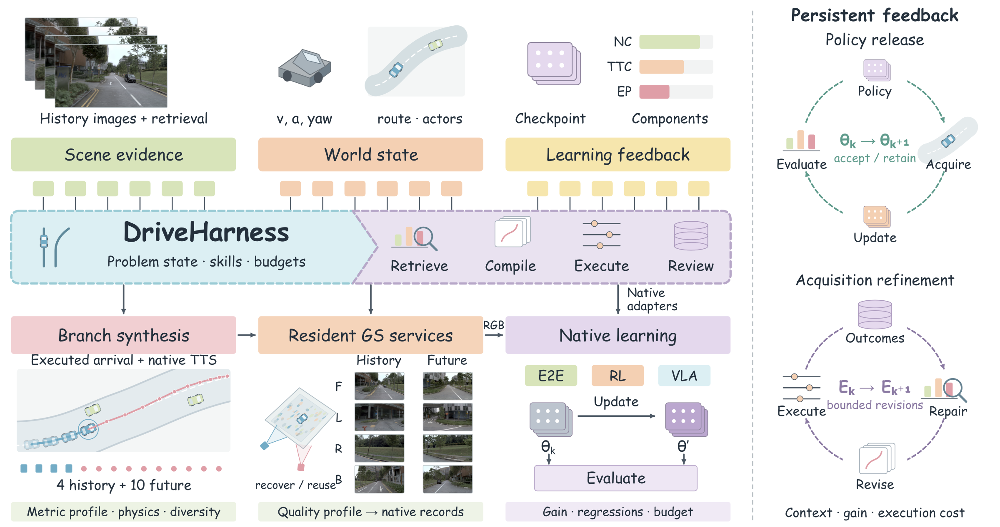

<h1 align="center">🚗 DriveRSI-R0</h1>
<h3 align="center">Harness-Guided Recursive Self-Improvement<br>via Retrieval and Visual Experience Synthesis</h3>

<p align="center">
  <strong>Retrieve relevant experience. Execute consistent branches. Evaluate before promotion.</strong>
</p>

<p align="center">
  <a href="docs/getting-started.md"><strong>Installation</strong></a> ·
  <a href="docs/running.md"><strong>Running</strong></a> ·
  <a href="docs/train-eval.md"><strong>Training &amp; Evaluation</strong></a> ·
  <a href="docs/release-status.md"><strong>Release Status</strong></a> ·
  <a href="README.zh-CN.md"><strong>中文</strong></a>
</p>

## 📰 Updates

- **2026.10.30** — Source snapshot organized with DriveHarness, native model adapters, branch rendering, admission, evaluation, and local inspection. Installation and execution guides are available in [`docs/`](docs/README.md).

## 🔍 Overview

<p align="center">
  <a href="docs/assets/overview.pdf"></a>
</p>

**DriveRSI is a research platform for turning driving feedback into traceable experience and controlled policy experiments.** DriveHarness connects failure diagnosis, training-source retrieval, branch generation, qualification, native training, and evaluation. Every attempt retains its source, budget, result, and decision, so later rounds can reuse evidence without silently rerunning completed work.

The platform supports two research routes:

| Visual experience and native learning | Frozen-model skill repair |
| :--- | :--- |
| Retrieve training sources, perturb history, execute a corrective continuation, and render the images required by the student. | Provide failure evidence to a Doctor, propose conditional skills, and evaluate frozen AUGUstus planning. |
| Admit image/object/trajectory-consistent samples, then compare real-data continuation with real-plus-synthetic replay. | Filter duplicate or ineffective changes, check cross-log safety regression, and promote or roll back skills. |
| **Changing state:** acquisition policy, qualified dataset, candidate weights. | **Changing state:** skill text, applicability, bounded calls, experience. |

Both routes use explicit budgets and retained parent versions. **This release establishes software interfaces and tested control logic; sustained recursive driving gains have not been established.** The current dynamic-asset experiment remains paused. See [verified scope and known limitations](docs/release-status.md).

## 🧩 Platform capabilities

- **Training-source retrieval.** Visual retrieval and independent text/state/topology clustering preserve separate train/test membership. Geographic checks are diagnostics, not the default selector.
- **Consistent visual experience.** History, teacher continuation, camera poses, object identities, and image timestamps are tied to the same physical branch. History/anchor-only profiles do not require future RGB.
- **Explicit admission.** Teacher PDMS **>0.95**, mean source-view PSNR **>25 dB**, and branch-binding checks remain separate. Source-view PSNR does not certify arbitrary novel views.
- **Native comparisons.** Model adapters preserve native model/loss semantics while recording data exposure, replay composition, update budgets, checkpoint recovery, and regression decisions.
- **Persistent DriveHarness.** Task ownership, bounded recovery, attempt accounting, and experience records support unattended execution of known workflows. Unknown outcomes require reconciliation.

## 🚀 Getting started

Follow the guides in order. Commands and machine-specific setup live in the documentation, keeping this page focused on the platform.

| Step | Guide | Contents |
| :---: | :--- | :--- |
| 1 | [Installation and configuration](docs/getting-started.md) | Linux control plane, native environments, weights, explicit local paths |
| 2 | [Data and image contracts](docs/data-contract.md) | Original data, `sensor_blobs/`, `navsim_logs/`, camera horizons, branch identity |
| 3 | [Run and inspect](docs/running.md) | Discovery, CPU checks, generation commands, task control, local visualization |
| 4 | [Training and evaluation](docs/train-eval.md) | Paired replay experiments, native requests, recovery, evaluation and promotion |
| 5 | [Complete DriveHarness workflow](docs/workflow.md) | Stage transitions, failure handling, frozen skills, provenance and budgets |

Native GPU backends use separate compatible environments. Datasets, checkpoints, private services, and old experiment outputs are **not bundled**. The release is intended for an editable source installation; it is not a one-command reproduction of a benchmark result.

## 🗂️ Code organization

```text
DriveRSI/
├── agents/          # Native models and adapters
├── src/             # Data, simulation, rendering, Harness, training, evaluation
├── scripts/         # Domain-owned command entry points
├── tests/           # Contracts, recovery, admission and integration checks
├── docs/            # Setup, execution, architecture and technical reference
├── data/            # User-provided original data
├── dataset/         # Generated sensor_blobs/ and navsim_logs/
├── lib/             # User-created retrieval, caption and cluster libraries
└── weights/         # User-provided parent models and backbones
```

New run records belong under `exp/<run-id>/`. See the [source map and backend boundaries](docs/code-map.md) for the ChainFlow, AUGUstus, DriveRL, NAVSIM and MTGS integrations.

## 🖥️ Local inspection

The local platform connects **problem → retrieved source → generated sample → training exposure → evaluation → decision**. Its default configuration starts empty, without previous experiment cards or scene images. Register the receipts you want to inspect using the [local visualization guide](docs/running.md#local-visualization).

This snapshot contains no GitHub Pages deployment or public project-site payload.

## 📋 Verification and status

The release passed a clean editable installation, **191 selected CPU tests**, command discovery, configuration parsing, and an empty local-view build. These checks validate software behavior; they do not measure driving performance. [Verification record](docs/release-verification.md) · [Known limitations](docs/release-status.md)

The latest dynamic-asset batch has not completed image/object binding admission or paired training. Frozen-skill trials demonstrate automatic validation and rollback, not sustained capability gains. Original experiment records remain in the research workspace.

## 🙏 Acknowledgments

We acknowledge [NAVSIM](https://github.com/autonomousvision/navsim), [nuPlan](https://github.com/motional/nuplan-devkit), [AUGUstus](https://github.com/haha-yuki-haha/AUGUstus), [ChainFlow-VLA](https://github.com/AFARI-Research/ChainFlow-VLA), [SimScale](https://github.com/OpenDriveLab/SimScale), and the other upstream projects recorded in [third-party notices](THIRD_PARTY_NOTICES.md). Their source manifests and individual notices are retained.

Documentation organization draws on [DrivoR](https://github.com/valeoai/DrivoR) and [ChainFlow-VLA](https://github.com/AFARI-Research/ChainFlow-VLA/tree/main/docs); the front-page hierarchy follows [DriveTTO](https://github.com/Rtwotwo/DriveTTO). The overview is copied unchanged from the DriveRSI-R0 manuscript; its [provenance](docs/assets/paper-figure-provenance.json) is retained.

## Citation and licensing

The title follows the current DriveRSI-R0 manuscript draft. Publication metadata will be added when available. This snapshot assigns no new root project license; consult [third-party notices](THIRD_PARTY_NOTICES.md) for bundled components and the repository owner before redistribution.
