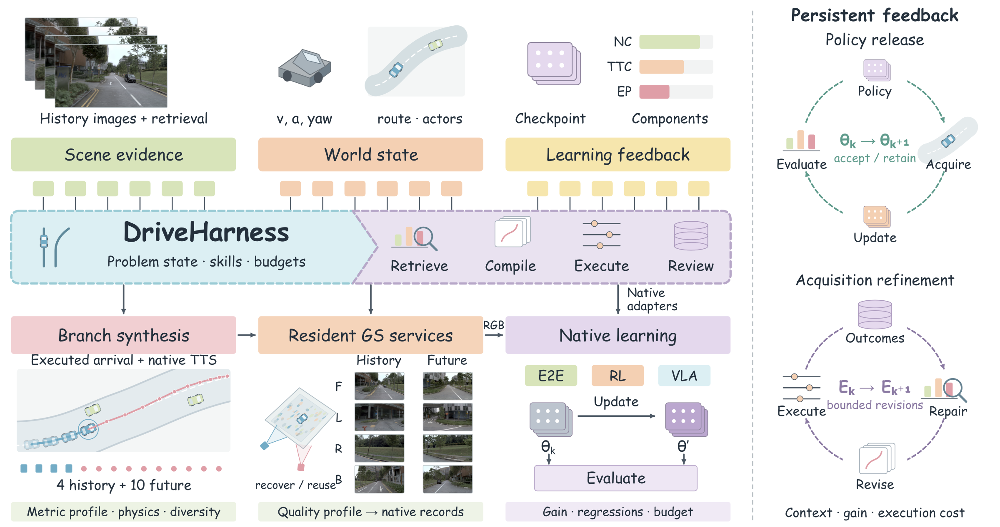

<h1 align="center">🚗 DriveRSI-R0</h1>
<h3 align="center">Harness-Guided Recursive Self-Improvement via Retrieval and Visual Experience Synthesis</h3>

<strong>检索相关经验 · 执行一致分支 · 验证之后晋级</strong>

  <a href="docs/getting-started.md">安装配置</a> ·
  <a href="docs/running.md">运行指南</a> ·
  <a href="docs/train-eval.md">训练评测</a> ·
  <a href="docs/release-status.md">发布状态</a> ·
  <a href="README.md">English</a>

## 📰 更新

- **2026.10.30** — 整理DriveHarness、原生模型适配、分支渲染、准入、评测和本地可视化源码；安装与命令说明集中到 [`docs/`](docs/README.md)。

## 🔍 平台概览

**DriveRSI将驾驶失败反馈转化为有来源记录的经验和可对照的策略实验。** DriveHarness管理检索、生成、准入、训练、评测、有限恢复和经验保存，每次尝试均记录输入、预算、结果与决定。

| 视觉经验与原生训练 | 冻结模型技能修复 |
| :--- | :--- |
| 检索训练来源，扰动历史，由教师完成纠正轨迹，渲染学生需要的图片。 | 为Doctor提供失败证据，生成有适用条件的技能，调用冻结AUGUstus规划。 |
| 核验图像、对象状态和轨迹属于同一分支，再进行真实数据续训与混合回放对照。 | 过滤重复或无效修改，做跨日志与历史安全回归，通过后晋级，否则回滚。 |
| 改变：生成策略、合格数据和候选模型权重。 | 改变：技能文本、适用条件、调用策略和经验；模型权重保持冻结。 |

本版本保留完整工程链路与已验证的软件机制。**尚未证明持续的递归驾驶收益；当前动态资产实验继续暂停。** 具体边界见[发布状态](docs/release-status.md)。

## 🧩 主要能力

- 检索与文本／状态／拓扑聚类独立组织，两库分别保存成员。
- 分支统一保存历史、未来数值状态、对象身份、时间戳和相机位姿；历史／锚点输入配置不生成未来RGB。
- **PDMS＞0.95、源视角平均PSNR＞25 dB、同分支绑定**分别验收。源视角PSNR不等于新视角像素真值。
- 原生训练保留模型与loss语义，记录回放比例、样本曝光、更新预算、恢复与退化检查。
- Harness对已知且已结算的异常执行有限恢复；未知执行结果先核清，不无限重启。

## 🚀 开始使用

| 顺序 | 文档 | 说明 |
| :---: | :--- | :--- |
| 1 | [安装与配置](docs/getting-started.md) | 控制层、原生环境、数据、权重和本机路径 |
| 2 | [数据与图像合同](docs/data-contract.md) | `sensor_blobs/`、`navsim_logs/`、历史图像和分支绑定 |
| 3 | [运行与检查](docs/running.md) | 入口发现、CPU检查、生成、任务控制和本地页面 |
| 4 | [训练与评测](docs/train-eval.md) | 原生请求、真实回放对照、恢复、评测与晋级 |
| 5 | [Harness完整流程](docs/workflow.md) | 阶段衔接、故障恢复、冻结技能与可追溯记录 |

代码主要位于 `src/`，原生模型位于 `agents/`，入口位于 `scripts/`。原始数据、生成数据、权重、私有配置和旧实验产物不随代码包分发。GPU后端仍需按各自版本单独准备，详见[代码地图](docs/code-map.md)。

## 🖥️ 本地可视化

页面串联“问题→检索来源→生成样本→训练曝光→评测→决定”。默认不登记旧实验；按[运行指南](docs/running.md#local-visualization)添加需要查看的记录。发布版不包含GitHub Pages部署和公网数据页面。

## 📋 验证状态

干净环境安装、**191项CPU检查**、入口发现、配置解析和空白本地页面构建均已通过。这些是工程检查，不代表驾驶成绩或完整GPU复现。[验证记录](docs/release-verification.md)

最新动态资产批次尚未通过完整图像／对象绑定，也未进入配对训练；冻结技能实验验证了自动回滚，尚未证明持续收益。原实验数据及暂停状态保留。

## 🙏 致谢与许可

感谢NAVSIM、nuPlan、AUGUstus、ChainFlow-VLA、SimScale等上游项目；来源与许可见[第三方说明](THIRD_PARTY_NOTICES.md)。文档结构参考[DrivoR](https://github.com/valeoai/DrivoR)与[ChainFlow-VLA](https://github.com/AFARI-Research/ChainFlow-VLA)，首页排版参考[DriveTTO](https://github.com/Rtwotwo/DriveTTO)，总览图直接复用论文原图，未做修改，保留[来源校验](docs/assets/paper-figure-provenance.json)。

标题沿用DriveRSI-R0论文草稿；待正式公开后补充引用信息。本次打包未为根项目新指定开源许可证，各上游组件保留原许可。
