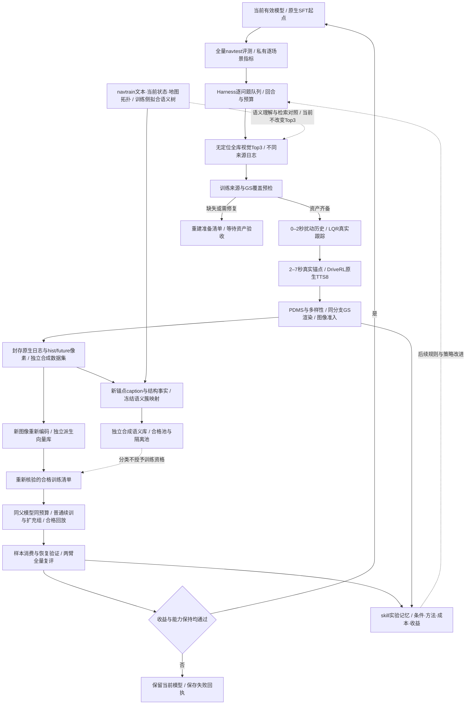

# DriveRSI 总体架构

源码核对：2026-10-28。本文是当前架构入口；任务是否执行、数据是否合格、模型是否晋级，分别以对应回执为准。本文更新不启动生成、训练或评测，不改变当前预算和准入。

## 两条回路，共用一条可追溯数据链

模型回路更新驾驶模型；系统回路记录干预方法、失败原因、成本与收益，为下一轮选择提供依据。当前已有有界执行与记忆接口，但还没有证明Harness能从经验中学会更有效的选题策略。



图中资产准备不代表已有自动重建后端；分类的虚线也不代表分类可以替代训练准入。可视化工作台的八步总图保持原有入口，展开本图的职责与边界。

## 本轮具体配方

当前学生是**ChainFlow stage1，无DiT**，使用其固定9405全量评测的239个零分问题。AUGUstus仍保留专属VLA适配，但不能继承这份失败队列或收益。当前生产复用原有全库视觉排序，连续历史有效性检查后，每个问题取三个不同来源日志；717对映射对应562个唯一训练源。这是来源清单，不是已生成数量。

生产选择不使用查询或候选的坐标、地理距离、地图身份、绝对航向、GT未来。以前的25米/30度筛选仅属历史审计；聚类约束视觉排名也只是对照。训练源自身地图、相机和姿态仍用于物理与渲染。语义簇由文本、当前状态和地图拓扑拟合，当前没有把视觉向量并入该聚类表示。相同地点或相同簇不自动证明相同交互，更不证明同一失败原因。

原始navtrain/navtest分别保管，训练侧拟合语义树，测试侧与合成侧冻结映射。利用navtest结果反复选数据和晋级属于**测试反馈适应实验**；若要报告泛化，需要锁定后另做独立评测。公开页面只展示聚合数据，逐问题身份与检索对应保留私有。

## 生成和评分必须使用同一个实际分支

| 时间 / 产物 | 实际含义 |
|---|---|
| 0–2秒 | 有界横纵向/速度扰动参考，通过原生LQR在物理世界中实际跟踪 |
| 2秒 | 实际到达的状态成为新锚点，不能换成参考路径的理想终点 |
| 2–7秒 | DriveRL原生TTS8候选搜索与执行，不是梯度TTO |
| 全7秒 | 10Hz的71个状态、70个动作，保留控制者及方法身份 |
| 历史图像 | t=0.5、1、1.5、2秒，四相机，共16张 |
| 未来图像 | t=2.5至7秒，0.5秒间隔，四相机，共40张 |
| 诊断起点 | t=0的四张图可另存，不混入四帧训练历史 |
| 原生PDMS | 新锚点后4秒，即2–6秒；不宣称给完整7秒打分 |

这借鉴了SimScale主动改变到达状态的思想，但不是对其实现、资产或全部协议的复刻。模板和参考只用于制造候选，实际物理执行、原生标签、图像绑定及恢复证据才决定产物。

准入是**版本化配置**，不是架构图中的任意常量。当前持续课程使用教师原生PDMS严格>95、源位姿PSNR严格>25dB，以及完整7秒/未来5秒ADE至少0.5米；之前27dB试验保留自己的规则和结论。源位姿PSNR是重建对照质量，不等于反事实新视角的像素真值。高程、其他对象外观与VLM检查在当前数值试验中保留诊断，本文不恢复旧的额外否决规则。

空间、速度、刹车/恢复时序和交互差异分开记录。当前ADE通过不等于产生10种驾驶技能，也不能把不同种子、性能测试重放或相同样本包计为新增数据。每个选定源首轮目标10条不同的合格分支，后续轮目标20条；预算耗尽时报告缺口。

## 执行加速是独立执行层

Harness拥有配额、任务身份、锁、恢复和最终提交；加速执行器只改变计算组织，不能改变标签、评分和准入。

| 组件 | 代码归属 | 一致性及接入边界 |
|---|---|---|
| 历史扰动 / CPU物理预取 | `src/rsi/correction/history_perturbation.py`、`src/rsi/experiments/reactive_autoloop.py` | 原生控制适配位于`agents/driverl/`；预取有界，不能重复提交在途任务 |
| GS资产常驻 | `src/rendering/gaussian/resident_session.py` | 分支切换复位车辆和相机，防止前一分支状态残留 |
| 精确源位姿缓存 | `src/rendering/gaussian/source_session.py` | 按资产、相机、时间、分辨率、渲染配置及版本校验；新视角不能冒用源对照 |
| 多相机批量 | `src/rendering/gaussian/worldengine_batch.py` | 同一时刻共享几何，保留各相机标定；不把动态世界当静态序列 |
| 无损图像与暂存 | `src/rendering/gaussian/image_store.py` | PNG与可选本地暂存；核对字节/像素与原子提交，避免共享盘半成品 |
| 常驻原生导出 | `src/rsi/services/native_export_worker.py` | 原生加载、标签和评分语义不变 |
| 常驻新特征服务 | `src/data/catalog/feature_worker.py` | 只复用编码器，不复用父样本图像特征；未知请求先结算 |
| 多路后处理 | `src/rsi/experiments/resident_postprocess.py`、`resident_batch.py` | 已有隔离多路基准；尚未等同于自动课程已接入常驻多卡生产队列 |

已测组件的像素、标签和特征一致性可以支持优化正确性；组件耗时不能直接外推成八卡全链吞吐或全量工期。缺资产重建、轨迹失败、去重重试、NFS提交和训练评测仍应分别计时。资产准备清单不能冒充完成重建。

## 独立合成训练库与语义池

原始库不变，新数据独立管理：

```text
dataset/
  collection.json                  当前课程与兼容视图身份
  synthetic_navsim/samples/         封存像素、日志、来源与准入证据
  synthetic_navsim/admitted/        合格样本索引
  navsim_logs/synthetic_driverl_v1/  原生兼容日志
  sensor_blobs_hist/                四帧新历史视图
  sensor_blobs_fut/                 十帧未来视图
  sensor_blobs/                     原生加载器联合视图
  manifests/synthetic_driverl_v1/    经校验的集合清单
lib/retrieval/generated/            新图像派生向量；不并入原始库
lib/cluster_caption/synthetic/      caption、结构标签、冻结簇成员与任务回执
exp/                               执行、拒绝、性能和训练评测证据
```

SimScale式兼容视图复用封存数据，可用硬链接避免再次复制像素；日志仅转换传感器引用，其他原生字段保持。完整物理记录与训练2Hz窗口分开。当前新增集合接口属于存储实现，不能因为目录存在就宣布有新数据。

`src/data/catalog/synthetic_classification.py`与`src/rsi/services/synthetic_classification.py`接入Harness。每条已封存分支以**自己的新锚点历史图像、速度、导航和地图结构事实**生成文本，冻结映射到粗/中/细/叶簇。没有未来图像输入，没有复制原场景caption冒充新分支。相机/运动事实与外观描述保持来源和状态。

`pools.json`包含合格和隔离成员，是语义检索池，**不是训练清单**。`training_members()`重新验证包、原生准入、像素/日志/文本证据及模型版本。分类不能授予物理或视觉准入；自动caption未经独立审核，不冒充官方语言监督。ChainFlow stage1也不需要为了此分类改变原生loss。

## 持续学习与Harness记忆

控制器位于`src/rsi/experiments/continual_curriculum.py`，策略位于`src/config/rsi/policies/continual-scene-learning.json`。有界`auto`负责prepare、dispatch、train、settle；一次一个问题、最多两轮，源尝试预算和停止条件明确。资源不足、资产缺失或结果未知时停止，不杀其他任务、不无界重启、不偷偷扩大检索池。

两臂从当前有效模型开始，共享完整navtrain及最多32条此前合格回放；扩充臂增加本轮新数据，使用原生固定合成槽位和相同优化器更新预算。两个臂的回放曝光次数未必相同，所以这是同预算混合数据干预，不能解释为固定回放曝光后的纯新增效应。

真实优化、样本非零学习率消费和跨进程恢复通过后，才做两臂完整12,146场景复评。晋级要求当前问题严格改善且达到0.95、均分不降、指定逐场景安全项不退化、以前解决问题保持、优于普通续训且原生收益门控通过。只有全部满足才替换有效模型指针；否则保留原模型与失败记录。晋级后跳过已经改善的排队问题，初始映射仍冻结，不冒称新检索。

技能记忆记录“哪个模型、哪类问题、哪种干预、多少预算、何种失败/收益”，不只保存prompt。当前仍是确定性选题和预算规则；证明系统自进化还需要多轮真实收益、成本和选择效率的对照。

## 当前维护入口与未完成事项

- 工作台使用`current_only`：当前任务单独显示，静态总体架构可浏览；不重新读出历史实验和测试身份。维护`src/config/visualization/architecture.json`及`src/visualization/architecture_figure.py`，不要复制整页HTML。公网发布不随本次架构更新开启。
- 已实现：逐问题有界控制、无定位Top3来源选择、历史扰动+TTS源码、合成分类独立库、训练/恢复/反馈接口。
- 已验证但仍需生产接入：常驻加速与多路后处理的完整自动预算、恢复和调度。
- 待完成：可无人值守验收的批量重建后端、跨来源全链吞吐、多通道检索相关性、持续训练收益与学会选干预的证据。

详见[持续课程](../rsi/continual-scene-learning.md)、[无定位生产检索](../data/localization-free-campaign.md)、[合成分类](../data/synthetic-scene-classification.md)、[合成源码入口](../rsi/synthesis-source-entrypoints.md)、[存储视图](../data/simscale-collection.md)和[统一工作台](unified-visualization.md)。
