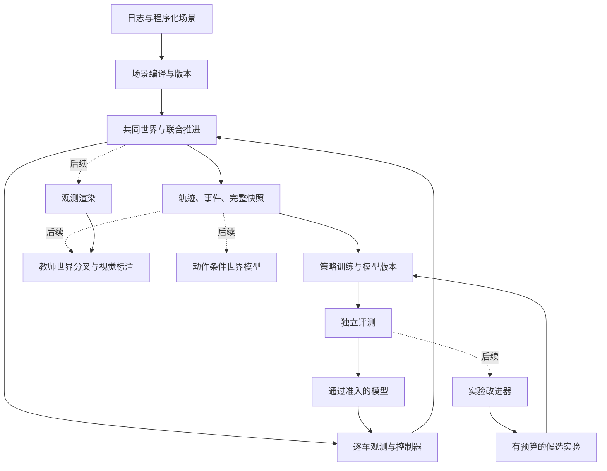
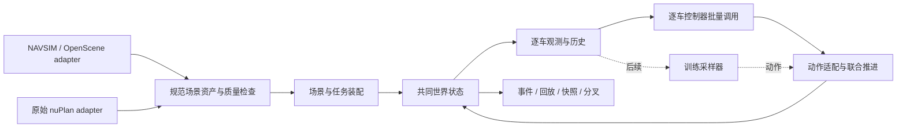

# DriveRSI 平台需求与验收标准

更新：2026-10-13。状态：交互平台设计；现有实现范围见第 11–12 节，按任务验收的协议见第 13 节。设计要求不等同于已实现能力。

## 1. 平台定位

**当前交付目标是可复用的多智能体交互仿真 SDK：导入真实场景、配置每车任务和控制器、联合推进、检查交互、记录并重现失败。** 基础研究对象是一般和交通交互：各车有自己的目的地、风格和约束；竞争、协调都可能发生，不默认以使对方失败为目标。

用户最新确定：平台以多智能体 Self-Play 为主线，近期数据入口为 NAVSIM，必须设计图像闭环训练及后续 RSI 接口；nuPlan 的结构化交互训练参考 DriveZero。当前先完善平台与这些接口的可实施设计，尚未启动训练或实现 RSI。第 20 节明确视觉训练边界、候选渲染接入与外层改进契约。工程代码分类管理；不新增零散 MD；临时 smoke 代码、结果和结论在取得结果后清理。

以下是建议默认值：先覆盖车辆级结构化交互，保持一个可维护的仿真后端；先在当前 32 actor、9 秒、0.1 秒步长范围内把语义做正确，再依据用例扩展容量和时长。32/9/0.1 属于当前适配能力，不应成为长期数据格式的硬限制。规则控制器足以驱动平台验收；不以训练算法、模型大小或 GPU 数量定义平台边界。

**当前平台成功的证据**：前车制动能因果地改变反应式后车行为；同一世界无逐车更新顺序优势；路线、路权与边界可解释；失败可定位并从之前状态分叉；更换数据源不改变核心推进接口。固定动作下车辆会动，只能证明执行链路，不证明反应式交互能力完整。

## 2. 已有基础与缺口

只读检查目标：`configured-worker-host:<repository>`。

| 项目 | 检查结果 | 影响 |
|---|---|---|
| 项目目录 | 自有包已按 `src/driversi/` 分层；具备 NAVSIM 编译、CPU 后端、联合控制和环境快照基础 | 在现有模块上扩展，不再新建平行框架 |
| DriveZero | 独立 Git 仓库，检查时提交 `2495954`；README 将 DriveRL 定义为 nuPlan inference runtime | 用作基线与接口参照，不当成完整训练平台 |
| GPU | 8 × NVIDIA H20，约 96 GiB/卡；检查时约 32 GiB/卡空闲，利用率 93–100% | 机器规模足够开展实验；当前不能按 8 张空闲卡安排训练 |
| CPU / 内存 | 192 逻辑 CPU，约 1 TiB 内存，检查时约 726 GiB available | C/C++ CPU 仿真 + GPU 训练是值得实测的路线 |
| 存储 | `/data` 为共享 NAS；根文件系统检查时约 202 GB 空闲 | NAS 保存数据和正式产物；热缓存位置、额度及容器持久性另行确认 |
| 软件 | 系统 Python 3.12.3；已有 `driverl_navsim` 环境为 Python 3.11.16、PyTorch 2.7.1+cu128；驱动 535.161.07 | 只确认安装信息，未验证 CUDA 执行兼容；项目建独立环境 |
| 编译器 | `gcc`、`cmake` 可见；当前 PATH 和常见 CUDA 路径未发现 `nvcc` | CUDA 扩展编译是候选后端的验证项，不推断机器绝无 toolkit |
| 数据 | 相邻 `dataset/` 有 maps、navsim_logs、sensor_blobs、NAVSIM 缓存及 HUGSIM 链接 | 优先现有 NAVSIM/nuPlan 地图生态，不先下载全量 Waymo |
| 原始 nuPlan / WOMD | 本次浅层目录检查未确认原始 nuPlan 数据库或 WOMD | 不承诺能直接运行原始 nuPlan 全部评测或加载 WOMD 场景 |

现有转换器已读取 timestamp、track token、boxes、ego pose 与信号记录，并处理地图投影；尚未建立路线拓扑、stop line 绑定或可信的全库划分清单。原始 nuPlan devkit 在外部参考仓库中可见，但代码存在不代表原始数据库已到位，也不代表已实现原始 nuPlan adapter。上表资源占用为首次检查时的历史记录，不作为持续可用资源承诺。

## 3. 从论文得到的技术方向

论文依据、版本和边界见 [比较文档](../research/platform_comparison.md)。核心选择是：

1. 借鉴 GigaFlow 的共享策略与逐车条件化，先获得行为多样性。历史策略联赛作为后续对照，不作为开始训练的先决条件。
2. 借鉴 GigaPixel 的学生闭环和教师世界分叉，把完整快照及分叉作为核心契约；保留动作与轨迹两类输出。
3. 借鉴 TerraZero 的程序化场景组合，逐步从日志初始化扩展到地图上的新交互。
4. 借鉴 Pictura，把可见性当作实验变量；未来视觉策略不能默认获得全局状态。
5. 借鉴 SPICED，把同策略群体协调与对陌生/人类风格交通的兼容分开评测。

**当前建议：PufferDrive 2.0 为首个工程验证候选，GPUDrive 为备用，Waymax 为参考与潜在独立对照。** 这是针对现有 PyTorch、CPU 资源及后续视觉路线的判断，不是性能实测排名。

PufferDrive 当前源码可见 classic/jerk 动力学、离散/连续动作及多种控制模式；但完整快照、逐车风格、信号、nuPlan 转换和高吞吐训练图像仍需逐项核查/补齐。GigaPixel 的扩展不等于公共 PufferDrive 默认具备的功能。最终选型门槛是：能正确接入现有场景，提供真实联合控制，并能以可维护的方式支持状态导出/恢复。

## 4. 需求分级

P0 是交互平台必须实现并验证的能力；P1 在基础交互稳定后加入；P2/后续项不在当前实现范围。接口可先定义，功能必须按实际进度标注。

| ID | 优先级 | 能力 | 交付与验收要点 |
|---|---|---|---|
| R01 | P0 | 场景编译与版本 | NAVSIM/地图 → 标准场景；覆盖 actor ID、时间、坐标、尺寸、路线、信号及缺失掩码；导出数据质量报告 |
| R02 | P0 | 共同世界与联合推进 | 多车基于同一 `s_t` 决策；车体碰撞、道路、规则事件正确；无顺序更新优势 |
| R03 | P0 | 逐车控制权 | current-policy / replay / rule 可混合；每辆车独立目标、条件、记忆与终止；按 provider 批量推理 |
| R04 | P0 | 可配置结构化观测 | actor-centric 状态、地图、近邻、目标和有效掩码；只给自身意图/条件；无未来轨迹泄漏 |
| R05 | 后续 | 共享策略 self-play 训练 | 交互平台验收后再接采样器与训练器；当前只预留准确的观测、动作、掩码、版本和批量接口 |
| R06 | P0 | 快照、恢复、分叉 | 导出完整可演化状态；原世界与分叉互不污染；可从失败前状态复现/替换控制器 |
| R07 | P0 | 事件、任务与指标分离 | 平台报告碰撞、路权、路线进度、等待和死锁等事件；任务插件决定完成/终止；奖励插件留作后续，不把训练目标写进动力学 |
| R08 | P0 | 失败分析与实验追踪 | 正式 rollout 的事件、状态回放和模型血缘；同一失败可定位到场景、actor、时间和版本 |
| R09 | P1 | 程序化场景与长期交互 | 在真实地图上重采样密度、路线、初速、风格、障碍和信号；检查可达性、spawn 合法性 |
| R10 | 后续 | 历史策略与跨群体评测 | 当前支持异构控制器的运行契约；策略池、训练对照与忘却研究后续开展 |
| R11 | P1/P2 | 可见性与视觉学习 | P1 定义可见性/相机契约；P2 实现批量透视渲染、学生控制和教师标注；与状态特权分开 |
| R12 | P2 | 世界模型与改进外循环 | 联合动作条件的预测/想象接口；变更提议—实验—独立验收—准入；所有候选消耗计入预算 |

先保留一个小型俯视回放器，能显示控制器身份、轨迹、目标、碰撞和奖励分项；第一版不建设复杂网页管理后台。

## 5. 数据是第一项实际工作

已有目录不等于已有训练场景。先从 mini 或公开训练划分挑选 100–300 个场景做结构验证；这个数量是工程抽样建议，不是统计充分性保证。

转换器必须确认：

- 坐标：地图绝对坐标、车辆中心与 rear axle、朝向与单位、全局到自车变换；每辆车都能成为 ego。
- 时间：原始采样间隔、历史/未来覆盖、轨迹缺帧；短日志不可假装成长时回放。
- 身份：track ID 稳定、进入/退出可追踪、同一槽位重用时 `generation_id` 变化。
- 目标：每辆可控车有可达目标/路线。可用日志终点设定基准任务，但不把其他车辆的未来轨迹输入策略。
- 地图：可行驶区域、路网连通性、车道方向、stop line 与 signal 关联；缺失项显式标记，不推定为绿灯。
- 数据划分：按原始 log、时间和地理区域分组，阻断重叠片段泄漏；已有合成数据继承源 log 的划分。
- 私有测试与封存测试仅用于约定评测，不进入训练、课程选择或自动改进反馈。

先走“日志初始化 + 学习车辆闭环响应”；之后走“地图 + 程序化生成”。对比时控制地图、步数和场景难度，才能判断收益来自 self-play 还是更多场景。

初始交互集建议覆盖四类：跟驰/前车急停、并道/合流、交叉口让行/无保护左转、窄道会车/阻塞恢复。第一版只做车辆学习策略；行人与骑行者先用明确标注的回放或规则控制，不声称已支持其 self-play。复杂路段还需高度/道路层级信息，避免把立交桥上下车辆判成碰撞。

## 6. 核心接口与运行时语义

以下是拟定的工程契约，不是已存在的 API。

| 契约 | 关键内容 |
|---|---|
| `ScenarioSpec` | 源 log 与 split、地图版本、初始状态、目标/路线、信号计划、spawn/despawn、随机种子、有效时间范围 |
| `WorldState / Snapshot` | 时钟、全体 actor、信号控制器、路线进度、历史缓存、动力学隐状态、RNG、控制器记忆、策略版本、actor 生命周期 |
| `ObservationSpec` | 时间戳、坐标系、历史长度、特权等级、可见性规则、模态、缺失/有效掩码 |
| `ActionSpec` | control / trajectory / replay override；单位、bounds、参考坐标、决策频率、跟踪器及动力学版本 |
| `PolicyProvider` | 支持的输入/动作规格、版本、batch 推理、reset/记忆状态、是否贡献当前训练样本 |
| `TransitionBatch` | 平台拥有 world/actor/generation ID、obs_t/obs_next、请求/执行动作、事件、终止原因与有效掩码；策略版本由控制器提供；log-prob、value 与优化信息由后续采样器持有 |
| `ExperimentSpec / Result` | 父版本、变更、数据与代码 hash、训练/开发/封存划分、预算、checkpoint 选择规则、结果与失败原因 |

每个 tick：冻结 `s_t` → 构建全部观测 → 批量获得动作 → 统一动力学推进 → 计算事件/奖励 → 更新历史和生命周期。

共享策略建议形式：

`a_i ~ πθ(o_i, goal_i, style_i, dynamics_i, memory_i)`。

共享参数不意味着共享记忆或相同目标。风格变量只在设定的取值范围内训练并记录，最终评测固定条件。对交通流的破坏性行为作为明确的压力测试，不混进默认驾驶目标。

训练阶段先保留底座原生动作和频率，确认基线后再加入 DriveRL/轨迹适配；不直接统一成一个未经验证的 5 Hz/jerk 方案。底层物理步、策略决策步和轨迹重规划周期分别声明。

到达、碰撞、越界、退出地图和超时分别编码。碰撞后停留、移除或继续的选择会改变交通，应按实验固定；超时在满足算法条件时 bootstrap，不能与真实 terminal 混淆。被规则/回放替代的动作不能伪装成学习策略采样。

快照不是复制位置数组。教师分叉要复制共同世界，在分叉里明确切换哪些车辆由教师控制；主世界继续按原控制器运行。首版允许先做正确、较慢的序列化分叉，之后再优化设备内复制。

## 7. 后续训练研究问题（当前不实施）

| 实验 | 对照 | 希望区分的问题 |
|---|---|---|
| E1：多车交互有效性 | ego-only + 固定背景 / 共享策略 self-play | 相同 agent-step 与计算预算下，交互训练是否改善陌生交通中的行为 |
| E2：条件化 | 固定风格 / 随机风格并把条件输入策略 | 行为多样性是否带来泛化，而非只降低训练难度 |
| E3：对手泛化 | current self-play / 冻结策略 / 规则 / replay / 未见策略混合 | 是否只适应同一策略的交通惯例 |
| E4：场景分布 | 日志初始化 / 地图程序化 | 收益来自多车训练还是初始化、路线和密度变化 |
| E5：失败修复 | 原始场景 / 相同状态分叉与单因素干预 | 某次失败来自策略、观测、控制误差还是仿真事件逻辑 |

E1–E3 为首批正式实验；E4–E5 随场景生成和工具成熟展开。驾驶是一般和交互，交叉对局报告完成率和违规/延迟矩阵，不能仅用零和胜率或 Elo 概括。

指标至少包含：按场景与按车辆的完成率、全碰撞率、明确归责规则下的碰撞率、碰撞相对速度、越界、红灯、逆行、进度、等待时长、死锁/超时、舒适度。报告分母、稀有场景分层和零事件时的样本量；停车不动不能同时通过效率验收。

正式比较使用同场景配对评测，建议至少 3 个独立训练种子；种子数不是置信度保证。先预定指标、checkpoint 选择和容差，再看结果。开发集用于调参，封存集用于阶段验收。NAVSIM 分数只是外部指标之一，不能替代多智能体闭环评测。

## 8. 性能需求与选型门槛

不使用跨论文 headline FPS 作为当前机器的验收线。分别记录：

- world-steps/s：共同世界推进频率；
- 有效 controlled-agent-steps/s：排除 padding、停用和无效条目；
- 完整训练 agent-steps/s：包含观测、推理、环境、优化和同步；
- 视觉阶段另报 images/s、camera 数和分辨率；
- 场景复杂度、有效车辆数、batch、CPU 核、GPU、显存/RAM、数据读取及 checkpoint 开销。

先在约定的空闲资源上测 1 卡与不同 CPU worker 数，再决定并行环境数及多卡扩展。C 侧共享缓冲可以减少序列化，但不等于 CPU↔GPU 数据传输自动消失。优先定位实测瓶颈，不预设一切必须在 GPU 上。

PufferDrive 平台阶段验收：现有场景转换成功、联合控制和反应式交互成立、终止语义透明、完整运行状态可导出恢复、所需缺口可在清晰适配层补齐。原生基线训练在后续训练阶段另行验证，不作为本轮前置任务。若状态封装和扩展代价过高，再用相同场景与语义验证 GPUDrive；避免同时建设两套后端主链路。

## 9. 后续视觉、世界模型和 RSI 如何接入

视觉阶段保留三种不同观测协议：特权结构化状态、可见性受限结构化状态、透视图像。先做小模型闭环，再决定 VLM 在低频战术决策还是高频控制中的位置；大模型必须定义延迟、动作有效期、超时行为和记忆重置。不能因渲染出图就声称支持真实相机迁移。

世界模型需要学习 `P(s_next | history, joint_actions, scenario)` 或对应潜状态分布。未控制的交通也必须声明行为来源。保存动作、干预、环境/模型版本和不确定性；想象轨迹与权威仿真轨迹分开。先验证多步误差、事件误差及策略排序是否保持，再用于训练或规划。

RSI 外循环的首个目标可限定为自动选择场景课程或训练配置。改进器读取训练/开发失败，提出候选，消耗固定预算执行，交由独立评测后准入。评价器、数据划分和资源统计不随候选自行修改。

策略参数迭代证明的是学习；自动实验搜索证明的是自动优化。要研究更强的递归改进，还需要比较不同版本改进器在相同起始模型、任务和总预算上的改进能力，把失败实验与搜索成本纳入，并检验跨任务迁移。平台能提供实验条件，不能预先保证出现“真正 RSI”。

## 10. 实施顺序与完成门槛

| 阶段 | 产物 | 完成门槛 |
|---|---|---|
| M0：需求/数据契约 | 本文、目录规则、数据字段清单、资源约束 | 场景类型、输入/输出、评测协议和职责清楚 |
| M1：数据与后端验证 | 独立环境、场景转换器、一个后端适配、可回放场景 | 100–300 场景结构抽查；坐标/ID/信号缺失明确；2–32 车联合响应正确 |
| M2：交互语义 | 路线/目标、地图语义、规则控制器、时钟与 actor 生命周期 | 跟驰、合流、让行、死锁用例可以解释和复现；replay 与 reactive 行为分明 |
| M3：可检查的实验平台 | 俯视回放、事件检查、环境及控制器状态快照、分叉 | 相同动作恢复一致、分叉不污染；能定位 actor、时间、原因和控制权 |
| M4：可接训练的环境接口 | 场景索引、批量环境、观测/动作适配、外部评测桥接 | 用确定性控制器验证单环境/批量环境语义一致；不依赖 RL 算法完成验收 |
| M5：训练（后续） | 采样器、shared-policy PPO、策略池、训练 checkpoint | 待平台验收后另定实验和预算，当前不实施 |
| M6：视觉/世界模型/改进器（后续） | 独立插件和正式研究协议 | 每条路线先通过自身闭环与外部验证，再扩大规模 |

当前交互平台能力分布在 M1–M4；不要把 M1 能运行环境称为第一版完整平台。第 9 节仅保留扩展约束，不推进 RSI 实现。

长期保留的契约测试：reset/恢复可重复、agent 顺序置换不改变联合时序、分叉隔离、actor ID 生命周期、有效/终止/截断掩码、碰撞/道路/信号边界、坐标往返与轨迹跟踪。GAE 属于后续训练器测试。它们与一次性 smoke 分离，清理规则见 [AGENTS.md](../../AGENTS.md)。

当前工程入口为**数据字段审计、场景转换和候选仿真底座的最小适配**。CPU 构建不依赖 GPU；训练前仍需确认可用 GPU 时间窗口。NAVSIM 日志与 nuPlan GPKG 可用，但不等同于已具备完整 nuPlan 数据库和信号动态。

## 11. 首次实现范围与显式假设

首次实现目标：建立 M1 的可运行基础，打通 CLI → NAVSIM 场景编译 → 原生 PufferDrive 联合控制 → 快照恢复。本节保留该次实现的假设，后续设计见第 12 节。目标目录无项目级 Git 仓库，base commit 为 `none`；已有外部仓库分别管理。PufferDrive 源码版本锁定为 `02f1008c12f3920ba3cd076d5204b2747a8c5cb2`。不新增零散设计 MD；本节承载规格、假设和阶段状态。`ASK=never`，未由用户指定的选择标为 default。

| ID | 未定项 | 本轮选择 | 类型 | 来源 |
|---|---|---|---|---|
| A01 | 本轮交付边界 | 数据与仿真基础；PPO、视觉和自动改进后续实现，运行验证不作为驾驶能力结论 | semantic | default |
| A02 | 数据范围 | mini 仅作工程验证；按文件/窗口显式选场景；split 参数必须提供，封存/私有测试不作为默认输入 | semantic | default |
| A03 | 时间与插值 | 从原始微秒 timestamp 建时间轴；最多 9 秒，0.1 秒目标步长；位置/展开角线性插值，速度由位置差分；标为插值场景，不当作原生 10 Hz 日志 | semantic | default |
| A04 | 参与者 | 初始存在且覆盖整个窗口的车辆、行人和骑行者；最多 32 个，距离初始主车最近者优先；缺帧/超额对象显式计数；暂不模拟动态出生 | semantic | default |
| A05 | 主车几何 | NAVSIM ego pose 是 rear axle，转换为 Pacifica 车体中心；固定尺寸来源于现有 nuPlan 参数；其他框从各时刻 ego frame 转世界坐标 | semantic | default |
| A06 | 地图与规则 | 从 nuPlan GPKG 提取局部车道基线和可行驶面边界；保留信号元数据及字段可用性标记，缺失不解释为绿灯；当前后端不实现红灯合规，不输出红灯能力分数 | semantic | default / sweep |
| A07 | 控制语义 | 原生 jerk 12 离散动作，0.1 秒；固定目标，到达/碰撞/越界后停止；控制掩码显式，其他对象 replay；不使用原生自动重置后的观测作为 final observation | semantic | default |
| A08 | 快照 | 第一版限定固定地图/actor/目标、无渲染和无随机动力学；保存原生可变状态和控制元数据，跨版本恢复拒绝；暂不承诺可恢复任意未来插件 | interface | default |
| A09 | 构建 | 独立 `.venv`；只编译 PufferDrive C 仿真适配，不安装全套训练/游戏依赖；外部 checkout 保持原样，已复现的网格边界越界在临时构建副本中以两处固定替换修复 | interface | default |
| A10 | 输出与测试 | 正式产物由 CLI 显式 output 指定；本轮临时产物全部进入 `.scratch/smoke/` 并清理；长期契约测试保留在 `tests/` | interface | user |
| A11 | 后端观测修正 | 原生 replay 只推进位姿，适配层同步其轨迹速度后重新计算观测；离散动作按原生 int32 ABI 写入 | semantic | source audit |
| A12 | 地图近似 | 局部可行驶面并集生成道路边界，包含裁剪边界；二维碰撞不区分高架层，不据此评价立体道路 | semantic | default |
| A13 | 地图投影 | 读取 GPKG meta 的 projectedCoordSystem；空间查询先将日志投影坐标 bbox 转换到图层 CRS，读入后投回米制坐标；拒绝缺失投影元数据 | semantic | default |
| A14 | 回合与奖励 | 碰撞/越界/到达后该车失效但车体留在世界；所有可控车失效或达到窗口长度时结束，不自动 reset；区分本步有效样本、新终止与时间截断。工程奖励为到达 +1、碰撞或越界 -1，冲突时失败优先，无 shaping，非正式训练奖励 | semantic | default |
| A15 | 策略接口与运行产物 | 每车独立绑定批量策略，按相同观测时刻集中收集动作；先提供零 jerk 和制动工程控制器。CLI 输出数组轨迹，snapshot 采用 JSON 元信息与无指针原生 bytes；当前只恢复环境，不恢复外部策略记忆/优化器 | interface | default |
| A16 | 快照匹配 | 场景二进制内容、actor ID、后端构建标识必须一致；快照包含动力学隐状态、观测/动作缓冲、计数及有效掩码，分叉重新分配世界内存；初始已失效车辆不产生训练样本 | semantic | default |
| A17 | 目标与到达 | 固定目标为所选窗口最后时刻的车体中心；平面距离严格小于 2 m 且速度不大于 100 m/s 为到达，不要求停车；窗口长度会改变任务目标。这是工程任务定义，不是道路路线完成率 | semantic | sweep |
| A18 | 可控对象筛选 | 窗口首尾平面净位移严格大于 2 m 的车辆可控；其他对象回放，包括运动后回到起点附近的车；没有合格车辆则拒绝编译 | semantic | sweep |
| A19 | 日志时间质量 | 相邻源帧间隔超过 0.75 秒拒绝插值编译；该门槛会影响场景可接受范围 | semantic | sweep |
| A20 | 信号缺失 | 每个源时刻的信号记录保存 available 标记；字段缺失为 false，存在但列表为空为 true；两者均不推断通行权 | semantic | sweep |

阶段顺序：F0 包与 CLI；F1 数据契约/真实日志审计；F2 场景编译与原生后端；F3 联合控制、状态和分叉；F4 回归验证与假设审查。每一步先验证再推进。本节只维护正式设计和能力状态，不归档临时 smoke 结论。

当前正式能力：F0–F3 接口已实现；F4 长期契约测试已纳入 `tests/`，覆盖数据语义、联合控制、事件、时间截断、当前环境范围内的状态恢复和分叉隔离。数据目录入口见 12.7；运行抽查不替代按交互类型分层的系统动力学/地图语义验收，M1–M4 尚未整体验收。所有工程控制器均为显式固定动作，无伪造学习结果或训练占位输出。运行方式和模块入口维护在根 README，临时结果按工程规则清理。

## 12. 交互平台设计与 NAVSIM / nuPlan 的接入边界

本节是当前设计结论，尚未实施的接口明确写作“拟定”。第 11 节记录现有 v0.1 代码选择；本节规划不会自动改变现有文件格式或仿真行为。当前不开发训练算法、视觉模型或 RSI。

### 12.1 后续能否用于训练

可以作为**以真实日志初始化的结构化驾驶交互环境**。数据提供地图、初始交通和参考行为；控制器共同决定动作；仿真内核产生新的状态与观测；未来训练器从这些新交互收集经验。接入数据不等于已经得到完整训练系统，也不能预先保证学到的行为可迁移到真实道路。

`s_0 = initialize(dataset_scene, task)`；`o_t^i = observe_i(s_t, simulated_history)`；`s_(t+1) = simulate(s_t, joint_actions, signal_state)`。

由策略控制的车在偏离日志后仍由仿真推进；只有明确标记 replay 的参与者从参考轨迹取位置。不得每步把学习车辆的位置或历史重置成日志真值。单车面对 replay 可以构成非反应背景下的闭环任务；多车每步根据新观测决策才提供双向交互条件。是否 self-play 取决于后续策略更新方式，并非多车可控即已完成 self-play。

| 来源/组件 | 合适职责 | 当前接入情况与边界 |
|---|---|---|
| NAVSIM 所用 OpenScene 日志与 nuPlan 地图 | 初始化、几何/任务来源、参考轨迹、数据驱动测试 | 当前已有转换器；2 Hz 数据插值不能补回缺失的高频运动和意图 |
| 原始 nuPlan 数据库与地图 | 第二种场景入口，读取可用的状态历史、路线和信号 | 拟新增 adapter；需确认数据文件、版本与字段完整性，不必重写世界推进 |
| NAVSIM 评测器 | 指定版本的外部规划评测 | 与 DriveRSI 的持续多车交互分别运行，不把内部事件奖励称为 PDMS/EPDMS |
| nuPlan 仿真/评测器 | ego 规划器的独立闭环检查 | 需专门 planner/trajectory adapter；保持官方协议，不把多车内部指标冒称官方成绩 |
| 原始图像/LiDAR | 日志状态下的感知/模仿学习、离线规划输入 | 不提供任意反事实状态的新传感器观测；相机闭环需要另建观测生成能力 |

OpenScene 是 nuPlan 的紧凑 2 Hz 表达，而非完全独立的数据来源。[NAVSIM 数据格式说明](https://github.com/autonomousvision/navsim/blob/main/docs/cache.md) NAVSIM v1 的背景车为 replay；v2 增加了反应式背景车，但官方说明仍要求 ego 在该仿真阶段提交一次计划，环境变化不会逐步反馈给 planner；pseudo-simulation 也不能直接当作我们的多智能体持续交互循环。[NAVSIM traffic agents](https://github.com/autonomousvision/navsim/blob/main/docs/traffic_agents.md)

nuPlan 的场景接口公开了 `database_interval`、逐时刻 ego/track 状态、route roadblock IDs 和信号读取入口；原始 adapter 应读取这些字段，不把频率或每车路线完整性写死。官方 reactive 配置使用 IDM 背景；“反应式闭环”不自动提供逐车可学习策略接管。[nuPlan 场景接口](https://github.com/motional/nuplan-devkit/blob/master/nuplan/planning/scenario_builder/abstract_scenario.py)、[reactive 配置](https://github.com/motional/nuplan-devkit/blob/master/nuplan/planning/script/experiments/simulation/closed_loop_reactive_agents.yaml)

### 12.2 统一的数据与运行结构

平台由单一 Python 包和清晰接口组织，先使用进程内批量调用。数据预处理和地图缓存不进入逐步推进的热路径；暂不引入微服务或复杂管理后台。

| 层与归属 | 拟定职责 | 关键约束 |
|---|---|---|
| `data/`：来源 adapter / 场景索引 | 抽取、投影、时间对齐、缺失标记、来源归一化、split manifest | 预处理一次；保留转换统计和来源身份；加入 nuPlan 时复用后续层 |
| `contracts/`：场景与任务 | 规范地图、初始历史、actor 规格、任务路线、参考轨迹侧表 | 初始/可见输入与日志未来分开；后端限制不得悄悄改变数据语义 |
| `sim/`：世界、时钟与后端 | 世界状态、控制权、共同推进、生命周期、信号、后端能力声明 | 每个 actor 每步只有一个状态写入者；未知/不支持能力显式拒绝 |
| `agents/`：控制器与动作适配 | replay、反应式规则、外部策略；单步控制/轨迹的显式转换 | provider 独立记忆，批量推理；轨迹必须经跟踪器实际执行 |
| `evaluation/`：事件与任务检查 | 碰撞、越界、路权、进度、等待、死锁、终止原因 | 几何事件不等于事故归责；规则不全的场景不能给出规则合规结论 |
| `rendering/`：检查用回放 | 时间轴、地图/车道、actor、目标、控制器身份、事件、分叉对比 | 首先做 2D 检查器；这不等于已实现相机观测渲染 |

目录只在有正式实现时创建；以上没有要求现在创建空模块。后续 `training/` 依赖这些接口，交互层不依赖具体优化算法。

建议将未来场景格式分为 `ScenarioAsset`（只读来源与地图）、`TaskSpec`（路线、控制权和结束条件）、`ReferenceTracks`（日志未来与离线标签）。运行时使用独立的 `WorldState` 和 `Observation`。真实数据中的 ego 有明确路线也不代表每辆背景车都有完整导航意图：背景任务须注明来自轨迹匹配、路网采样或人工配置，无法确定时保持 unknown。

现有 `Scene` v1 是后端验证格式，不作最终公共格式冻结。升级时显式标记 schema，旧场景使用明确转换或继续走旧适配器；不能在同一 schema 下悄悄更改坐标、目标或频率含义。32 actor、91 个轨迹采样点应通过 `BackendCapabilities` 验证；超过能力的请求拒绝或由调用者显式选择裁剪。

### 12.3 当前最需要补齐的设计缺口

| 现有代码事实 | 对未来训练/交互的影响 | 下一步设计 |
|---|---|---|
| `Scene` 将日志全窗口轨迹、控制掩码、地图放在一起 | 标签、参考与可见状态边界不够强 | 隔离 future/reference；只允许观测构建器读取当前及历史世界状态、该车自身任务 |
| 地图只有基线和裁剪后的道路边界 | 不能可靠判断路权、停止线、红灯、路网可达性 | 增加有方向的 lane graph、drivable polygon、stop line、signal 关联和有效性标记 |
| 地图 crop 由全体日志未来位置包络确定 | 裁剪范围可能携带未来信息，离开 ROI 又可能产生人工边界碰撞 | 固定初始区域/公开任务路线的地图加载规则；区分物理路缘和地图缺失边界 |
| 仅全窗口存在且净位移 >2 m 的车可控 | 静止等待车、走走停停或返回起点车辆可能被排除 | 按合法初始状态和可达任务决定可控性；记录 excluded 原因与覆盖分布 |
| 目标是窗口终点，2 m/100 m/s 到达参数仅作工程示例 | 容易把任务完成误读成正确驾驶，无法解释沿路线进度 | 采用有来源的路线/目的地、进度和任务成功规则；验证可达性，不用人工宽松速度门槛代替驾驶要求 |
| 非可控车 replay，可控车示例只有固定 jerk | 有同步执行，尚缺行为响应的默认基线 | 增加有反应的跟驰/车道跟踪，再加入显式让行；replay 始终保留为单独对照模式 |
| 1124 维观测紧耦合后端，无通用历史缓存 | 外部模型不能直接复用 NAVSIM/nuPlan 输入，容易拿日志历史代替模拟历史 | 定义 versioned ObservationSpec，含 actor-centric 历史、地图、目标、signal 与掩码；明确特权/可见性级别 |
| 当前奖励在 `world.step()` 内固定计算 | 后续变更训练目标会改动世界接口 | 将 events、TaskOutcome、终止策略、RewardAdapter 分离；默认控制器不依赖奖励 |
| 当前 snapshot 不包含外部 controller 状态 | 有状态规则或 RNN 加入后不能完整复现 | 区分 WorldSnapshot 与 EpisodeSnapshot；后者包含 RNG、历史缓存、provider 状态、绑定和时钟 |
| 当前日志保存 state/action/event，没有完整 obs_t、obs_next、policy 状态来源 | 不能直接把已有 NPZ 当作通用 RL replay buffer | 定义 versioned StepRecord；观测可内嵌或由固定版本 encoder 精确重建；完整记录请求/执行动作与控制器版本 |
| 旧单文件 split 是手动标签；目录接入新增来源/窗口检查，但无全量划分、nuPlan adapter 或批量环境管理 | 已读分区核验不保证全数据防泄漏，也没有可靠的跨数据集运行入口 | 见 12.7 的已读范围；继续完善全量 split manifest、第二 adapter 和 VectorWorld |

观测与数据泄漏需分开判断：目前给自身任务目标是已声明的任务条件，不自动算泄漏；把其他车辆未来轨迹、未来信号计划或未公开任务输入策略才会破坏可比性。地图裁剪和 actor 筛选也要作为编译阶段的信息来源审计，不能只检查神经网络输入。

### 12.4 共同世界与控制权

每个世界按固定顺序推进：冻结 `s_t` 与当前信号 → 构建所有 actor 的观测 → 各 provider 基于同一时刻批量决策 → 校验/适配动作 → 联合推进必要的物理子步 → 检查碰撞、路权与生命周期 → 生成新历史和 `StepRecord`。

必须区分物理步长、策略决策步长、轨迹重规划步长。更高频插值不代表更高精度测量；若未来降低碰撞子步长度，应记录相应动力学/事件检测版本，并验证快速穿越时的接触检测。每车同时只有 replay、rule、policy 或 external-command 中的一个控制来源；当前先按回合固定绑定，动态切换须增加显式切换边界和内部状态交接，不能让 replay 与动力学同时覆盖同一 actor。

外部 NAVSIM/nuPlan planner 常输出未来轨迹。拟通过 `TrajectoryAdapter` 明确车体中心/rear-axle、参考坐标、时间戳和车辆参数，再交跟踪器转成底层控制。不能直接把轨迹点当实际位置；需记录跟踪误差、限幅、失效和实际执行动作。给背景车复用 ego 模型时，还要为它重建该车自己的观测和目标；不能复制原 ego 的相机输入或导航命令。

初版可以保持固定 actor 集合和短时长；下一阶段必须定义日志结束、驶出地图、被遮挡、退出场景的不同含义。目标侧 actor ID 与仿真槽位分离，槽位复用更换 generation ID。地图覆盖耗尽应报告 domain exit / insufficient map，不能自动算物理路缘碰撞；数据缺失也不能算任务成功。需要信号判定但信号未知的路口先标记 unknown 或排除，不能默认通行；无信号路口另按已知优先通行规则定义任务。

### 12.5 数据集接入与划分

NAVSIM 路径沿用现有编译器，增加来源 manifest、历史和路线拓扑；原始 nuPlan 路径拟通过 `AbstractScenario` 抽取实际时间戳、ego/track 状态、地图、可用的路线和信号，进入同一个规范场景。先用匹配来源片段对齐坐标、ID、时间、速度与几何，再比较运行行为。不能为了抽象统一而伪造 nuPlan 或 NAVSIM 缺失的字段。

数据 manifest 至少包含 `source_dataset/version`、原始 log 身份、场景 token、时间区间、地图版本、官方 split/filter 与用途。NAVSIM 的 `navtrain` 等是源日志上的过滤划分，片段可能重叠；与原始 nuPlan 混用时应先对齐共同来源，再按 log/时间分组划分，避免同一驾驶片段经两种格式进入训练和测试。旧单文件 `--split` 只填元数据；12.7 的目录接入只核验已读源分区及重叠，还没有正式训练/验证划分和全局防泄漏保证。[NAVSIM 划分说明](https://github.com/autonomousvision/navsim/blob/main/docs/splits.md)

mini 仅作工程检查。训练/开发/封存用途由 manifest 控制，生成的变体与分叉继承来源 split；不把官方测试集用于拟报告的标准训练协议。具备完整数据读取能力不要求先加载全部传感器：结构化平台优先日志和地图，传感器文件按实际观测插件需求加载。

### 12.6 后续训练兼容性与当前验收

| 后续用途 | 平台可以提供什么 | 额外必要条件 |
|---|---|---|
| 结构化状态下的在线 RL | 动作引起的新状态、逐车观测、事件与掩码、可重复场景 | 完成交互语义与批量接口，再接外部采样器、奖励与优化器；目前未完成训练链 |
| 多车 self-play | 多车独立任务与共同状态转移、同一/不同策略批量执行 | 有反应的策略持续更新属于后续训练层；当前固定动作示例本身不是 self-play |
| 日志模仿学习 / 离线 RL | 参考轨迹、历史和来源索引 | 区分轨迹标签与真正执行过的控制动作；2 Hz 位置差分不足以直接给出精确 jerk 标签，离线 RL 还需定义动作、奖励和行为分布 |
| 视觉离线规划、候选轨迹评分 | 日志图像可用于对应日志状态下的学习/评分 | 这类用途不等同于多步闭环视觉控制，必须单独命名实验 |
| 多步闭环相机策略训练 | 后续可复用场景与共同世界 | 需能根据新位姿及新交通状态生成一致图像的 renderer / 经验证观测模型；现有 sensor_blobs 不足以覆盖任意反事实 |
| 官方 NAVSIM / nuPlan 指标 | 未来外部评测 adapter | 单独固定官方版本、输入输出和场景协议；不能由自定义 rollout 直接推导官方成绩 |

拟定环境入口保持小而清楚：`reset(scenario, task, seed)`、`observe(actor_ids)`、`step(joint_actions)`、`snapshot(scope)`、`restore(snapshot)`、`fork(snapshot, overrides)`、`close()`；批量包装提供同语义的 world 维度。能力探测声明支持哪些 actor 数量、时长、信号、观测、动作、快照范围；不支持的请求必须明确失败。当前 `PufferDriveWorld` 只有其中一部分固定语义，以上不是现成函数签名。

在不训练任何模型的情况下完成以下平台验收：

1. 数据契约：100–300 个分层场景，逐项统计有效/拒绝原因，不只统计成功编译比例；高架、缺帧、无路线和信号未知必须可解释。
2. 双向响应：在同一初始世界只改变前车制动，验证反应式后车的动作和后续状态改变；replay 对照按定义不响应。这样才能区分联合执行与交互策略。
3. 联合时序：置换 actor 存储顺序与 provider 调用顺序，按 ID 对齐结果；精确相同或事先说明浮点容差，不接受顺序产生的信息优势。
4. 动力学与规则：直行、制动、转弯、接触、驶出地图、路权和超时均有可检查用例；规则让行不是只用一个 IDM 跟驰公式就覆盖所有路口。
5. 完整恢复：带历史、有状态规则和 RNG 的 episode 恢复后相同动作得到相同结果，分叉干预不污染原世界。
6. 检查器：回放可暂停、逐帧、选择车辆，查看控制来源、观测可见范围、路线、事件和终止原因；可对比原世界和分叉。
7. 批量接口：单环境与批量环境在同场景/动作下等价，valid/terminated/truncated/final observation 语义一致；学习算法尚未加入也能验证。

当前实施顺序：**规范场景/任务边界与索引 → 地图路线/路权 → 反应式控制器 → 俯视检查器与 episode 快照 → 第二数据入口与批量接口**。原始 nuPlan adapter 的设计可以先做；在数据库未核实前不把它标为已接入。训练器继续后置。

### 12.7 NAVSIM 数据目录接入约定

本次目标：将指定数据根目录接入可查询场景目录，再从目录生成可复用场景资产；复用现有场景编译与 CPU 世界，不实现训练。实现遵循 research-implement-feature（ASK=never，balanced）；用户的文档整理约定优先，规格与假设集中在本节，临时执行记录及审阅结果使用 `.scratch/smoke/` 并在报告后清理。基线无提交（本地 Git 尚无 HEAD，服务器无 Git），不初始化服务器仓库，不自动提交未审查的既有文件。

| ID | 未指定问题 | 本次选择 | 类别 | 来源 |
|---|---|---|---|---|
| D01 | 接入哪些目录 | 只接受精确名称 mini、trainval、test；不递归导入 private、synthetic、future、backup。原数据只读；版本未知时显式 unknown | semantic | default |
| D02 | 分区与用途的关系 | mini=engineering、trainval=unassigned、test=heldout；不声称官方 scene filter，不自动分配 train/development。旧单文件命令保留但注明 unverified | semantic | default |
| D03 | 首批覆盖与窗口选择 | 显式限制日志数与每日志窗口数；按文件名确定顺序，在每日志可覆盖时长的起始帧中等距选择。保存总文件数/实际读取数与选择规则；不是统计代表性样本 | semantic | default |
| D04 | 目录格式与可重复性 | SQLite v1 保存源相对路径、大小/mtime、原始 log/token、时间区间、编译参数及质量状态；拒绝覆盖已有目录文件。消费时重新检查文件状态与来源；时间区间含插值所用末帧 | interface | default |
| D05 | 有效与失败含义 | 索引阶段复用无地图编译校验；通过仅为 geometry_pending。地图编译另记录成功/失败；不把数据通过等同道路规则或驾驶质量通过 | semantic | default |
| D06 | 重复与泄漏边界 | 同一次目录内按源 log 名和闭区间检查跨分区重叠；源 log token 可用则同时保存。发现重叠拒绝编译冲突窗口；未读取文件和其他目录不在保证范围内，跨格式 nuPlan 对齐后续实现 | semantic | default |
| D07 | 正式资产和临时检查 | 正式目录与编译场景放 outputs/datasets/ 的显式新目录，批次 manifest 保留每次选取的场景与编译失败原因；运行验证轨迹/审阅输出均属 smoke，报告后删除 | interface | default |
| D08 | 编译场景语义 | 沿用 Scene v1 的 10 Hz 插值、最多 32 个全窗口对象、净位移筛选、日志终点目标与地图裁剪；不在数据接入时悄悄改变任务。trainval 编译场景标 unassigned，不冒充 train | semantic | default |
| D09 | 时长不足的已读源是否参与去重 | 先保存可验证的来源身份与原始时间区间，再检查可编译时长；短日志仍参与跨分区重叠。无法解析来源/时间的日志明确记错误，不提供其去重保证 | semantic | sweep |
| D10 | 部分帧缺失可选 log_token | log_name/map 必须逐帧一致；所有已提供的 log_token 必须一致，缺失帧保留缺失。目录保存可用 token，消费端核对存在的值，不把可选值缺失误报为来源改变 | interface | sweep |
| D11 | 标注损坏但来源可解析的日志 | 读取可信 pickle、验证来源/时间、验证完整帧格式分阶段进行；保存有效来源后再做标注校验。标注损坏仍作为拒绝记录，并参与已知区间的跨分区检查；无法确认来源的拒绝另列为 overlap_unchecked_logs | interface | sweep |

实现阶梯：F0 数据根目录清单 CLI → F1 SQLite 来源/窗口索引及跨分区检查 → F2 按索引批量编译与来源复核 → F3 实际 mini 资产接入现有世界及累积回归检查。完整日志数据质量、道路语义、反应式控制器、检查器、nuPlan adapter 仍按前述顺序推进。

## 13. 如何判断平台达到后续任务要求

本节维护正式验收设计，不归档临时 smoke 结果。以下数值是 **DriveRSI 建议的初始工程门槛**，不是论文共同标准、官方基准门槛或真实道路安全认证；实施前应将测试集、容差、适用范围和预算固定到配置中。

### 13.1 分开检验平台、控制器和研究方法

平台是否正确回答：动作是否按声明的动力学改变状态、事件是否算对、观测是否来自正确时刻、恢复是否包含所需状态。控制器是否优秀回答：是否安全且有效地完成任务。研究方法是否有效回答：相同预算下能否改善持留场景和独立环境表现。三者不能用一个平均分替代。

平台接受故意制造碰撞的动作并准确报告碰撞，可能是正确行为；平台把所有车冻结而得到低碰撞率，则不能因此达标。运动分布像日志，也不证明控制器会对外部干预响应。验收采用 **硬契约全部通过 + 指定任务所需能力通过 + 满足该任务预算**，不允许高吞吐抵消错误的交通语义。

| 论文/协议依据 | 可借鉴的证据 | 对本项目验收的含义 |
|---|---|---|
| Cusumano-Towner 等，GigaFlow，ICML 2025 | 在 CARLA、nuPlan、Waymax 等独立条件检验策略；长时 self-play 评测另设频率、噪声和交通配置 | 自己环境中的成绩不足以证明泛化；长时稳定性须公开全部运行条件。[论文](https://proceedings.mlr.press/v267/cusumano-towner25a.html) |
| GPUDrive，arXiv:2408.01584 v3 | 区分原始速度、有效 actor goodput 与训练耗时，并分析数据/目标问题 | 报告真正可用的受控 actor transition 数；数据拒绝、不可达目标与策略失败分开。[论文 §4](https://arxiv.org/html/2408.01584v3) |
| Gulino 等，Waymax，NeurIPS 2023 Datasets and Benchmarks | 显式状态、联合动作及控制掩码；闭环碰撞、越界、进度、运动学与不同背景控制器 | 检查状态/动作契约；行为评估同时看安全和进度，背景策略要作为实验变量。[论文](https://arxiv.org/abs/2310.08710) |
| Rowe 等，GigaPixel，2026 预印本 v2 | 从学生到达状态分叉教师世界；分别报告渲染、带模型训练吞吐，并用外部视觉驾驶基准检验 | 分叉须忠实、独立、带控制条件；结构化仿真通过不等于视觉闭环通过。[论文](https://arxiv.org/html/2606.19641v2) |
| nuPlan 官方指标 | 将碰撞、可行驶区域、方向、进度、TTC、舒适性等分别定义 | 先验证指标实现，再评价控制器；没有路线与地图语义就不能冒称官方成绩。[指标说明](https://github.com/motional/nuplan-devkit/blob/master/docs/metrics_description.md) |
| Montali 等 WOSAC 及官方 2025 协议 | 多个随机联合未来的运动、交互、地图特征分布；协议中的未来长度为 8 秒 | 真实性另作分布检验；轨迹分布分数不足以单独证明干预响应；8 秒并非所有平台通用门槛。[论文](https://arxiv.org/abs/2305.12032)、[官方协议](https://waymo.com/open/challenges/2025/sim-agents/) |

### 13.2 按任务声明资格

| 资格 | 所需证据 | 当前代码边界 |
|---|---|---|
| 可运行的仿真基础 | 场景读入、联合动作、状态/事件返回、环境恢复与分叉 | 已有接口和局部契约测试，适合继续开发；不是全部平台需求已通过 |
| 多车交互研究环境 | 正确地图/任务、双向反应、异构控制器、交互过程足够长、可解释事件与回放 | 固定 jerk 示例不能证明响应式跟驰、合流或让行；尚缺任务级验收 |
| 可接结构化训练的环境 | 上一项，加批量/单环境一致、观测无未授权未来、完整 transition、有效掩码、稳定采样性能 | 尚无 VectorWorld 和通用历史/采样契约；能逐步调用不等于已完成训练接口验收 |
| 可接教师分叉/世界模型数据 | 可演化的 episode 快照、实际联合动作及其时间/版本、多分支因果一致性 | 现有 snapshot 仅覆盖固定环境，不包含未来有状态 provider、历史缓存、RNG 插件 |
| 可接闭环视觉/VLM | 状态一致的多视角观测、遮挡/标定/时钟、轨迹执行器、模型延迟与超时语义 | 未实现反事实相机观测与完整模型适配；日志图像不能替代 |

资格必须附带数据域、车辆种类/数量、动作模型、最大时长、地图能力和控制频率。通过某一有限任务域不意味着支持全部驾驶任务；尚不支持的能力返回 unsupported/unknown，且不能将该项算作通过。

### 13.3 核心指标与建议门槛

| ID / 验收对象 | 测量方式 | 建议初始门槛 | 现有证据及缺口 |
|---|---|---|---|
| V01 数据与坐标 | 初始/源采样点的坐标及 yaw 对齐；ID 唯一性；缺失标志；拒绝原因；跨划分 log/时间重叠 | 声明支持域内，身份/时间/来源检查全部通过；无静默丢弃或错误默认。坐标往返误差建议 ≤1 cm、yaw ≤0.1°，仅作转换精度检查 | 现有单位/时间/来源测试；尚缺独立字段对照与全量划分。2 Hz 插值不等于达到该真实运动精度 |
| V02 动力学与动作 | 直行、恒定控制、制动、转弯的独立解析/数值参照；记录请求与执行动作；非法动作拒绝 | 规范用例全部通过，误差容差预先由积分方程和步长确定；无 NaN/瞬移/未声明越限；缺省零 jerk 不冒充零加速度 | 当前原生动作可运行，但缺系统参考模型比对、低频轨迹跟踪验收 |
| V03 地图与事件判定 | 独立几何 oracle/人工核查的碰撞、擦边、越界、停止线、信号、方向和路线事件；事件级 precision/recall | 明确答案的规范用例 precision=recall=1，正负例都要覆盖；未知规则与裁剪边界不得被误算为合规/实体碰撞 | 当前只有二维几何事件的局部测试；路权、信号、层级道路、裁剪边界语义仍未齐备 |
| V04 联合时序与可见性 | 置换动作字典、provider 调用顺序、actor 存储顺序并按 ID 比对；隐藏未来/他车目标改变而合法输入固定 | 所有契约例通过；控制器基于同一 tick，无提前读取他车同 tick 动作；禁止信息改变不应改变合法观测 | 已有字典顺序/共同时刻测试；完整 actor 排序、历史、未来可见性仍待扩展 |
| V05 因果交互响应 | 同快照配对干预；后车执行加速度变化、首次响应延迟、最小间距、TTC/PET；replay 与无关干预负对照 | 先要求已知解析响应的跟驰规范用例全部通过；响应只能在允许的观测变化后出现，方向符合既定控制律，延迟符合声明的控制周期 | 默认控制器尚无反应能力；轨迹变化本身不是通过条件 |
| V06 恢复与分叉 | 同动作重放误差；分叉写入污染；序列化后恢复；有状态 provider、历史和 RNG 的一致性 | 同一确定性构建的契约例要求精确一致；不同实现才允许预声明逐字段容差。分叉污染计数为 0 | 已有固定环境快照；episode 范围仍待有状态控制器接入后验收 |
| V07 稳定性与生命周期 | reset/close、终止与截断、final observation、对象失效、batch/单环境对齐；内存和错误 | 初始压力目标 ≥10^6 个有效受控 actor steps、≥1000 次 reset，无崩溃/NaN/静默错位；固定工作负载预热后内存不随回合数持续增长 | 此数量只是工程压力门槛；现有短回合测试不能支持长期可靠性结论，批量接口未完成 |
| V08 任务覆盖与可诊断性 | 跟驰、合流、路口、窄道四类；不同速度/密度/风格/地图；失败能定位 actor、时间、控制器、事件与快照 | 第一轮每类 ≥25 个不同初始配置，按原始日志/独立模板分组；每类单独报告，所有失败均有原因或明确 unknown | 城市覆盖不等于交互覆盖；目前还缺自动交互标签、完整任务与检查器 |
| V09 性能与资源 | 有效 agent SPS、world SPS、step/reset/snapshot/fork 的 p50/p95/p99、内存、加载时间与成本 | 由实验预算反推；不设脱离模型与硬件的百万 FPS 门槛。固定 CPU 核数、batch、actor 数、地图规模和真实占用 | 尚无统一性能基线；仿真、完整 rollout 和完整训练必须分别测量 |

规范事件用例应含正负对照，例如真实越界与离开已加载 ROI、横穿接触与仅接近、红灯越线与红灯前合法等待。精确性要求针对有确定答案的受控用例；真实日志有标注噪声时报告误差分布和争议样本，不要求闭环策略复刻唯一日志未来。

V01 的覆盖率分开报告：读取成功率、适用域内可编译率、因当前能力/筛选规则排除率、失败及 unknown 率。不能删除难例后只对剩余样本报成功率。可控车净位移筛选、全窗口跟踪筛选、三维道路简化等均会改变覆盖分布。

### 13.4 最先应实施的配对干预实验

冻结同一初始快照、道路、路线和 RNG。直线道路上让 A 为前车、B 为后车，初速与间距选择在待测跟驰控制律的有效域内，且不会因接触或到达目标提前终止：

1. 分支一：A 维持既定行驶；分支二：仅改变 A 的制动控制。
2. B 分别使用 reactive 跟驰与 replay，形成四组；再加入不会在该观察窗口影响 B 的远处车辆干预作为负对照。
3. 比较 B 的**实际纵向加速度**而不是离散动作编号差值，记录响应幅度、首次响应时刻、最小间距和事件。可定义 `D_a = mean_t |a_B^brake(t)-a_B^keep(t)|`。
4. reactive 组在感知到前车变化后按既定控制律减速；replay 的计划/参考运动保持不变。replay 的受碰撞后状态可能被后端终止，因此因果观测窗口须选在接触前，或单独比较 replay 的计划输出。
5. 同 tick 的联合动作在干预发生前使用相同 `s_t`，B 不能提前反应；无感知延迟的即时规则控制器应在下一次可用观察后响应。人类风格延迟模型按其显式参数判断，不能统一要求 0.1 秒。

`D_a>0` 单独不足以达标：噪声、错误串号或随机控制也能造成变化。必须同时满足时序、方向、规定控制律、负对照和分叉隔离。该实验验证平台+指定控制器组合，不能推导所有未来策略都正确或具有真实人类行为。

### 13.5 平台通过后，如何评价交通行为

以下指标评价固定控制器/策略与场景的组合，不直接当作仿真器资格证：

- 安全：发生碰撞的 actor-episode 比例、独立碰撞事件数/vehicle-km 或 vehicle-hour、越界、逆行、闯灯；单位、分母与初始非法状态单列。同一次连续接触只算一个事件，不能按帧重复计数；按参与车辆统计与按碰撞对统计分别命名。
- 效率：基于合法路线的进度与完成率、通行量、旅行时间、额外等待；日志终点距离不是路线完成率。零碰撞的停车基线必须同时显示零/低进度。
- 交互：跟驰间距、TTC、冲突区 PET、让行成功与通行延迟、合流成功、死锁率及解除时间。死锁须明确“有可行进展而持续无进展”的条件，合法红灯等待不算死锁；TTC 不可定义时保留掩码，不填 0。
- 舒适/可执行性：速度、纵横向加速度、jerk、曲率及超限率；输出轨迹时另报跟踪误差、限幅和无法执行率。
- 真实性（后续）：在持留日志上分层比较运动学、车距/TTC、道路相对位置及事件分布，可借鉴 WOSAC 的多样本似然。真实度与安全性分开，不能用更像日志替代更安全。
- 泛化（有可比控制器后）：固定源 log/地图划分，形成候选控制器 × 同类/异类规则/冻结策略/replay 对手矩阵，报告各项和最差分组；外部 nuPlan/NAVSIM/WOSAC 评分须用对应数据、版本及官方 adapter，不能改名套用内部指标。

短期不要求运行正式学习实验。全停车、固定动作、日志回放、不同参数的反应式控制器即可检查事件与指标的区分能力；应在事先构造的适用场景上满足已知预期关系，不声称某类控制器在所有场景必然优于另一类。

### 13.6 后续模型的额外验收

| 后续任务 | 必需的平台指标/契约 | 加入模型后才评估的能力 |
|---|---|---|
| 结构化 RL / self-play | V01–V09 中任务必需项；按 actor 的有效、终止、截断及最终观测；策略版本与实际执行动作；单环境/批量一致；对手可替换且未授权未来不可见 | 学习稳定性、样本效率、跨对手泛化、遗忘；没有这些实验时只能声明可接训练接口 |
| 教师分叉 / DAgger | 分支初态一致、教师与学生世界独立、所有参与者的控制来源明确；每个标签绑定教师版本、意图/风格、时刻和有效时域；episode 级恢复 | 学生在自身到达状态上的改进、教师可见性差异、闭环相对离线蒸馏收益 |
| 动作条件世界模型 | 完整联合动作及真实后继、历史、RNG/控制来源、未受控交通行为声明；同状态多干预结果与权威模拟器可比 | 1/3/5/8 秒预测误差、事件误差/校准、不确定性、规划候选排序与闭环表现；时域不能超出有效数据和环境能力 |
| 视觉/VLM 闭环 | 根据改变后的位姿/交通生成对应视图；相机标定、遮挡和时钟；不同模型输入权限分离；低频决策、延迟/超时、轨迹跟踪语义 | 感知/规划错误、干预后的闭环控制、真实图像适配和迁移；画质或离线识别分数不单独构成平台通过 |

时域按每个实际日志窗口与任务共同确定，不要求不同数据集或场景采用相同秒数。历史部分不能计入从决策起点向后的交互预算；时长短于该任务完整观测要求时标为证据不足，不自动通过。8–9、15、20–22 或 30–60 秒仅是有相应数据和后端支持时的可选测试档，不是平台资格的统一门槛。延长需要处理地图覆盖、任务持续性和 actor 生命周期，不能靠反复 reset 或直接拼接日志冒充连续仿真。3 秒窗口可用于局部响应测试，但不足以宣称全部交互完成；具体数据驱动规则见第 16.1 节。

### 13.7 实验协议、统计与预算

1. 分层场景和冻结回归集：按交互类型、城市、密度、速度、信号已知性和道路层级报告；变体按原始日志/模板聚类，不能把同日志相邻窗口当作独立样本。unknown/unsupported 单列；对必须具备的能力，unsupported 等同尚未通过。
2. 统计：报告样本数、独立源日志数、成功/失败原因、分组分布和置信区间。对真实数据按 log/独立场景做 cluster bootstrap；同一快照两分支采用配对差值。确定性规范测试的“全部通过”是有限用例事实，不是零错误概率。
3. 性能：`valid_agent_SPS = sum(world,t,actor) valid_controlled / wall_seconds`，不计 padding、已失效车和无需学习的 replay 车。分别公开冷加载、纯仿真、含观测/控制器/记录/reset 的采样吞吐；未来另测含更新的端到端吞吐。记录混部资源占用。
4. 预算反推：需要 N 条有效 transition，允许采样时间 T，则完整采样链至少达到 N/T。例如 10^8 条、24 小时纯采样预算需要约 1158 条/秒；若同一总预算还含更新/评测/预处理，须扣除这些时间或测真实端到端速率。该例是算术预算，不是当前实测速度或训练方案。
5. 独立校验：几何/运动使用独立解析实现或明确参考，不让被测内核给自己的事件当真值；有原始 nuPlan 数据后再做同源片段的跨 adapter 对齐。在可控条件一致时比较差异，不能把不同背景策略导致的轨迹差异都当作模拟器 bug。
6. 产物分类：正式验收集、配置、指标版本和回归用例长期维护；正式资格评测放 `outputs/<evaluation_id>/`。一次性 smoke 的脚本、结果、图表及结论仍全部清理，不迁入文档。本次仅维护协议，没有执行新的实验或宣称新增资格。

建议下一轮优先顺序：**独立几何/动力学 oracle 与地图路线语义 → 前车制动配对干预 → 其他三类交互及可诊断回放 → episode 快照和批量 transition → 压力/吞吐验收**。通过已声明范围的交互验收后再接训练；训练有效性与视觉/世界模型资格分别申请新的任务级验收。

## 14. 短时反应式交互实现约定

本轮边界：先实现当前状态观测、独立运动/几何检查、车道连接和保守路线、无记忆规则跟驰、配对制动验收；不实现信号相位、路权协商、合流决策、长期 actor 生命周期、RL 或 RSI。工程选择在实现前登记。开发模式：ask=never，effort=balanced，assurance=draft；最多五个实现梯级、每级五次修复、两轮同族假设审阅。仓库没有基准提交，本轮按明确文件清单审阅，不创建提交。

| ID | 类别 / 来源 | 采用的约定及含义 |
|---|---|---|
| I01 | interface / default | 保持 Scene v1 和原有 13 列 state；另加 motion() 的纵向加速度、横向加速度、转角三列；Observation 增加可选 metric-v1 当前状态视图。原有固定动作策略继续可用。 |
| I02 | semantic / default | metric-v1 为结构化、无遮挡的 50 m 半径邻车观测，场景坐标系为米制；每车只获得自身、半径内当前邻车及显式任务路线，不提供日志未来。旧的 1124 维编码仍含声明过的终点目标。 |
| I03 | interface / default | 车道图为单独的 JSON schema v1，绑定地图名、版本和 origin；包含原始 lane/connector ID、基线、已知限速、出口与未加载出口。旧场景文件不原地更新。 |
| I04 | semantic / default | 从初始 actor 位置外扩固定距离读取车道图，不用日志未来；保留完整相交基线，不截断节点。nuPlan 的 exit_lane_fid 是 connector 的上游，entry_lane_fid 是下游。缺失限速/信号为 unknown，不推断路权。 |
| I05 | semantic / default | 自动路线只沿唯一出口延伸，遇分岔、缺失出口、循环即截断；不借日志未来选择转向。匹配要求距离 ≤4 m、朝向差 ≤60°；默认任务末端减速停车。该路线只是局部工程任务，不等于原驾驶员意图或完整合法路线。 |
| I06 | semantic / default | 规则控制器采用 IDM 纵向目标加速度 + 几何前视横向跟踪，量化为现有 12 种 jerk；默认期望速度 8 m/s、时距 1.5 s、停车间距 2 m、舒适加/减速度 1.5/2 m/s²。只用于单路线、无信号、低曲率跟驰；不声称路口或合流已达标。 |
| I07 | semantic / default | 路线上前方车辆按投影和横向占用筛选，以车辆外形沿路线的投影估计保险杠间距；TTC 仅在正闭合速度、正间距时定义。指标分清目标加速度与执行后的实际加速度。规则控制器无 RNG/历史记忆；恢复重用相同冻结参数/路线，仍不支持任意外部有状态策略 checkpoint。 |
| I08 | semantic / default | 配对规范场景为合成直道、9 s、10 Hz，初始速度/间距在配置中冻结；1 s 时从同一快照分叉，仅改变前车制动，另设远车干预、replay 对照。响应时延以分叉后首次不同的目标/实际加速度分别计时；量化可能使执行延迟超过一 tick。 |
| I09 | semantic / default | 本轮不改变旧地图裁剪和原生 offroad 语义；车道图出口缺失单独报告，不把 ROI 视作合法路缘。独立几何检测先覆盖车辆矩形重叠及非接触，不能据此声称道路、闯灯、路权检测已验收。 |
| I10 | semantic / default | 动力学用恒速/恒 jerk 解析距离、速度及饱和边界检查，几何用独立 SAT；原生微小曲率下按预声明容差比较。有限规范用例通过仅支持其范围，不等同全场景正确。 |
| I11 | interface / user | 实现归既定 src/tests/configs；可重复验收入口长期维护，临时运行产物在 .scratch/smoke/ 本次子目录中，结果报告后删除；不新增 Markdown。 |
| I12 | semantic / default | 合成验收场景的 metadata.task_goals_xy 显式覆盖受控车终点，避免改写 replay 参考轨迹制造假目标；缺省仍为 Scene v1 原有末端目标。前车制动采用目标速度降低 3 m/s 的无记忆速度控制，避免持续负 jerk 导致倒车。每种 follower 控制模式内共享一个干预前快照；不同控制掩码之间不声称快照相同。 |
| I13 | semantic / default | 本轮规范集为 5 个初速 × 5 个车距的 25 种合成跟驰配置，属于一个模板的变体，不是 25 个独立真实交通样本。replay 对照仅比较首次接触/终止之前。默认实际加速度响应窗口为 2 s，报告全部配置及失败原因，不只报告均值。 |
| I14 | semantic / default | 路线限速暂用已知节点限速的最小值作为保守控制上限，unknown 节点仍是 unknown；没有已知值时使用配置期望速度，不把它当法定限速。原生动力学允许倒车，低速量化虽偏向解除负加速度，尚不提供前向停车保证。 |
| I15 | semantic / regression finding | 固定地图和显式任务下，改变受控车辆参考未来不应改变当前观测/转移。底座 set_means 原用全轨迹中心导致浮点依赖；构建副本改为初始车辆位置与固定地图计算中心。旧的地图裁剪仍依赖编译时日志未来，本轮不声称整个数据管线已通过无未来信息验收；旧构建快照因 build_id 不同拒绝恢复。 |
| I16 | semantic / sweep | 初始匹配在满足 4 m/60° 的候选中按距离、朝向差、ID 排序；前两候选距离差 <0.25 m 且朝向差 <0.1 rad 时拒绝，不意味着只有一个候选才接受。路线最多 32 节点，相邻端点 ≤2 m 时直线连接，超过则截断；连接线是几何近似，未验证可行驶性。原 I07 的外形投影同时应用自车与邻车，不再假设自车始终对齐车道。 |
| I17 | semantic / sweep | 首次响应阈值为加速度差绝对值 >10^-5 m/s²；同 tick 目标差容差 10^-10。实际响应须在 [0.2,2.0] s 内且首次差值为负；目标响应须在 0.1 s 且差值为负。平均绝对加速度差在共同的接触/终止前状态区间（包含初始零差快照）计算，与 2 s 首次响应预算不同，产物记录比较样本数及末时刻。几何接触仅指独立 SAT 重叠；任意 stopped 仅用于截断因果比较，不当作碰撞事件。 |
| I18 | interface / sweep | 创建正式验收输出后、执行首个 case 之前写入 running 报告；中断或异常留下未完成状态，只有所有 case 完成才写 complete。不提供断点续跑，重试使用新输出目录。 |

实现梯级：F0 当前状态/动力学读出及 CLI 链路；F1 独立运动和碰撞规范检查；F2 车道图/路线编译与绑定；F3 反应式跟驰、路线跟踪及真实数据入口；F4 配对干预、负对照、恢复与同 tick 时序验收。每级运行累计回归后进入下一级。正式功能状态和命令维护在 README；一次性验证结论不归档到本节。

## 15. 真实场景稳健性与可视化检查器

目标：把显式多车任务、可执行控制、逐帧诊断和分层验收连起来。先修复已有真实样例暴露的缺口，再拓展任务范围；不将地图匹配成功、无碰撞或一段漂亮回放等同于完整平台达标。工程约束仍是 ask=never、CPU 工作、不改原始数据、只维护既有文档；本轮新增实现归原有模块。正式可视化展示资产放 outputs/demonstrations/，临时验证仍在 .scratch/smoke/ 并清理，两者不得混称。

| ID | 类别 / 来源 | 实现前明确的选择 |
|---|---|---|
| S01 | semantic / reproduced evidence | 分岔共同入口的多条近重合 connector 可对应不同意图，单帧位置/朝向无法辨识时保留歧义。匹配器输出全部候选和原因；允许显式 initial_node_id 任务输入，只能选符合距离/方向条件的候选，不读取日志未来。唯一连续链的接缝可按拓扑/端点几何消歧，真正分支不能自动选择。 |
| S02 | interface / default | 路线任务文件为 JSON schema v1，绑定 scenario_id 与 source_log，initial_nodes 为受控 actor ID 到初始车道/connector ID 的显式选择；未列出的车继续自动匹配，任何未解决歧义均明确失败。选择属于工程意图，不声称恢复原驾驶员意图。 |
| S03 | semantic / default | 路线跟踪按后端实际 10 Hz jerk 动作、加速度/转角限幅校验，速度需考虑将要遇到的曲率与执行滞后；控制参数/版本进入回放。修复必须保持直道干预响应，不允许清空事件或全车停车代替驾驶完成。具体变化按根因证据补录。 |
| S04 | interface / default | 单文件离线 HTML 回放读取正式 Scene/rollout；可选车道图及同场景、相同时间轴的比较记录。严格检查身份、时间与数组 shape；reference 日志未来仅作显式可关闭的诊断图层，不作为策略观测。无 CDN、无外部服务依赖。 |
| S05 | semantic / default | 回放 state[k] 为 t=k×dt；action[k] 从该时刻作用并产生 state[k+1]，事件/terminated[k] 在 k+1 显示。末帧和失效车不能显示仍在执行旧动作。replay 加速度由速度差分并注明区间；原生 motion 只解释受控车辆。俯视图不等于相机闭环观测。 |
| S06 | semantic / default | 真实场景评估使用运行前固定列表，失败、歧义、初始不可用状态均保留计数；分别报告数据加载、任务解析、执行契约和行为事件，不用单一总分抵消缺陷。模板实验、真实数据短窗口、压力测试各自限范围声明，尚不声称长期/信号/路权/训练资格。 |
| S07 | semantic / reproduced evidence | 跟踪 v2 以有符号车体速度解释执行动力学和横向加速度，路线投影速度仅用于路线接近率。按可执行横向加速度和前方曲率预瞄速度；朝向/横向偏差较大时暂缓加速并恢复跟踪。参数、曲率限速、恢复模式、实际/路线/目标速度进入诊断。与错选路线的修复分开验收，不把追上错误路线当作正确意图。 |
| S08 | semantic / reproduced evidence | 初始候选不能仅按距离优先：近处但大航向差的 connector 可能不如较远但方向一致的候选。采用公开、固定参数的距离/朝向联合评分，输出分项证据和歧义判定；这是观测匹配启发式，仍不保证恢复真实意图。完整参数在实现接口中明确并写入输出。 |
| S09 | semantic / regression finding | JERK 底座原本强制 abs(curvature)≥10^-5，直行产生微小正横向加速度，叠加跨零归零逻辑会阻碍负横向 jerk 从直行启动右转。构建副本取消该人为下限、保留已有零曲率直行分支，保证左右对称；不修改外部 checkout。改变动力学构建后旧快照拒绝恢复；可视化比较允许不同构建并显示构建身份。 |
| S10 | semantic / reproduced evidence | 纵向 jerk 候选须评估负加速度以最大正 jerk 释放至零期间的最低速度；优先使用不会非预期倒车的可行候选，初态不可行时明确诊断，不在仿真核内隐藏倒车。横向量化比较转角幅度/速率限制后的实际候选加速度，使用当前转角、车体速度与后端轴距定义。约束进入控制器描述；以低速跟驰、双向弯道和有进度的偏移恢复回归检查，不能以全部停车换取通过。 |
| S11 | interface / reproduced evidence | native 可能因初始越界将车停止并清零速度；回放保留 scene_key、初始位置/朝向核验，仅对初始 stopped 且模拟速度全零的车允许速度修正并显式标注。全体受控车初始停止时允许零步单帧诊断，关闭播放控件；不能算作已验证持续交互。 |
| S12 | semantic / reproduced evidence | 分岔前路线剩余长度可能短于停车距离。支持逐车显式 successors（上游节点→下游节点），只能使用真实拓扑边且全部声明必须被路线遍历消费，拒绝未知、无关和循环指令；不利用日志未来补意图。检查初始车头至路线端点的可用距离与即刻施加最大 5 m/s² 制动的理想下界 v²/10，距离不足明确诊断；满足该下界仍不代表有限 jerk 下可停。已越过端点时停止追踪身后端点，按末端切线稳定方向并制动，记录 route_exhausted，不把此退化状态当路线完成或避碰保证。 |
| S13 | semantic / review finding | 真实审计分别统计初始无效状态与推进后的事件；零有效步为 no_valid_steps，恢复检查为 null（未执行），不能算契约通过。重放/恢复核对 state、motion、valid/terminal/truncation、reward 和全部事件。HTML 检查 state 事件标记与 transition 掩码一致；显示有符号纵向速度及两分支构建版本，goal 明确为 Scene 窗口末端/显式 xy 目标半径事件，不等于路线完成。 |

第 15 节的匹配和控制约定取代第 14 节 I06/I14/I16 的对应旧实现：匹配分数为距离（米）+ 2.0×朝向误差（弧度），与最佳分差不超过 0.25 m 的所有候选都参与歧义判定。唯一连续链的接缝要求上游唯一出口、端点间距 ≤0.25 m、投影接近节点接缝 ≤1 m；无法证明唯一时仍拒绝自动选择。路线延伸仍最多 32 节点、≤2 m 的连接缝用直线近似，未加载出口/分岔停止延伸。显式初始节点只解决起始意图，不构成任意路口导航。

固定真实集 `src/config/evaluation/navsim_mini_16.json` 是开发回归集：每城四个不同来源文件，包含已用于定位问题的样例；同一驾驶日志的分段可能相关，不作为持留泛化证据。自动解析失败必须留在总分母中。匹兹堡显式任务 `src/config/scenarios/pittsburgh_route_task.json` 是单独工程变体，不计作自动消歧成功。`evaluate-scenes` 的零退出码只说明本次审计契约通过，行为是否满足任务要求必须看事件、路线误差及有效进度。

本轮实施顺序：复现与冻结验收输入 → 路线任务和跟踪修复 → 离线交互检查器 → 固定真实场景集与已有配对协议 → 独立审阅/浏览器交互检查。后续依次补齐真实路缘与 ROI 区分、信号/路权/冲突区、合流和让行、长时生命周期及批量/性能验收；RL 与 RSI 继续独立排期。

## 16. 持续交互、渲染与合成数据的边界

当前产品目标为可供多人使用的多智能体交互、可视化与极端场景合成平台；RL/RSI 保留消费接口，仍不在当前实现范围。以下区分已实现能力、当前新增诊断和待实现架构。不能把长日志、实时播放或渲染论文的吞吐当作本平台已经支持长时仿真和视觉闭环的证据。

### 16.1 时域定义及当前实现决策

| 时间概念 | 定义与配置边界 |
|---|---|
| 源日志覆盖 | 文件首末时间戳及同 log/map、无大间隔的连续片段；文件跨度不保证任意起点可用。当前输入约 2 Hz，缺口不能凭插值视为连续真值。 |
| 历史观测 | 初始化和模型可见的过去；独立于未来轨迹。当前 Scene 编译不导入起点之前历史。 |
| 预测/监督窗口 | 一次模型输出或标签时域；NAVSIM 规划的历史/未来配置不等于源文件或持续世界长度。 |
| 仿真回合 | 从初始化到终止/截断的物理时间，当前 dt=0.1 s。mini 资产选择 3 s；索引默认 3 s，单文件编译默认 9 s，现有适配层上限仍为 9 s。 |
| 渲染与导出时钟 | 显示刷新、传感器采样、文件编码分别配置；30/60 FPS 显示插值不能增加物理观测或监督真值。 |

现有编译器仅保留整个源窗口都有记录的非 ego 对象，忽略中途进入者；延长窗口会改变初始交通群体。9 s 限制来自自有编译校验、91 帧二进制写入和 native 恢复检查，不应归因于 OpenScene 数据或未经核查的上游固定数组。移除此限制之前必须处理人口选择、任务终点、地图范围和生命周期。

DriveRL 时域参考（2026-10-13 核查，依据与页码见 docs/research/platform_comparison.md 第 9 节）：源片段 41 历史 + 200 未来帧 @10 Hz，约 24 s；初始化 11 帧/2 s；训练 rollout 110 步 @5 Hz，名义 22 s；nuPlan 闭环评测 15 s；视觉学生的 20 步 @5 Hz 是 4 s 预测窗口。这些是参考实验配置，不是本平台应统一到的时长。原始日志、初始化、策略历史、训练采样段、episode 预算、标签窗口须独立配置；当前编译支持 0.1–9 s，不将论文时域或算术换算记为本平台已实现。

**数据驱动时域与统一交互要求（用户修订，2026-10-13；已实施范围与后续边界见第 19 节）。** 每个窗口根据起点、连续时间戳、来源身份与所需字段确定可用未来；不能按 `dataset=navsim` 固定为 6 s，或按 `dataset=nuplan` 固定为 22 s。[NAVSIM 官方加载器](https://github.com/autonomousvision/navsim/blob/main/navsim/common/dataloader.py) 从日志按 SceneFilter 切片；[当前 navtrain 配置](https://github.com/autonomousvision/navsim/blob/main/navsim/planning/script/config/common/train_test_split/scene_filter/navtrain.yaml) 为 4 个历史/当前帧和 10 个未来帧。样本、整份日志及决策起点后的连续未来必须分开。若某个导出样本仅含 2 s 历史与 4 s 未来，历史用于初始化，不能将其计成 6 s 前向交互；实际秒数以时间戳和锚点为准。

| 决策 | 后续实现与验收约束 |
|---|---|
| 逐窗口候选时长 | 提供明确的固定时长模式与数据自适应模式；固定模式不足则拒绝，自适应模式取用户预算上限、起点连续可读未来、已声明后端上限的最小值，并向下对齐物理 tick。此结果仅为候选时域，不是场景合格证明。不得静默把固定请求缩短；记录每个限制及取整损失。 |
| 独立准入 | 候选窗口还须检查路线、地图支持、初态、对象容量及所需控制器/信号字段。地图和路线是空间/语义检查，不可由日志长度推导成已知可用秒数；未知支持必须显式报告。运行中偏离支持区域按原因截断。 |
| 场景与索引 | 每条窗口分别保存决策起点、历史覆盖、连续未来、请求上限、计划时长及限制来源；消费端读取逐窗口计划值，不能继续用整个 catalog 的单一 duration 编译。输出记录实际时长、每车有效时长、至少两辆反应式受控车共同有效的区间与终止/截断原因。旧固定时长索引和展示资产保持原协议。 |
| 人口与任务 | 自适应缩短不能暗中改变任务定义。当前全窗口 track 交集、位移 >2 m 控制筛选及日志终点目标都会随时长改变；在重构为起点人口/显式任务前必须记录这些差异，不能标为同一任务的纯时长对比。生命周期和任务改造仍是核心后续工作。 |
| 交互主体 | 所有入选的多智能体交互场景至少有两辆具备当前世界反馈接口的受控主体；每 tick 共同观测、分别决策、联合推进。允许存在 replay 和仅显示对象，但它们不计入反应式主体数。没有足够主体的样本保留为回放/单主体资产，不静默计入交互合格集。 |
| 因果验收 | 共同存活或运动只说明控制暴露，不证明交互。用同一初态/快照的有影响干预、无关干预和 replay 对照验证响应；响应须发生在合法观测之后，方向与控制律一致，记录目标动作和实际动力学响应。同一配对实验共享计划截止时间，提前终止保留原因，不以分支独立缩短消除失败。按交互类型预先确定观察时间；窗口结束前证据不足标为不足，不算通过，亦不为制造变化强迫无关车辆响应。 |
| 完成与截断 | 成功、碰撞/越界、参考耗尽、源缺口、支持范围耗尽、后端/时间预算分别记录。不得冻结尾帧、循环播放、跨缺口插值或拼接 reset 延长；不得在看到碰撞后回头缩短计划时域并覆盖失败。受控车偏离后的状态来自联合动作，源未来只用于显式 replay/监督。 |
| 记录与评价 | 预先冻结场景选择、时域选择规则、预算和失败分母，混合时长按任务/时长分层；报告有效 agent steps、暴露时间/里程及因果响应结果，不能直接用不等长回合的原始事故数排名。数据有效、可运行、交互证据充分与行为成功分别判定。 |
| 模态边界 | 结构化交互以状态、地图和控制器支持为准；相机/重建支持另外记录，禁止因存在历史 RGB 就声称新状态的视觉闭环有效。超过日志可用未来的继续仿真只有在独立生命周期、信号及地图支持通过后才开放，明确标为合成延伸，不能冒充日志支撑时域。 |

当前单场景编译及 World 按 Scene 时间轴支持不等长短回合。第 19 节已实现 exact/fit_source、逐窗口 catalog v2 和 gallery v2，旧 v1 九秒协议保持；新增真实跟驰探针仅核验一个选定前后车对。动态生命周期、任意交互类型与所有场景的交互认证仍未实现。

| ID | 类别 / 来源 | 本轮实现前决策 |
|---|---|---|
| H01 | interface / user | 新增只读 audit-horizons CLI，使用可信 NAVSIM 日志、起始帧与多个候选时长；输出 JSON schema v1。业务归 data，CLI 只接参数；不新增 Markdown，不改原始数据或既有 Scene。 |
| H02 | semantic / default | 审计允许检查超过当前 9 s 编译上限的时域，分别返回数据覆盖/连续性/当前编译时域是否支持；不得将数据可用记为完整场景可编译或交互通过。沿用实际编译的左侧 searchsorted，纳入包围目标时刻所需的下一源帧。 |
| H03 | semantic / reproduced evidence | 报告原始非 ego track 集合：起始数量、全窗口保留、起始但不完整、中途新出现；这些是筛选前集合，包含不支持的种类，不等于可控车数量。越过 gap/log/map 边界或文件不足的窗口不给出假有效人口统计，明确原因；起点和时长非法则拒绝。 |
| H04 | semantic / default | 连续片段按同 log/map 和相邻时间差 ≤0.75 s 定义，报告片段数、最长时长、起点可持续时长及可读历史；单帧片段时长为零。未核验相机文件和地图范围，不声明视觉或地图完整。 |
| H05 | interface / user | 诊断无需 GPU；长期回归覆盖时间边缘、身份边界、间歇 track 和非法输入。一次性实际数据/性能测量在本轮 .scratch/smoke/ 子目录，结果报告后清理；不在文档归档该次数字。 |
| H06 | interface / default | audit-horizons 的退出码 0 表示完成只读审计，窗口是否有数据/当前支持须读取分项；参数错误为 2。输出到 stdout 或新的 JSON 文件，拒绝覆盖已有输出，特别是源日志；不用诊断成功冒充场景验收通过。 |
| H07 | semantic / profiling finding | 现有 follow rollout 为记录诊断和提交动作各计算一次相同 commands。本轮改为每 tick 一次批量 commands，同一返回值同时生成诊断和联合动作；不缓存跨 tick 结果，不新增控制器记忆，不改变物理频率、路线或掩码。以改动前记录与新记录逐字段精确一致、单 tick 单次决策回归验收；计时只说明固定短场景配置，不推出长期容量。 |
| H08 | interface / review finding | 时域审计 API 和 CLI 均接受只有一帧的非空源日志，报告零连续时长、无有效窗口；不得因复用编译读取入口而拒绝这类诊断。可信 pickle reader 新增显式 allow_single_frame 选项，仅审计 CLI 启用；编译/索引读取仍默认至少两帧，空日志始终拒绝。 |

本轮梯级为：时域与集合语义固定 → 审计实现和回归 → 真实日志命令验证 → 现有管线有界性能诊断与重复决策消除 → 同族假设审阅。最多五级、每级五次修复、两轮审阅；不修改动力学或引入训练。新渲染器和长回合属于下述后续里程碑。

### 16.2 长回合必须显式处理的状态

1. 初始人口从起点确定，不能以“未来全程存在”删除后来会离场的车。稳定 actor ID 与容量槽位分离；记录出生、离场、终止、失效原因和有效掩码。日志出现/消失可能是标注或传感器范围变化，不能直接断言物理出生/死亡。
2. 被接管车辆由动力学持续推进，不随原日志消失而消失；replay 仅在其声明参考区间有效。参考耗尽必须配置终止、移除或显式交接，禁止静默冻结、传送或自动换策略。后续进入的 replay 车与已偏离日志的受控车可能冲突，注入前须检查当前世界并记录拒绝或重新初始化，不能将原日志到达时刻直接作为物理真值。
3. RouteTask 同时定义路径、合法终端、到达速度条件和完成判定；解除 Scene 日志窗口终点提前停止。中间导航锚点到达与最终任务完成分开：DriveRL 的 goal 事件不终止 rollout 可作为参考，但本平台仍须按任务显式定义终止策略。到达、碰撞终止、回合时间截断、参考耗尽分别记录。短路线不足时拒绝或请求明确后继，不用未来日志自动选意图。
4. 地图按任务走廊/明确区域加载，真实路缘与加载边界分开；到加载边界为 out_of_support，不能伪报道路碰撞。30–60 s 资格同时要求足够地图、路线、信号/控制器时域与人口管理，不能只扩大数组。
5. 快照包括世界、生命周期槽位、任务进度、控制器状态、RNG、历史和记录游标；摄像机 rig 随分支保存，操作员自由视角属于 UI。长回合验收要覆盖新车进入、旧车退出、容量上限、reset 和两分支独立演化。

### 16.3 同一世界驱动三种可视化/观测输出

| 模态 | 用途 | 声明与依赖 |
|---|---|---|
| structured / BEV | 当前状态检查、路线编辑、事件与多车因果调试 | 当前提供离线 2D 检查器；下一步实现在线会话。几何图像可作带标签的合成观测，必须标明模态。 |
| primitive_rgb | 基础道路/车辆几何的透视图，遮挡、多相机和批量接口验证 | 参考 GigaPixel 的简化几何方案；不是写实 RGB。当前地图二维，尚无可靠坡度/高架分层/完整 SE(3)，不能直接声称真实相机标定对齐。 |
| reconstructed_rgb | 有资产支持范围内的 3DGS 写实渲染，先做离线合成再评估在线 | 参考 SimScale/MTGS 的静态背景和独立动态对象；需要匹配坐标的重建、对象资产、相机标定与有效视域。旧日志图像仅是 recorded_rgb，不能代表新位姿或新交通的观测。 |

RenderFrame 契约应绑定 episode/branch/generation/tick、sim_time、scene_key/build、actor IDs、rig/renderer/asset 版本、分辨率、内外参和模态；透视深度、分割等只在 renderer 实际提供时声明。资产坐标→场景坐标、相机 SE(3) 与内参明确，图像、标签和运动来自同一冻结状态。render_valid、出界原因和质量标记必填；新视角、露出的背景、灯光/反射、动态阴影或新车辆外观缺失不能被画面“看起来正常”掩盖。

在线实现由 Session 独占世界及控制器，统一处理 pause/play/step/reset/分叉。HTTP/WebSocket 只传命令与不可变帧，任何客户端不能直接并发修改 native 世界。每次 reset 更换 generation，旧响应不可混进新回合。物理 dt 固定；显示可丢帧，权威状态/动作记录不得丢帧。渲染/编码队列有界；录制模式满队列暂停生产或明确失败，预览模式只保留最新帧并统计丢帧。离线批量按尽可能快模式运行，交互按墙钟节流，两者相同动作序列必须得到相同世界。

路线编辑先限暂停态：在地图拓扑上指定每车起始车道、分岔与终端，检查连通、长度、方向及动力学可执行性；任意手绘折线不能直接冒充可行驶路线。运行中变更只允许在 tick 边界以版本化事件应用。操作员跟随/自由视角和导出传感器 rig 分开，拖动窗口不能改变模型观测或数据标注。

多人使用先做独立进程/会话、只读共享地图资产、隔离输出目录和配额；服务先绑定 loopback，远程访问走 SSH。对外开放之前再验收认证、任务取消、限流、目录访问和崩溃隔离。禁止调用会杀死全机 Xvfb 或抢占固定 display 的上游窗口初始化；渲染应使用独占上下文或隔离 worker，不影响其他研究任务。

### 16.4 极端场景数据集契约

ScenarioSpec 独立保存源片段/地图/划分、逐车初态和控制器版本、RouteTask、干预调度、种子、相机 rig、终止/有效区域。先支持可解释的参数化前车制动、路线冲突和初始速度/间距扰动；路口/合流压力场景需相应交通规则和控制器先达标。源日志和分叉变体同组划分，避免同源泄漏。

权威记录包含 state[k]、联合 action[k]、state[k+1]、事件、生命周期及掩码、控制来源和各时钟。图像 manifest 按 tick 关联记录，标注 2D/3D 框、深度、语义、可见性等各自的真值来源。输出使用临时未完成文件→校验→原子提交 manifest，消费者拒绝未完成批次；后续采用分块写入，避免整段视频/轨迹驻留内存。

质量准入分三层：物理与任务合法性、记录完整性、视觉支持范围。失败碰撞可以是合格的负例，但必须说明是任务结果、初始非法、控制器失效还是模拟器错误。极端程度以 TTC/最小间距/干预幅度/事件分层，不用一项“越危险越好”总分；没有可靠教师时不得把失败后轨迹直接标作正确驾驶监督。

### 16.5 性能与可靠性验收

固定代码/后端 build、数据 hash、种子、CPU/GPU 和共享负载，至少分别报告冷启动、热状态推进、完整结构化采样、渲染、编码写盘和 reset/fork。world steps/s、有效 controlled-agent transitions/s、camera frames/s 和显示 FPS 必须分开；分母排除失效、padding 和 replay 学习样本，但总体交通数量另报。计时使用单调时钟，GPU 阶段明确同步；短样例的平均耗时不是多人容量承诺。

正式 benchmark 矩阵包括交通规模、并行会话数、长短回合、相机数/分辨率、记录开关；报告 p50/p95/p99、峰值 RSS/显存、输出带宽、丢帧、错误、实际有效样本数。交互初始工程目标为 10 Hz 物理步进无持续积压、所选配置下 p95 完整 tick ≤100 ms；显示目标可先设 30 FPS，但必须测端到端帧龄和输入响应，不能把播放已有帧算实时仿真吞吐。以上为待验收目标，并非已达到的结果。

稳定性按第 13 节百万有效 agent steps/千次 reset 的初始预算逐步执行，并增加快慢客户端、录制背压、异常终止、磁盘不足、两会话隔离和长回合内存检查。优化前建立固定基线；profiling 后再处理邻车查询、重复决策、序列化、内存复制或 native 批量化，不为追求 FPS 降低物理/标签正确性。暂不把共享服务器空闲显存当作可用训练/渲染算力。

实施优先级：逐窗口来源/支持审计与时域选择 → 统一路线终端和人口生命周期 → 不等长场景的动态交互准入与因果验收 → 在线 Session/无损记录 → 按实际数据与任务扩展后端时域和压力测试 → 简化透视相机/批量性能 → 单个资产完整的 3DGS 区域离线合成 → 支持范围内的在线视觉。15、20–22、30–60 s 只作可选参考档，短场景不因未达到某个固定时长被排除，但必须满足其任务的有效交互要求。现有日志/地图足以继续来源审计和短时结构化工作；写实试点先选一份官方处理数据和匹配 checkpoint，确认可编辑动态对象与坐标后，再请求对应原始 nuPlan DB、图像、LiDAR、地图和标定，不预先下载全量数据。

## 17. 全场景可视化与交互实体边界

平台主体仍是共同世界内的多智能体交互；合成数据由真实执行的状态、联合动作、后继和事件产生。本轮补齐可视化的信息覆盖、对象类别和参与方式，不将“画出来”当作已加入物理世界，也不通过扩大观察接口泄漏日志未来。

| ID | 类别 / 来源 | 实现前约定 |
|---|---|---|
| E01 | semantic / user | 区分类别与参与方式：controlled_dynamics 为当前受控车辆；replay_physics 为实际进入 Scene 的回放车辆/行人/骑行者；context_reference 为源日志或地图显示信息。前两类参与当前物理世界，第三类不参与碰撞或策略观测。相同源 ID 已在世界内时以模拟状态为权威，不重复叠加日志实体。 |
| E02 | interface / default | 新增独立 SceneContext JSON schema v1，不修改 Scene v1、native 容量或旧回放文件。内容含 metadata、frames、map_features、map_layers；以完整 Scene 内容指纹及 source/log/map/origin/time 绑定。compile-context 读取可信原日志和地图，export-replay 可选 --context；旧命令继续可用。业务分别放 contracts/context.py、data/context.py 和既有 rendering 模块，不新建 Markdown。 |
| E03 | semantic / default | Context 保留窗口内全部原始 annotation 类别和 ID，不套用物理容量 32、全窗口交集或位移筛选；包含 vehicle、pedestrian、bicycle、traffic_cone、barrier、czone_sign、generic_object 及未知类别。坐标统一转换到 Scene 的平移地图坐标；无效尺寸/非有限几何明确拒绝，不能悄悄画成正确物体。 |
| E04 | semantic / default | Context 动态显示采用最近过去源采样，显示源采样时间和龄期；只在距采样 ≤0.75 s 且不越过最后源采样时有效。源帧中缺失的 ID 不跨缺失补齐，新对象不提前出现；允许包含覆盖末端所需的下一源帧，但不能提前使用它。该日志层仅供诊断，在车辆偏离后不代表反事实世界真值。 |
| E05 | semantic / default | 地图展示实际可读取的道路、人行道、横道、停止区域/线等有空间几何的图层，保留源 layer/fid；显示范围显式保存，未提供与已加载为空分别报告。源交通信号只提供 connector ID/red 布尔时，显示红/非红/未知及关联区域，不能凭空添加灯杆，也不能将非红当绿灯。交通标志仅显示数据中确有的类别或几何，没有专用标志图层时明确 unavailable。语义几何不会改变当前碰撞/路权规则。 |
| E06 | interface / default | 检查器区分类型图形、类型/参与方式开关、世界与上下文计数和来源时间；选择上下文对象时不沿用受控车动作、曲线、目标或分支结果。所有嵌入 JSON 和标签保持转义；地图和 Context 与 Scene 不匹配则拒绝，不隐式重投影或错配。 |
| E07 | semantic / verified backend scope | 当前车辆可观测并与已进入 Scene 的行人/骑行者发生碰撞，也可由跟驰器按路线占用响应；回放对象自身不避让或因碰撞停止。events 只对受控 ID 有效，通用 collision 不能冒充已识别碰撞对手类别。新增独立几何/配对回归验证这一有限交互范围，不声称已实现行人策略或路权。 |
| E08 | semantic / user | 合成产物保持世界记录与日志参考分层：state/action/next-state/mask/event 为模拟执行记录，Context 为来源补充。记录参与实体类型、控制来源和覆盖缺口；存在大量未建模对象的场景不能标为完整视觉闭环真值。原始 RGB、BEV 截图和未来写实渲染标明不同模态，参考物体不能悄悄进入训练观测。 |
| E09 | interface / review finding | NAVSIM 地图适配器声明其支持的源图层清单；清单中缺失的空间层逐项报告 unavailable，存在但诊断范围内无要素报告 loaded_empty。仍读取并展示清单之外实际发现的空间层，不把未知源层丢弃，也不凭缺失项生成几何。 |
| E10 | interface / user finding | 地图参考节点、交通灯位置与连接器信号不能复用“圆形行人”的显示符号；地图点使用十字/方形或专用灯符号，图例解释其来源。绘图标记大小只用于辨认，不更改源位置、物体尺寸或物理碰撞几何。 |
| E11 | interface / user / inspected NAVSIM source | 参考 NAVSIM visualization/bev.py 与 config.py 的语义面分层：默认交互视图突出道路、横道、步行和停车区域，保留必要边线和一套中心线；重叠的车道组/道路区段/辅助连接面与参考节点归诊断图层，提供“全部图层”预设，仍保留全部对象类别及逐层开关。道路采用低对比填充，交互对象与路线更突出；本轮沿用控制来源颜色与类别图形，不把显示预设变化当作数据删除或物理规则变更。 |

本轮梯级：对象/地图来源核查与契约 → Context 编译及绑定 → 交互参与回归 → 类型完整的可视化与真实浏览器检查 → 正式展示、累计测试和限定假设审阅。沿用 balanced/draft、每级最多五次修复、两轮同族审阅；原始数据、外部仓库和动力学不修改。正式展示保存于 outputs/demonstrations/entities-v1/；一次性测试、截图和审阅材料归本轮 .scratch/smoke/entities-20261013/，报告后清理。

## 18. 九秒交互证据与样例集

本轮目标为更多可核查的交互可视化，以及真正从源数据重新编译的 9 秒回合。基线为当前无提交的工作目录；不覆盖既有 3 秒资产，不通过循环播放、延长静止尾帧或重置拼接增加时长。继续使用已有 CPU 后端、规则控制器与验收协议，尚不实现 30–60 秒生命周期或训练。

| ID | 类别 / 来源 | 实现前约定 |
|---|---|---|
| V01 | semantic / user / default | 真实场景采用既有 navsim_mini_16.json 冻结的全部来源起点，重新编译 9 秒、最多 32 个物理对象，逐例保留编译拒绝、任务未解析、执行失败及行为事件。不能只展示成功例后称总体通过；此集合为开发回归集，并非持留泛化集。 |
| V02 | semantic / default | 分别报告请求时域、实际记录时域、有效 controlled-agent transitions、至少一辆/两辆受控车仍有效的时长、逐车有效时长与提前终止原因。全窗口 track 交集仍是当前物理人口选择规则，记录 3/9 秒保留人口差异；源 Context 只补充显示，不能冒充缺失物理对象。 |
| V03 | semantic / reused protocol | 复用既有 25 组跟驰协议（一个合成模板的速度/间距变体），在 1 秒同一快照分别干预前车、远处无关车，并以 reactive/replay 形成正负对照。保留全部协议结果；预先固定第 0、12、24 组各三种双分支视图用于浏览，不把九张页面称作九类独立驾驶能力。 |
| V04 | interface / default | 统一工程 rollout 写盘接口供普通 rollout 与跟驰协议复用；配对分支记录真实共同前缀 0–1 秒与分叉后的 1–9 秒。记录完整动作、诊断、事件及掩码，不把区间记录重新标成从 0 开始。原跟驰指标的干预后计算范围保持不变。 |
| V05 | interface / default | 新增 build-interaction-gallery 命令及版本化配置，产物为正式 outputs/demonstrations/interaction-9s-v1/ 的 report.json、逐例资产和 index.html。索引链接全部成功/失败状态及明确的时域和互动指标；不使用总分互相抵消缺陷。输出必须新目录，运行中报告保持 running，结束后记录 complete 或错误。 |
| V06 | semantic / default | 真实场景沿用原起点路线解析，不为通过而静默指定分岔或移除车辆；显式任务变体若另加必须单列。本轮只称短时跟驰/干预与四城数据覆盖，不声称合流、路权、长期稳定或训练资格通过。计时仅记录本次完整采集耗时，不推出多人并发容量。 |
| V07 | semantic / real-data finding | 原生初始化停止会清零平面 vx/vy，但保留日志 vz。回放绑定仅允许带 stopped 标记、vx/vy 为零且 vz 仍匹配 Scene 的这一变换；位置、朝向、身份与非停止车速度检查不放宽。原始样例集保留，修复后独立生成 interaction-9s-v2，不覆盖失败记录；实际提前终止保持原时域，不补帧。 |

梯级：现有入口与 9 秒来源审计 → 统一记录与前缀回归 → 有界样例集和索引 → 真实执行及浏览器对照 → 累计回归和同族限定审阅。balanced/draft、每级最多五次修复、两轮审阅。一次性材料仅放 .scratch/smoke/gallery-20261013/，报告后清理；正式证据保留，不新增 Markdown 文件。

## 19. 逐窗口时域与真实场景交互探针实现

目标：从实际日志选择各窗口时长，贯通 CLI、catalog、Scene、rollout 和展示，并对可适用的真实跟驰场景运行配对干预。基线为无提交的现有工作目录；复用现有 CPU 世界与 RouteFollower，不改原生动力学或伪装长回合。实现技能采用 balanced / draft、ASK=never；本节替代技能默认新增文档，临时执行及审阅材料归 `.scratch/smoke/adaptive-20261013/` 并在本轮结束前清理。正式产物为 `outputs/demonstrations/interaction-adaptive-v1/`，不覆盖历史展示。

| ID | 类别 / 来源 | 实现前决定 |
|---|---|---|
| A01 | interface / user | 新增统一时域选择函数；compile-navsim 和 index-navsim 提供 exact / fit_source 两种模式及最小时长，默认 exact 保留现有行为。fit_source 的 duration 表示上限，可超过当前后端 9 s；输出实际候选、连续未来、后端上限、限制原因、取整损失，向下对齐 0.1 s。无可用未来或不足最小时长明确拒绝，不伪造帧。 |
| A02 | semantic / default | 精确模式不足拒绝；自动模式仅由请求预算、连续源支持、后端上限决定，不根据事故或编译成功率反复缩短。源 gap >0.75 s 和 log/map 边界中断支持；插值包围帧须在同一段。最小时长默认 0.1 s，仅为可编译门槛，不是交互合格门槛。 |
| A03 | interface / default | 新 catalog schema v2 逐窗口存 planned_duration_seconds 和 horizon_plan JSON；只读兼容现有 schema v1，消费其已固定的批次时长。fit_source 在整个文件非末帧起点区间按帧索引等距选取，先冻结起点，再保留短窗口拒绝；exact 保持既有选点。日志身份/重叠规则不放宽。 |
| A04 | semantic / default | 初始人口、位移 >2 m 筛选、日志终点 goal 暂保持原语义且显式标记，自动时域不能冒充生命周期或任务终点修复。逐窗口记录受控数量及人口变化，不以可编译或两车存活代替因果证据。 |
| A05 | interface / default | gallery 新增 schema v2 配置：真实窗口可 exact/fit_source、各例可指定预算；既有 schema v1 九秒协议仍可执行。合成配对协议维持自己的固定时域，不再要求其与所有真实窗口同长。同一配对实验的分支共享计划时域，提前终止不补帧。 |
| A06 | semantic / default | 新增真实场景跟驰探针：先共同跟驰 0.5 s，在快照上按稳定顺序选择具有受控前车的有效后车；观察预算 2 s，不足则 evidence_insufficient，无合格配对则 not_applicable。前车制动从分叉起至分支结束，每个有效 tick 将其纵向目标设为 min(当前跟驰目标, -3 m/s²)，经原离散 jerk 动作执行，不是瞬时施加固定加速度；幅度、起点和持续规则同时保存在探针报告与分支元数据。其他主体按相同当前世界策略响应。输出 baseline / lead_brake 及后车按 baseline 动作开环执行的负对照，明确 action_replay 不等于日志轨迹回放。参考动作耗尽即停止并记录原因，不补动作；复制的诊断仅为 baseline 参考，页面按逐帧控制来源标记共同前缀、开环阶段及末帧最后执行来源。 |
| A07 | semantic / default | 探针在共同有效且未接触/停止的时间段比较后车目标与实际加速度；首次合法响应应在干预后的观测，不能提前读到同 tick 动作，数值阈值 1e-5 m/s²。负对照在接触前应保持后车动力学一致，重复分支应确定性一致、父世界不受污染。只证明选定跟驰对与干预的响应，不认证合流/路权或每辆车；独立模板已有远车负对照保留。 |
| A08 | interface / default | 每例分别保存时域选择、路线/执行/恢复状态、共同受控时长和 interaction_probe 状态；可视化显示请求/计划/实际时长、缩短原因、响应延迟与对照记录链接。未执行、不可适用和证据不足不得显示为通过；执行完成不升级为资格认证。 |
| A09 | semantic / user | 短窗与长窗均执行同一同步世界接口，按可观察响应验收。以独立回归验证断点、源尾、量化、旧索引消费、不等长时域、探针正负对照；真实来源的全部失败保留。只跑 CPU 工程验证，不训练、不改其他项目环境或原始日志。 |
| A10 | semantic / reproduced user bug | 实际低速回放车辆源框出现约 π 方向跳变，普通 yaw 插值产生原地旋转。新增车辆框轴向歧义处理：仅非 ego 车辆标注的源间隔平面平均速度 ≤1 m/s 且包裹角跳变 ≥150° 时，对后续 yaw 累积 π 偏移，选择与前一方向连续的等价矩形轴；保留首帧、中心/尺寸、原始 Context 及全部校正明细。该结果是框轴连续化，不是已恢复真实车头方向；正常小角转弯和 ±π 数值边界不冻结。ego 定位朝向、行人/骑行者不套用此规则。 |
| A11 | interface / user finding | 回放页面显式区分源时间戳间隔、10 Hz 插值/物理记录、用户播放倍速；同时展示日志参考运动速度、控制器期望速度与模拟实际速度。受控 follow 的默认期望速度 8 m/s 不是复现原始司机速度；不因视觉较快擅自修改物理 dt 或将受控轨迹拉回日志。发生轴向校正的回放车显示校正标记，日志仅参考层仍保持原始标注。 |

实施梯级：F0 既有 CLI→索引基线（已在项目独立环境通过）→ F1 时域选择与逐窗口编译/展示贯通 → F2 真实跟驰探针与可核查对照 → F3 真实数据资产、浏览器检查和累计回归 → F4 限定假设审阅及清理。每级最多五次修复、最多两轮同族暂定审阅；当前环境没有本地 pytest，测试使用服务器项目独立环境。

## 20. NAVSIM 视觉 Self-Play 与后续 RSI 接口设计

本节为 2026-10-13 用户方向的设计约束，所列接口按里程碑落地。第 21 节已开始实现在线几何相机、独立视觉 Actor 输入及包含历史/记忆/RNG 的 VisualSnapshot；原结构化 Observation 与 Snapshot 保留原范围。模型优化、群体策略学习和写实闭环尚未实现，不能把规则或像素诊断控制测试当成视觉训练或泛化通过。

### 20.1 方法职责与近期数据入口

- DriveZero 的 DriveRL 可参考日志初始化、逐车控制来源和结构化教师训练；论文明确视觉学生通过轨迹蒸馏学习，没有放入渲染闭环内训练，不能直接作为多车视觉 Self-Play 的已完成方案。[论文 §4](https://arxiv.org/html/2609.06055v1#S4)
- GigaPixel 可参考简化透视观测、学生共同控制世界、同状态教师分叉标注、真实图像感知适配；Self-Play DAgger 与直接像素 RL 均应能消费平台接口，不将训练器固定成一种算法。[论文 §3](https://arxiv.org/html/2606.19641v2#S3)
- SimScale 可参考静态背景/动态对象分离的 3DGS 重建、指定相机和对象位姿渲染及恢复样本筛选；其数据生成不等于所有车辆使用视觉学生共同学习。[论文 §2](https://arxiv.org/html/2511.23369v2#S2)

NAVSIM 提供来源场景、地图、任务、原始图像和标定；原始图像只对应采集车实际位姿和实际交通。它们可用于离线学习、原状态教师标注及配对感知适配，不能作为偏离日志后的新观测，更不包含其他受控车辆实际拍摄的相机视角。NAVSIM 官方评分保持独立；持续多车图像循环由 DriveRSI Session 执行。

现有资产的只读抽查确认一份 mini 日志首帧含 8 路相机路径、K、distortion、sensor2lidar 和 ego/LiDAR 位姿，8 个图像文件及 LiDAR 文件存在；这不是全数据完整性审计。dataset/hugsim 指向另一项目的工作区，已读渲染实现和样例，但现有 models 分类为 KITTI-360/nuScenes/PandaSet/Waymo，尚无与 NAVSIM 同源重建的配对证据。不能拿这些资产直接渲染 NAVSIM 地图，也不能修改或复用该项目正在运行的环境。无需先下载全量 nuPlan；视觉试点先做一个 NAVSIM 日志的连续图像/标定/点云/动态标注及重建资产清单。

### 20.2 唯一权威世界与两种渲染用途

保留同一个权威世界推进所有物理参与者。传感器渲染只消费不可变 WorldFrame，不调用另一仿真器的 step，不推进 NPC，也不改写世界；第三方渲染函数若写入 camera/dynamics 对象，适配器必须使用隔离副本。

快速几何 RGB 用于批量视觉交互与算法开发，需要透视、深度遮挡及每车相机，不是 BEV 截图。它不保证真实图像泛化。写实 RGB 使用与场景匹配的重建背景和可编辑动态资产，用于受支持区域的视觉验证、恢复数据和后续训练；扩展到所有车视角前要逐 rig 验收有效视域。两种渲染器复用 sensor 契约，产物模态必须区分，不能训练中静默切换。

当前 Context 中未进入物理世界的日志对象不能原样画进训练 RGB 并当作交互真值。动态对象需要正式确定 physical replay/controlled 等角色、有效区间和碰撞/可见性语义；静态遮挡物也需已声明的几何/角色。无法满足的场景标记覆盖不足。原日志动态车必须从重建背景分离，防止车辆移动后留下重复影像。

当前二维框轴 π 连续化只解决矩形插值歧义，不能保证真实车头方向；挂载相机或匹配有前后外观的 3D 车辆资产前，必须另验姿态方向。世界→资产坐标、车辆中心/后轴参考点、地面高程、完整 SE(3)、畸变与相机外参分别记录；平面几何试点明确适用范围，不能默认覆盖坡道、高架。

### 20.3 拟定最小接口与时间契约

以下名称为接口设计，不新增空壳模块。各接口在对应可运行里程碑实现时放入既有目录。

| 拟定接口 | 目录 | 必须保存的语义 |
|---|---|---|
| CameraRig / SensorFrame / VisualObservation | contracts/ | actor/camera、episode/branch/generation/tick、曝光/采样仿真时间、RGB 与历史有效掩码、K/外参/畸变、资产和 renderer 版本、有效视域及失效原因；RGB、源日志帧、调试画面分别标记 |
| Renderer.render_batch(WorldFrame, camera_requests) | rendering/ | 一次冻结状态批量生成逐车观测；图像可留在 GPU，浏览器预览独立；不逐车 RPC，不改变动力学时序 |
| VisualPolicy.infer(observations, memories, binding) | agents/ | 共享网络、逐车记忆与导航目标；Actor 输入只含图像历史和明确允许的自车遥测/导航，不含邻车真值、隐藏目标或日志未来 |
| Population.assign(EpisodeSpec) | agents/ | 逐车 policy artifact/version、角色、rig、风格、trainable mask、随机种子；采样段内固定行为版本，在明确边界更新 |
| Session.step / snapshot / fork | sim/ | 同一时刻观测→批量推理→执行适配→联合推进；完整快照包括世界、群体绑定、相机历史、控制器/RNN 缓存、RNG、时钟与记录游标 |
| Collector.collect / Teacher.label | training/ | 前者产生学生实际到达状态的轨迹块；后者从同一完整快照分叉并显式指定全体教师/背景控制器，不能只换 ego 后称联合教师目标 |
| Trainer.update / Evaluator.evaluate | training/ 与 evaluation/ | 训练请求独立于场景与渲染；返回不可变模型 artifact，评测使用版本固定的场景、对手与预算，奖励和评测保持分离 |

初期视觉 Session 同步执行；物理保持 10 Hz，相机/策略可先配置为 5 Hz，在整数 tick 边界决策，轨迹跟踪器在物理 tick 执行。频率均是建议配置，必须记录。原日志 2 Hz 图像不能重复成 5/10 Hz 后冒充新传感器观测。相机历史不足时显式 mask 或使用已声明的因果 warm-up；缺帧、超时、失去支持不得静默继续使用旧图像。

训练模拟可等渲染/推理完成后推进仿真时间；要研究实际延迟时另设延迟协议和动作队列。实时预览可丢显示帧，训练观测/权威记录不可丢失。每个预测轨迹与实际执行低层动作都保存；未来 PPO 的 log-prob 绑定策略实际采样的动作空间，不能将轨迹概率偷换为离散 jerk 概率。`valid_actor`、`sensor_valid`、`trainable`、`label_valid`、terminated/truncated 分别记录；相机缺失和 renderer 越界不是驾驶碰撞。

轨迹块最少绑定 source group、scenario/task/renderer build、camera rig、策略版本、逐车记忆边界、图像引用、policy_action、executed_action、next observation、奖励/事件和结束原因。RL 可另带 log-prob/value；DAgger 另带 teacher version、分叉群体、标签时域/有效掩码及教师失败原因。禁止将工程规则控制器自动视为可靠教师；特权教师的遮挡信息优势应通过可见性约束、历史或标签筛选单独处理。

### 20.4 Self-Play 训练路径与 RSI 外层

先区分两项里程碑：单辆视觉策略与反应式背景交互，验证视觉闭环；至少两辆分别根据自身图像行动的可训练策略共同交互，验证视觉 Self-Play 接入。共享权重并不意味着共享相机历史、目标或隐藏记忆。规则、回放及冻结历史策略可混合加入，但报告其占比并排除非学习主体的训练掩码。后续按未见对手、密度和来源日志评测，避免只在同策略交通中形成惯例。

训练先保留 NAVSIM 真实图像初始化/离线学习基线，再接学生闭环采样及教师分叉的 Self-Play DAgger；直接视觉 RL 是同一环境上的另一个 Trainer，不必从头用随机大模型开始。几何 RGB 学到的行为需要真实图像适配和独立视觉评测，不能以模拟回报代替迁移结论。短样本的教师标签不足预测时域时截断并 mask，不能补出日志外真值；像素支持和世界支持需同时满足。

RSI 作为平台外层改进接口：`ImprovementRequest(base_artifact, development_evidence, allowed_changes, budget)` → `ImprovementProposal` → 冻结的 ExperimentSpec → Collector/Trainer → 候选 artifact → 独立 Evaluator → `PromotionDecision`。候选可以改变课程、训练数据选择、模型/训练配置或教师组合；改变世界/渲染/奖励语义时生成新实验版本并重新验收，不能把环境变容易当作同协议模型进步。训练器和改进器不改写固定测试集、晋级标准或评分实现。

每次请求记录父模型/改进器版本、源码与依赖哈希、来源日志组、场景/渲染器、种子、已消耗采样/渲染/优化预算、失败尝试和结果。发布新策略仅在指定采样边界替换，失败候选不覆盖旧版本，可回滚。世界模型未来可作为显式的预测/想象组件，其预测轨迹与权威环境记录分开。模型持续训练和自动调参不自动等于递归自我改进；RSI 实验应比较不同改进器版本在相同基模型、任务及总预算下产生有效改进的能力，包含搜索失败成本。

### 20.5 第一批视觉准入实验与性能预算

1. 同位姿渲染与源相机对齐，核对 K/外参、对象 ID、投影、遮挡和有效视域。真实相机不存在的他车视角单独标记为虚拟 rig，不能称已验证实拍视角。
2. 同快照只干预前车，先验证世界变化导致后车图像变化；再接视觉策略验证后车动作响应。遮挡/无关干预、相机故障、原图回放为独立对照，不要求随机未训练模型立即学会制动。
3. 至少两辆视觉主体，保持 actor 私有历史和记忆；禁止 metric 真值进入 Actor，teacher/critic 使用特权状态需明确声明。恢复/分叉包含观测与模型记忆，渲染容差与动力学精确一致要求分别定义。
4. 逐个场景确定有效时间：源支持、任务/人口、世界上限和渲染有效域分别报告，主动缩短/提前结束不伪装交互完成。固定日志组划分覆盖其所有合成分支，避免重建或失败变体跨训练/测试。
5. 性能记录 worlds × visual actors × cameras × resolution × sensor frequency、模型版本与硬件；分别测完整 tick、GPU 渲染、视觉推理、传输/写盘以及有效 learner transitions。相机需求为 B×A×C×f images/s，不能用单相机 FPS 推导多车训练吞吐。先验收两车少量相机，再增加场景并发；5 Hz 交互目标意味着给定负载下完整决策链 p95≤200 ms，这只是待实测目标。

近期可交付顺序：NAVSIM 传感器与资产绑定 → 单一权威世界的相机渲染 → 两车视觉观测/完整分叉/记录 → 学习策略与群体采样接口 → 同协议 DAgger/RL 小规模学习验收 → 独立候选评测与 RSI 接口。任务终点、人口生命周期和地图支持作为共同前置约束继续加固；当前无需为了接口设计启动训练或改动其他项目环境。

## 21. 首版几何视觉交互实现约定

2026-10-13：按用户授权实现第 20 节的首个可运行里程碑。基线为当前无 HEAD 的工作目录，不提交既有未跟踪文件。采用工程实现技能 balanced / draft、ASK=never；本节代替技能默认新建的 SPEC/ASSUMPTIONS/BUILD_NOTE，临时记录及审阅仅放 `.scratch/smoke/visual-20261013/`，完成后清理。正式展示归 `outputs/demonstrations/visual-v1/`。输入为已有 Scene v1 或声明的合成跟驰模板，输出为版本化视觉轨迹、相机预览与测量指标。成功入口为 `driversi rollout-visual` 和对应长期回归；不启动模型优化。

| ID | 类别 / 来源 | 实现前决定 |
|---|---|---|
| P01 | semantic / default | 第一版为 CPU 几何透视观测：平面地面、道路线段和世界中车辆/行人/骑行者的长方体，采用深度遮挡，不加载 Context 参考对象。忽略源 z，物体底面为 z=0，相机高度为地面上方的 rig 高度；支持 rig 刚体旋转，拒绝地下/地面相机。地图基线与边缘仅画 0.12/0.18 m 符号条纹，不推断道路宽度；物体近/远平面裁剪、透视逆深度插值，天空深度为 +inf，实例编号只用于 QA。模态 primitive_rgb，虚拟 rig，与真实 NAVSIM 相机及写实观测区分；不声称包含全部道路设施、可靠高程或真实外观。NAVSIM 传感器清单另作原始资产检查，不能给几何图像套上真实标定身份。 |
| P02 | semantic / default | 两车以上采用共享的确定性像素诊断策略：只读 RGB 历史、相机标定、自车遥测及声明目标，以几何颜色/大小规则验证输入影响动作；不是学习策略、可靠驾驶教师或已完成 Self-Play 训练。真实场景只演示同源几何相机及接口，驾驶失败如实记录；不宣称任意路线导航已解决。 |
| P03 | semantic / user + default | 世界仍为现有 PufferDrive；固定人口、日志终点和最长 9 秒语义保持显式。相机由当前世界生成，数据时域沿用 Scene。默认每 0.1 秒同步采样/决策，支持整数物理 tick 的采样周期；持有动作必须记录其观测 tick，末端不足一个周期按实际步数保存，不补源帧。 |
| P04 | interface / default | contracts/ 增加相机、不可变世界帧、RGB 观测与策略结果契约；renderer 批量输入冻结世界；Actor 不接收深度/分割/世界状态。相机历史有独立有效掩码，策略记忆用逐 actor 显式数组和每车 RNG；策略配置/版本在回合内固定，未来模型适配器遵循无隐式可变状态协议。 |
| P05 | interface/default | MTGS会话SDK提交external_actions时必须同时提供expected_tick并与当前世界相等；本地请求预检不改变会话状态。自动规则CLI拒绝external群体，不为它伪造默认行为。外部动作仅表明调用方给出动作，不表明已记录模型观测或隐藏状态。 |
| P05 | interface / default | VisualSession 包装唯一世界，拥有 rig、群体绑定、历史、记忆、RNG、采样时钟和 episode/branch/generation；快照/磁盘恢复与分叉覆盖这些值，拒绝配置不匹配。干预在指定 tick 边界覆盖执行动作并保留策略输出，不能冒充模型行为。失败的观测/推理不推进世界。 |
| P06 | interface / default | 视觉记录独立 schema v1，逐决策保存输入 RGB/有效历史、策略动作、实际执行动作、观测 tick、世界后继、终止/截断和策略版本；图像可由无损压缩 NPZ 复用，HTML 仅预览。明确训练掩码为 false；尚无 log-prob、可靠奖励、教师标注或模型优化，后续 learner 不可误读为 PPO 批次。输出目录必须新建，完成 manifest 最后提交。 |
| P07 | semantic / default | 准入检查为相机方向/投影、遮挡、输入隔离、配对前车干预、像素策略响应、同快照恢复和分支独立；同 tick 不提前响应，开环动作和远车干预作对照。像素或动作变化本身不是驾驶安全通过。性能只报告指定低分辨率 CPU 配置的实际时长和帧数，不能推出写实 GPU 或多人训练容量。 |
| P08 | interface / source audit | NAVSIM 传感器清单 schema v2 保留原始 K/畸变与完整 SE(3)，按已核查的 OpenScene 生产约定将误命名 sensor2lidar 字段解释为 camera→source ego，再组合 global→scene 变换，camera→LiDAR 单独推导（见 21.1）；另列 source ego rear axle→车辆中心的前向 1.461 m 偏移，不能把平面 Scene 与原始带 roll/pitch 位姿当作完全一致。源相机轴为右/下/前，图像尺寸从 JPEG/PNG 文件头读取或标记不可用，不由主点推断；缺失资产逐项报告，拒绝越出 sensor_root 的绝对路径/遍历/符号链接。清单只证明来源与标定可解析，不证明畸变模型、渲染资产匹配、全帧完整或写实闭环可用。 |
| P09 | semantic / integration finding | 开环动作负对照仅在独立几何检测的首次接触或受控主体停止之前要求动力学一致；碰撞后原生停止是合法物理响应，不能要求仍与无碰撞分支相同。报告该比较的实际状态数/时间边界及完整碰撞事件，不删除接触后的记录，不通过缩短回合隐藏失败行为。正对照的首次图像/动作响应必须落在共同有效、无接触区间内。 |
| P11 | semantic / sweep | 相机挂载检查每个受控 actor 的 `heading_qualification`。默认仅接受 `verified_front` 或由合成模板显式定义的 `declared_synthetic`；缺失/其他状态拒绝。原 NAVSIM Scene 未具备逐车真实朝向验证时，必须显式 `allow_unverified_heading=True` / CLI `--allow-unverified-heading` 才可作虚拟框轴实验，绑定与记录标明 `unverified_box_axis`，不认证真实前相机或写实训练。该选项仅开放 primitive_rgb 诊断用途，是第 20.2 节真实方向准入要求的显式实验例外；不会将 π 连续化提升成方向真值。 |
| P10 | interface / review finding | Actor 观测显式携带相机 ID、K 和 camera→body 刚体外参，并随快照校验、恢复。通用视觉接口支持有效的多相机 rig；像素诊断策略按 ID 选择 front，不依赖数组首位，且只接受 CameraCalibration.front 的标准前向外参（含安装位置），其他方向或安装位置明确拒绝并保持世界不推进。任意有效 rig 可用于渲染，不代表该特定诊断策略能够使用。 |

梯级：F0 已有真实 CLI→轨迹基线（完成）→ F1 相机契约、几何批量渲染和来源传感器清单 → F2 视觉策略/会话、完整快照与对齐记录 → F3 CLI、因果回归和可查看的两车/真实场景展示 → F4 累计检查、限定同族假设审阅和清理。每级最多五次修复、两轮审阅；暂缓 3DGS/NAVSIM 配对重建、在线多人服务、学习更新和 RSI 执行器，不创建空壳模块。

### 21.1 原始相机对照与渲染质量边界

源相机图库作为独立诊断入口：从固定 NAVSIM mini 日志和起点读取连续原生帧，复制原始 JPEG/PNG 字节并记录 SHA-256；不把照片输入反事实模拟。显示真实分辨率、帧/LiDAR 时间戳、八相机资产状态、全部源标注及地图。预览窗口为配置选定的源帧数，不改变场景编译时域；播放按源时间戳，不插帧或伪造 10 Hz 图片。相机曝光时刻在现有 metadata 中缺失，不能以共享 frame timestamp 认证多相机严格同步。

投影默认关闭：将 source ego 系的 3D 框角经 camera→ego 外参逆变换、K 投至原图，进行近平面/画面裁剪；它是 pinhole 几何检查，不处理源畸变，不作真实轮廓、遮挡或逐像素深度真值。八相机 missing、解码失败、未提供地图层分开显示。地图参考节点用十字符号，不能与行人混淆。静态框属性和未知类别原样保留，不能为匹配照片删改对象。

生产脚本核查修正：OpenScene 的 `sensor2lidar_rotation/translation` 字段实际直接保存 nuPlan camera 表的 camera→ego 变换；不能再乘一次 lidar2ego。源传感器清单升级 schema v2，明确记录这个约定，并单独推导 camera→LiDAR 变换；不适用于未声明同一生产约定的原始 nuPlan DB。依据为 [OpenScene 相机生产代码](https://github.com/OpenDriveLab/OpenScene/blob/main/DriveEngine/process_data/helpers/nuplan_cameras_utils.py) 与 [标注生产代码](https://github.com/OpenDriveLab/OpenScene/blob/main/DriveEngine/process_data/create_openscene_metadata.py)。本段替代 P08 中按字段名称推断的 camera→LiDAR→ego 链路；其他完整 SE(3) 与偏移要求保留。

质量分三层报告：几何/时序正确性（投影误差、遮挡、ID与时钟、分叉一致性）；外观与时间质量（在同位姿、同标定、同时间、匹配有效域及配对真值下测 PSNR/SSIM/LPIPS、动态区域和闪烁）；下游用途（冻结视觉模型在源图与合成图的检测/规划表现、闭环安全和泛化）。当前 primitive RGB 仅有第一层部分工程证据，缺少纹理、建筑、材质、灯光和真实动态资产，不以图像放大或平滑宣称写实性。源图与虚拟 rig／不同世界状态的 primitive 图不组成有效像素配对，因此图库不计算伪 PSNR/SSIM。源图库也不认证视觉 Self-Play 训练资格。

## 22. 单区域 MTGS 写实渲染试点

2026-10-13：用户授权上一轮提出的配套区域试点，并指定 hf-mirror.com 下载及 configured-code-host 运行资源。基线仍为无 HEAD 的工作目录。继续采用工程实现技能 balanced / draft、ASK=never；本节承接需求、假设和梯级，不新增报告 Markdown。正式第三方源码独立放 clones/MTGS，配套资产放 outputs/datasets/mtgs-boston-pilot/，正式展示放 outputs/demonstrations/mtgs-pilot-v1/；临时脚本、检查及审阅仅放 .scratch/smoke/mtgs-pilot-20261013/，结束清理。

| ID | 类别 / 来源 | 实现前决定 |
|---|---|---|
| M01 | semantic / user + default | 首个资产为官方 Boston road_block-331220_4690660_331190_4690710 及匹配 MTGS checkpoint。它是独立渲染接入样例，不能套在已有四个 NAVSIM 场景上；逐帧核对来源、坐标、相机、实例，再决定与世界绑定。 |
| M02 | interface / default | 第三方运行环境与核心 .venv 隔离；在 32341 当前空闲 GPU 上短时推理，不训练重建、不改动其他研究环境。下载固定仓库 revision，使用镜像 transport，核对官方 LFS size/SHA-256；原始归档作为正式资产保留，解压限制在资产目录且拒绝越界成员。 |
| M03 | semantic / default | 第一验收层为源位姿重建和显式对象位姿干预；任何尚未绑定物理世界的干预只能称 renderer probe。未确认可视域、原车外观/朝向、全对象覆盖之前，结果 trainable=false，不把相机新视角或模型插值称为已验证真实观测。 |
| M04 | semantic / default | MTGS 默认不完整覆盖行人/骑行者及可控信号；源对象、重建节点、世界对象分别列出，缺失不删除、不替代为通过。背景和刚体实例按统一坐标组合，受控位姿覆盖日志位姿须替换而非叠加，并隔离分支缓存。 |
| M05 | interface/default | 候选图库只引用服务器已有图像与clip，不复制PNG；显式web-root约束页面、片段与图像都位于同一提供服务的目录。候选链接按generation和tick定位原回放（非捕捉tick选不晚于目标的已有帧），逐车策略与动作来源可见。 |
| M05 | interface / default | 写实适配代码位于 rendering/，采用惰性第三方导入，不影响无 torch 的核心环境。相机、实例变换、时刻、资产与后端版本显式输入或记录；无 Git HEAD 的当前工程另记录实际适配器源文件 SHA-256。输出含 RGB 和有效性/缺失原因。调试视角与策略相机分开，不能给源相机伪造采集时间。 |
| M06 | semantic / default | 固定少量帧验证输入资产、原视角及车辆位姿改变；质量/性能以实际配置报告，未建立独立配对真值时不输出图像质量分。公开 60 Hz 插值不是运行速度承诺；本试点不据此宣称多车视觉 Self-Play 已达标。 |
| M07 | semantic / sweep | 展示采用重建训练相机，并仅一次施加 checkpoint 学到的相机位姿与曝光校正；输出为 rgb_appearance。最多扫描 80 个候选，选择可见刚体位移引起非零像素变化的样例，第一例确定 traversal，随后不跨日志拼接。该选择仅支持可编辑渲染示例，不是代表性覆盖或独立测试集质量；记录候选拒绝原因与未完成状态。源对象按原始 traversal/frame token 关联，不使用加载器可变的最后一次 train/eval 状态。 |
| M08 | interface / integration finding | 32341 的系统库不能加载原 32000 的共享物理扩展，试点保持 MTGS 渲染与物理后端 ABI 独立；完整原生回归在 32000 运行。隔离 MTGS 环境可以复制当前主机已安装且兼容的科学计算发行包与元数据，再补所需依赖；不链接或修改其他项目环境，记录实际版本。此做法需实际 GPU 渲染验证，不宣称复现官方原始软件栈。 |
| M09 | semantic / visual inspection | 实际原位姿图在源相机去畸变映射外出现明显伪影，因此另存纯几何相机有效掩码，按官方去畸变与实际裁剪/缩放约定生成；固定加载器当前不应用裁剪。它不包含行人/骑行者等语义排除掩码。原始 RGB 保留不改，检查器可叠加无源图支持区域，并分别报告全图与支持区域的位移变化。v2 选择进一步要求支持区域内有非零变化，不能以边缘伪影通过。该掩码只表示源相机映射有效，不证明新视角重建质量或世界对象完整性。首次无该掩码产物保留在 mtgs-pilot-v1，补齐后的正式检查入口为 mtgs-pilot-v2。 |

梯级：F0 既有 CLI 与资产可达性 → F1 固定资产下载/解析及独立运行环境 → F2 原位姿实际 GPU 渲染 → F3 实例位姿干预及可视化 → F4 核心回归、假设复审及清理。每级最多五次修复、两轮同族暂定审阅；尚需单独完成的世界人口生命周期、所有代理资产和学习闭环不通过渲染试点自动验收。

### 22.1 NAVSIM 世界驱动渲染与伪影诊断

2026-10-13：用户要求修复画面伪影、模糊和残影，并选择实际 NAVSIM 场景进行多车交互的实时渲染。继续使用现有后端和正式渲染资产，先核对同源日志，不将 Boston 重建套到其他城市。基线仍无 Git HEAD；工程实现采用 balanced / draft，临时材料集中 `.scratch/smoke/mtgs-interaction-20261013/`，结束清理。

| ID | 类别 / 来源 | 实现前决定 |
|---|---|---|
| N01 | semantic / user + default | 先按 log/token/时间/坐标建立 NAVSIM 与重建的同源绑定；无匹配不伪造匹配，不默认静态 Boston 背景适用于其他区域。保留原始 RGB，区分源支持外伪影、相机/实例接入错误和 checkpoint 重建缺陷；显示裁剪不作为质量修复证据。 |
| N02 | semantic / default | 首轮交互复用共享 RouteFollower 规则策略和 PufferDrive 权威世界，逐车目标独立、同 tick 观察后联合执行。它是后续 Self-Play 的平台接入验证，不是学习型视觉 Self-Play；写实图像暂不输入旧色块策略。相机逐 tick 由当前世界位姿生成，记录 trainable=false 和物体未覆盖项。 |
| N03 | interface / integration finding | 核心物理环境保持 Python 3.11，32341 的 native 构建输出至独立目录，通过显式 DRIVERSI_NATIVE_PATH 加载，不覆盖 32000 的共享构建。写实 GPU 推理保持 Python 3.10 隔离环境；若同进程依赖不兼容，用本机持久进程传递整世界观测/联合动作，禁止逐车 SSH/RPC 或每帧重载模型。 |
| N04 | semantic / default | 实时时序以仿真 tick 为准；分别报告物理/策略频率、渲染采样频率和完整生成耗时。在线生成不等于达到墙钟实时，播放 FPS 不替代吞吐。任一世界/渲染错误明确停止，不静默改为源图回放。 |
| N05 | interface / source audit | 持久 MTGS runtime 与原 probe 共享初始化、严格拓扑校验和按需加载。渲染串行执行，源相机与 frame/token/time 匹配；物理世界的 XYZ 与 wxyz 四元数覆盖已绑定节点，其他节点明确沿源状态。覆盖前后清除全部刚体缓存，异常也恢复；不修改 checkpoint。原相机保留未校正位姿时仅施加一次学习校正，显式新位姿不带会再次触发校正的 cam_idx/cam_token。 |
| N06 | semantic / source audit | 可提供原镜头畸变域输出：将原始 K/畸变对应的像素反投影到渲染 pinhole 图，再重采样，并保留映射有效掩码与原 pinhole RGB。它恢复原相机视域与投影约定，不是补全重建、去模糊或行人合成；不得用其改变有效区域内的质量结论。 |
| N07 | semantic / source audit | 已找到 traversal 7 与 NAVSIM trainval 日志 2021.09.15.16.17.26_veh-28_01085_01182 的同 token/时间窗口。匹配器核对地图、相机路径、轨迹 ID，并保留 MTGS refined 与 original 位姿差异。直接减一个 global2world_translation 不能自动视为已完成世界注册；须量化差异后再声明渲染绑定方式。场景编译复用原筛选规则，未进入物理世界但仍被重建显示的节点独立统计。 |
| N08 | interface / default | 本机持久物理 worker 采用逐行 JSON 的整世界请求/响应，核心环境执行共享 RouteFollower。step 必须匹配 expected_tick，保存策略动作与干预后执行动作；非法动作/时刻不得推进，异常恢复原快照。reset 恢复初始世界，模型在 GPU 进程中持续驻留；不把进程边界转换成逐车调用。 |
| N09 | semantic / source audit | traversal 7 的 refined/original 高度差可达约 2.18 m，不能直接套绝对日志 XYZ。首轮采用逐源帧的参考相对绑定：世界车辆相对其 NAVSIM 插值参考的 XY/yaw 偏差，施加于匹配时刻的重建节点位姿；相机绕精修 ego 中心施加同样的平面变换，保留重建高度/俯仰。此模式保证零偏差回到原重建，但不是单一刚体注册或严格图像-碰撞几何同构，输出明确 display_only，不能用作已合格训练观测。参考轨迹仅用于显示对齐，不进入 RouteFollower 的当前邻车观测。 |
| N10 | interface / default | 初版在线检查器为单会话本机 loopback 服务，控制请求串行，模型常驻、整世界步进；随机控制令牌和同源请求限制防止网页跨站触发运行。展示 tick、源时间、实际耗时、覆盖和控制来源，预览频率不改变物理时钟。帧与正式记录按 generation/tick 分离；暂停/reset/失败必须显式，不提供多用户容量保证。 |

梯级：F0 同源资产与既有入口验证 → F1 有证据的伪影修复和可复用渲染实例 → F2 世界状态/相机/实例绑定及连续多车运行 → F3 逐帧展示、配对干预与耗时记录 → F4 累计回归、限定假设审阅、同步清理。匹配资产覆盖、动态节点和物理绑定逐项验收；行人非刚体资产、学习更新和多人服务不由本轮自动认证。

连续会话加固：执行后的 transition 必须先记录，再发布对应 RGB；渲染失败保留已推进动作、事件和 tick，停止后续推进，显式 reset 才能重试。界面区分世界 tick、图像 tick、动作观察 tick，动作面板不得混入比图像更新的状态。加载会话时复核绑定覆盖、遍历、帧 token/时间与数据资产身份；参考相对运动以选中的源种子时刻计算，源时间偏移及末端微秒级容差显式记录。`bind-mtgs-source` 提供可重复的匹配入口及输入 SHA-256；匹配成功仍不等于写实训练观测通过。源场景、物理人口和可编辑重建节点分别统计。

实际实现约束：只覆盖受控车辆的重建节点；未经接管的节点保留原 checkpoint 的行为，不归一化或重写其静态平均四元数。源标注存在掩码与渲染节点存在性分开：静态节点在源帧未标注时仍可能参与渲染；这也不等于其最终像素可见。检查器披露没有物理绑定的重建对象和没有独立重建资产的源参与者。

性能路径：相机直接从匹配的标定构建，首尾样本与官方加载器逐字段精确核对，包括内外参、尺寸、时间和含数组的 metadata；不逐帧加载无用的语义/深度标注。镜头映射采用有界缓存，源参考图片在同会话内按种子复用，渲染图采用无损 PNG。热路径清单使用紧凑 JSON；物理提交 JSONL 在渲染前 fsync，最终图像状态仍以 manifest 为准。完整分支计时包含决策、IPC、GPU、图片写入、清单发布和返回状态，模型冷启动与 reset 初始化另列；不得用排除发布开销的分项实时倍率代替完整采样吞吐。在线运行仍按整数仿真 tick 对齐，不因墙钟慢于物理频率而伪造时间或丢失物理步。

### 22.2 多主体视角与可审计序列接口

2026-10-14：代码、数据、实验和测试仅在 configured-code-host 的 DriveRSI 工程开发与保存；本地通过 SSH 转发访问页面。沿用已有 NAVSIM 同源场景与隔离物理/MTGS环境，不启动 RL、视觉策略训练或 RSI 优化。

本里程碑分为两项实际接口：

- 在已有源 ego 相机之外，为显式选择的受控且有重建节点的车辆生成虚拟前向相机。每个流携带 owner_actor_id、sensor_id、rig、相机位姿、仿真 tick、重建种子与图像有效性；排除相机所属车辆的自身重建节点。虚拟机位不能冒充源照片的采集视角，源照片仅保留在原 ego 对照流。相机校正恰好一次，渲染器不推进车辆，不创建第二套世界。
- 提供完成回合的序列导出与校验，严格按 generation 隔离，保存物理初态、每步策略动作和实际执行动作、后继状态、事件及终止/截断掩码，并将按实际 tick 拍摄的图像关联到序列。相机较慢时保存真实间隔内的全部动作，不复制图片伪造更高频观测。特权状态与可见图像分区，来源轨迹不进入视觉 Actor 输入。

多主体视角初版仍采用参考相对显示绑定；不因新增机位而宣布图像-物理配准、车头方向或新视域可靠。当前资产缺少 ego 外观及独立行人资产，必须按视角记录这些缺失。源镜头有效掩码只衡量投影，不作为新视角质量判据。未认证视角可供检查，但 trainable=false，诊断/世界模型探索/视觉RL的准入结果分别给出原因。

当前 MTGS 规则动作不读取图像，故仅导出“世界动力学序列 + 对齐显示图像”，不能标作视觉策略经验、模仿教师真值或 PPO batch。行为角色/版本、动作空间、频率和控制器配置显式保存；未采集的 log-prob、reward、策略输入、memory/RNG 快照不可补造。后续学习采样优先复用已有 VisualSession 的 pre-action RGB、独立历史和记忆契约，在 renderer 合格后接入。

验收：两个不同 owner 的相机随各自世界状态变化；渲染自身排除不影响另一视角且异常时无全局污染；配对干预前图像/状态一致；从序列文件可以重新读取联合动作/状态/掩码，跨分支、跳步、错误相机 owner、未来图像对齐或缺失文件必须拒绝。未来 nuPlan 增加数据适配器复用相同 Scene 与序列契约，本轮不宣称已实现原始 nuPlan DB 接入。

实现状态：`MTGSWorldSession` 支持显式非 ego `virtual_camera_actors`，`mtgs_multiview.py` 负责车体中心 roof rig、坐标校验和单次相机优化逆解；所有流记录有效 camera_to_world 与 excluded_tokens。`export-mtgs-episode` 从完整初态生成分代 physics/sensors/camera-intervals，未采集字段及各任务资格显式报告；虚拟流允许无源照片，不能冒用 ego 照片。初版实测为同源 Boston 的三名相机拥有者、四路相机，仍是规则驱动的写实检查。反事实车辆高程沿来源时刻节点，未根据其新道路位置求取地形；support 明确记录这一局限，不把严重伪影视角删掉或认证为合格。原始 nuPlan DB、写实视觉 Actor 输入、群体学习更新和 RSI 改进循环仍未实现。

### 22.3 当前位置驱动的有限高程修正

2026-10-14，工程实现 balanced/draft、ASK=never。基线 HEAD ddd8f0828cffeae2bf46f9649c3fff4e39c09504，已有未提交/未跟踪平台代码，保留原状态并单独保存本轮修改前文件；不将其他历史改动纳入提交。全部工作仅在32341服务器。目标为解决同源坡道场景反事实车辆停在旧XY、却沿后续source时刻抬高的显示缺陷，不宣称建立真实道路地形或完成物理-渲染注册。

| ID | 类别/来源 | 实现前决定 |
|---|---|---|
| H01 | semantic/default | 每个受控actor用自身匹配源帧的原始map-axis中心XY与精修节点中心Z建立有限轨迹高程代理；ego使用精修ego车体中心pivotZ。它只近似同一路径附近高程，不是道路mesh，不改变2D动力学或物理state.z。 |
| H02 | semantic/default | 相对修正为 profile(currentXY)-profile(referenceXY at source seed)，分别加到受控节点和ego相机；虚拟机位继承修正后所属车位姿。零XY偏差保持旧图不变，静态未接管节点保持原样，source-time模式作为显式比较基线。 |
| H03 | semantic/default | 只在距该actor轨迹2m以内、无端点外推、段长不超过20m、局部坡度不超过0.25、无明显多高度投影歧义时支持；这些是本工程保守默认值，不是论文标准。高度差超过2m拒绝。查不到或歧义时保留旧source-time高度但明确fallback原因，整帧不得被认证为高程完整；不夹紧后谎称支持。 |
| H04 | interface/default | run-mtgs-session增加height-mode=source-time或reference-track；默认source-time保留旧记录含义，本轮试点显式reference-track。清单保存配置与每actor source/target投影、deltaZ、支持/回退原因；相机保留自身高度修正与场景是否全覆盖，导出继续trainable=false。 |
| H05 | semantic/default | 接近训练视角与镜头有效掩码不能证明画质；本轮保持原始坏图。检验高度变化是否符合解析坡面、配对分支时序、不同相机owner一致性及物理记录精确不变，不将图像变化自动称为质量提升。 |
| H06 | semantic/default | 借鉴HUGSIM按当前位置查询高度的结构，但其相机原点/y-down坐标与本项目z-up/box-center不同，不复制常数或姿态公式。完整道路面、横坡、车辆俯仰/侧倾、ego与行人外观、视觉策略学习仍后续实现。 |
| H07 | interface/sweep | 合法静止ego可以是非受控回放对象，其源相机保留source-time高度，独立标记uncontrolled_source_camera，不加入受控actor支持汇总，也不声称其地面已认证。 |
| H08 | semantic/sweep | 高程采样采用同一travel/log和绑定时间范围内全部匹配重建源帧，按时间去重；相同时间不同frame token或frame_id视为歧义并拒绝。采样不由请求相机顺序、数量或单路密度决定。 |
| H09 | semantic/sweep | 最近距离加0.05m内候选的高度极差>0.10m即多高度歧义（包含相邻段和重复XY）；端点外仅容许0.0001m数值误差；先选最近段再检查坡度/段长，不绕过不合格近段转选远段。1e-6m以下段作为重复XY证据。 |

实施梯级：F0核查源坐标与真实查询覆盖 → F1有限轨迹高程函数及解析/边界回归 → F2世界/相机接入与支持状态展示 → F3同源GPU配对并验证物理不变、恢复一致 → F4累计检查及同族暂定假设复审。本轮临时材料仅在.scratch/smoke/mtgs-height-20261014，结束清理；正式渲染对照保留outputs/demonstrations。

本节代码接口已接通：高程代理、世界显示绑定、相机支持诊断、viewer与序列导出使用同一审计字段。受控总体支持与相机自身支持独立，非受控ego不能导致capture异常或被默认认证。源帧高程采样独立于请求相机顺序。完成同源6秒配对的正式证据保留于`outputs/demonstrations/mtgs-navsim-height-v2/height-verification.json`，包括未通过项；不以恢复一致或高度查询成功代替画质验收。下一阶段需要可靠地面几何与车辆底面接触查询，先明确坐标/有效范围/失效状态，再验证横坡、姿态与新机位；缺失的ego/行人资产及视觉策略输入仍是独立待办。

### 23. 策略群体、外部联合动作与难例候选采样

2026-10-14，balanced/draft、ASK=never；工程基线沿用现有HEAD并在本轮专属smoke保存修改前文件，不把其他历史改动打包提交。所有开发和数据保留32341服务器，无新增Markdown。本里程碑提供同一世界内逐车策略绑定和实际渲染运行、外部策略动作入口、从审计序列提取候选片段及可视化入口；不启动学习型Self-Play、RL或RSI优化，不把规则控制器视为学会驾驶。

| ID | 类别/来源 | 实现前决定 |
|---|---|---|
| P01 | semantic/default | 一个回合的策略集合与actor绑定固定；共享策略参数，按actor独立读取同一个冻结观测，联合推进一次。首版采用已有无状态route-idm-v2，可配置不同FollowingConfig；role仅描述participant/candidate/reference_opponent，不代表发生学习。默认配置保持旧行为。 |
| P02 | interface/default | population JSON版本1定义policy_id/version/controller/parameters及actor_id-policy_id-role绑定，覆盖且仅覆盖全部controlled actor，拒绝未知/重复/遗漏绑定。规则观测版本metric-v1，外部入口external-unverified（不冒称读取了metric或RGB），动作jerk_discrete_12；ready与每步保留完整策略身份，policy_actions和executed_actions继续分开，记录override来源。 |
| P03 | semantic/default | 增加external-joint-v1策略入口；所有外部actor的动作一次性提交，必须精确覆盖外部actor，缺失/多余/非法动作在世界推进前拒绝。expected_tick在同一generation防止过期决策；reset后调用方丢弃旧决策。它仅提供模型适配边界，不声称RGB已被模型读取。外部记忆/RNG归调用方，未记录时不得宣称完整学习episode恢复或PPO可用。 |
| P04 | interface/default | WorkerClient和MTGSWorldSession接收显式population配置，advance接受external_actions；无外部策略时旧CLI不变。在线自动推进不能替外部策略伪造动作，应明确失败/拒绝。不引入动态模块加载、任意代码执行或训练框架。 |
| M01 | semantic/default | 候选挖掘输入为既有完成mtgs_inspection_episode序列，先校验已有manifest/JSONL/图片引用一致性。候选是排查与再采样入口，不是统计学长尾证明、奖励或正确教师标签。继承来源trainable/eligibility，不提升训练资格。 |
| M02 | semantic/default | 分开输出driving_event（collision/offroad）、driving_behavior（有效车速>=1m/s且a_long<=-3m/s²，参数显式可调）、interaction_intervention（policy与executed动作不同，仅表明覆盖动作）、render_quality（高程不支持/资产覆盖缺口/新视角未认证）。不从中心点捏造TTC，不自动以模糊分数证明真实性。 |
| M03 | interface/default | 连续同actor/原因的证据成组，默认前后各1秒上下文，向现有camera capture tick外侧对齐并截于该generation边界；每段保留完整首状态、区间全部联合动作/后继状态与按原频率的相机引用，不跨分支、不重复图片伪造新帧。若捕捉支持不足则显式拒绝或标记，不默填。 |
| M04 | semantic/default | RSI/VLM/世界模型消费者取得候选原因、policy版本、父episode/分支/tick和观测/动作引用；特权物理状态与相机观测权限分开。当前仅可inspection，未记录reward/log-prob/模型记忆/Actor输入，接口不得伪装为完整训练batch或自动晋级。 |
| P05 | interface/sweep | external_actions必须显式带当前expected_tick，非法输入在改变世界/记录前拒绝；tick只在同一generation防陈旧，调用方reset后必须丢弃未完成决策。跨reset自动防重放尚未实现。 |
| P06 | semantic/sweep | 规则群体RGB使用标记为False；存在external-joint-v1时，输入未记录，使用情况为unknown(null)。构造会话即保存protocol；behavior、sensor和camera interval同步保留unknown，资格仍为inspection。 |
| M05 | interface/sweep | 图库及原回放在显式web_root内，媒体只引用不复制；链接携带generation/tick并定位既有捕获帧，不跨分支补帧。 |
| M06 | semantic/sweep | 急减速使用后继状态有符号前向速度(vx*cos(yaw)+vy*sin(yaw))>=阈值且a_long<=负阈值；倒车反向加速不计入。actor_ids必须与来源各generation初态all_actor_ids完全同序。 |

梯级：F0既有真实序列→导出资产的端到端检查；F1群体与外部动作→同一世界联合推进及回归；F2渲染会话/序列保留策略身份→真实混合群体GPU配对；F3候选挖掘与图库→真实数据逐步对齐与拒绝坏输入；F4累计测试、浏览器与限定同族暂定复审。临时材料仅.scratch/smoke/population-mining-20261014，结束清理。正式图库与候选资产保留outputs。

本里程碑实现状态：逐车不可变群体、分组同步规则决策、外部联合动作SDK、行为版本与干预来源导出、候选采样及服务器图库均已接通。自定义策略使用情况未知时保留null；训练奖励、log-prob、策略输入/记忆未采集，不可补造。配置的candidate/reference_opponent只是角色，不是已训练模型或经过验证的教师。

正式v2配对及候选分别保存在outputs/demonstrations/mtgs-navsim-population-v2和outputs/datasets/mtgs-candidates-population-v2。先前v1配置未实际传入，不计作群体验证成功，失败产物保留。原始nuPlan DB、人口生命周期/更长时域、完整物理-图像配准、可靠新视角、学习型视觉Self-Play和RSI晋级循环仍后续实现。下一步可先连接一个明确记录输入/模型记忆的外部策略采样器，同时使用渲染缺口候选推进资产与配准修复；不要以候选数量证明长尾覆盖或画质提升。

### 24. 可切换的结构化/视觉决策与合成采样

2026-10-14，开发基线记录在本轮smoke baseline.json。用户明确视觉模式用于后续合成采样，关闭后仍为结构化交互；决策输入与渲染/录制独立。先实现可运行的诊断策略闭环与完整因果记录，不启动学习训练。

| ID | 类别/来源 | 实现前决定 |
|---|---|---|
| V01 | semantic/user | CLI --visual-policy/--no-visual-policy显式切换，默认关闭；关闭时保持原结构化策略与物理结果，仍可按需写实渲染。该开关不等同于关闭相机录制。 |
| V02 | interface/default | 视觉模式显式选择visual_actors或默认当前受控相机owner；其余车辆仍结构化控制。生成并保存有效population，将选中车辆设为external-joint-v1，由本会话托管视觉运行器供联合动作，不把所有受控车称为视觉车。 |
| V03 | semantic/default | 第一版策略为rgb-moment诊断：仅根据自己有效前相机像素均值选择制动/零jerk动作，明确不是驾驶教师或学习模型。共享无状态策略对象，每车历史、memory和RNG独立；RGB以外只允许自车telemetry及导航任务，禁止邻车真值/日志未来。 |
| V04 | interface/default | 异构相机输入按actor/history/view组织，记录K、镜头模型/畸变、optical right/down/forward到车体forward/left/up变换及像素支持掩码，不套用几何统一针孔rig；模型输入从内存取，PNG仅为无损记录，不回读PNG决策。 |
| V05 | semantic/default | 物理10Hz、采样按sensor_stride整数tick。仅新capture时推理，中间物理步保持已记录的离散动作，不重复图像冒充新观测；全部物理动作、后继状态和模型记忆更新分别记录。 |
| V06 | interface/default | 托管外部动作携带session_id/generation/tick及逐车policy版本身份，reset清空history/memory/held动作，拒绝上一代令牌；未托管旧外部接口保留既有expected_tick约定。 |
| V07 | semantic/default | 决策记录保存原始RGB/valid无损文件引用、像素摘要、实际preprocessing=identity_uint8_rgb、calibration、自车输入、memory和RNG前后、动作与来源；末帧没有产生动作时不标为策略输入。当前只支持诊断离散动作，不补reward/logprob/教师标签。 |
| V08 | semantic/default | 视觉采样使用新协议及独立导出，保留structured旧inspection协议；诊断/资产配准/行人及新视角缺口使trainable=false。未来模型可替换托管策略对象，但本轮不声称训练、完整世界快照/分叉或轨迹跟踪已实现。 |
| V09 | semantic/default | 本轮保持同步可靠记录，先用内存输入切断PNG读回；异步录制、有界背压、GPU常驻与渲染批处理在测得开销后实现，不用开关实现来声称实时提速。 |
| V10 | interface/sweep | 诊断策略要求CAM_F0或virtual_front；默认只选具备该前相机的受控owner，显式选择缺少前相机的ego在加载GPU前拒绝。导出同时保存各generation完整tick0世界初态，明确为privileged而非Actor输入。 |
| V11 | interface/sweep | 完成的paired-manifest是冻结快照；读取decisions journal时只验证其引用的前缀，允许在线reset后追加新generation，不读取或混入快照之外的决策。 |

梯级：F0默认开关CLI→既有运行器契约；F1异构视觉输入与独立状态/令牌回归；F2写实会话托管策略和完整采样记录→两车真实视觉GPU运行；F3结构化旧结果一致、模式展示及定向复审。临时材料仅.scratch/smoke/visual-toggle-20261014，结束清理；正式资产outputs。

本轮实现状态：默认关闭的CLI开关、显式视觉车辆子集、异构内存观测、每车独立history/memory/RNG、跨reset身份、保持动作、实际决策日志及独立视觉采样导出均已接通。关闭时仍复用结构化群体；渲染可作为两种模式的合成输出。首版诊断策略不认证驾驶能力。正式v2由冻结源码运行；后续portable世界snapshot、轨迹输出、异步录制和学习模型训练仍待实现。

### 25. 可替换策略与完整会话分叉

2026-10-14，balanced/draft、ASK=never；基线HEAD 5d3b65d70518fc2852845635aea8d25ffe008ea8，全部代码/数据在32341服务器。沿用research-implement-feature流程，规范/假设/梯级集中于本节，不新建Markdown。目标为合成采样的可重复干预和后续模型接入，不启动训练。

| ID | 类别/来源 | 实现前决定 |
|---|---|---|
| B01 | interface/default | Worker增加snapshot/restore JSON操作，包含原生bytes的base64、安全非pickle元数据、scene/build、控制器配置及显式tick；restore验证兼容性，失败回滚。固定规则控制器无隐藏memory。 |
| B02 | semantic/default | 快照仅支持相同源码/场景/资产/相机/策略配置的可信本地恢复，保存世界、当前时钟、最新sensor、逐车历史、memory、PCG64、held动作/决策和记录前缀。文件依赖仍在服务器；不是无依赖跨版本检查点。 |
| B03 | interface/default | MTGS会话snapshot/save/load与fork(output, checkpoint)创建独立物理worker、session_id及可写输出，复制已录制前缀和引用图像，保留原tick/代号，重写前缀决策session_id并记录parent身份。父回合不回滚，不覆盖正式产物。完整前缀使旧导出器仍按tick0验证；分叉点前数据不是新样本。 |
| B04 | semantic/default | 分支共享只读模型权重和缓存，但MTGS运行时有临时可编辑状态，因此本轮仅允许串行渲染，不能声称并行会话隔离/吞吐提升。分支历史和memory/RNG/图像buffer独占，策略对象必须无隐藏可变状态；学习模型所有回合状态通过显式memory/RNG传入。 |
| B05 | interface/default | 新增显式Python策略Protocol及描述校验：describe/initial_memories/infer，原始异构RGB接口、jerk_discrete_12、显式memory和逐车RNG；策略version与有效population一致并冻结，运行中变更描述拒绝。没有动态导入/HTTP模型执行或训练框架。 |
| B06 | semantic/default | 默认ImageMoment诊断行为保持原样；自定义策略记录自身kind/preprocessing，identity_uint8_rgb仅描述交给适配器的原始输入，模型内部变换由适配器声明。导出器仅能重演已有诊断策略，自定义适配器不能冒用诊断资格；所有数据继续trainable=false。 |
| B07 | semantic/default | 共享原子动作空间与同tick联合推进不变；干预只覆盖执行动作，不能改变另一actor本tick观察。验收覆盖奇数物理tick的held动作恢复、相同动作分支一致及后续干预响应。画质/资产/几何缺口不因快照通过获得认证。 |
| B08 | semantic/sweep | 兼容检查绑定实际runtime.scale；相同资产但不同渲染比例/分辨率的检查点在建分支前拒绝，不能混合旧历史与新标定。首轮同族复审发现此遗漏，按同配置恢复约定修复。 |
| B09 | semantic/default | 分叉后的序列导出保留branch_lineage；候选挖掘校验其与原session一致，默认只将分叉点之后的新后缀作为新证据。上下文片段可包含共享前缀用于复现，但不能把这些旧事件重复作为新难例；普通旧序列无lineage时行为不变。 |
| B10 | semantic/default | 干预验收必须同时报告policy动作与实际覆盖动作是否不同。诊断策略已经制动时，再覆盖同一制动属于无效对照，不能要求或声称世界改变；保留该失败配置，本轮改用显式配置的另一名结构化车辆进行真实制动差异对照。像素诊断动作不改变也不等于没有图像输入。 |

梯级：F0既有worker入口→CPU序列/检查产物；F1可移交世界checkpoint→恢复和错误回滚；F2可替换策略及显式采样器状态→独立history/memory/RNG检查；F3完整写实会话分叉→真实NAVSIM奇数tick分叉与图像/动作对照；F4累计检查及同族暂定假设复审。临时材料仅.scratch/smoke/session-fork-20261014，结束清理；正式证据outputs/demonstrations。

实施状态：F0–F4完成。Worker JSON检查点及事务回滚、SamplingPolicy接口、显式逐车状态、SessionCheckpoint非pickle磁盘保存/加载、MTGSWorldSession.snapshot/fork、独立worker和复制前缀/身份、结构化与视觉序列lineage、候选前缀证据排除已接通。

正式证据：`outputs/demonstrations/mtgs-branches-v3/pilot/verification.json`及`release-checks.json`。真实同源7车、4相机，结构化与2视觉车混合模式各3分支：tick11保存并从磁盘恢复，2组49步后缀状态/动作/事件一致，各124张RGB逐像素一致；视觉实际输入/记忆/RNG一致；另一名结构化车辆10步不同制动动作从tick12产生世界差异。默认结构化60步×13字段与上一正式版一致。复制前缀不计新采样：6条完整回放共360步，实际新推进316步；分叉点前11步保留作上下文。诊断视觉行为仍可能碰撞，不以恢复正确证明驾驶正确。

739项核心测试通过，2项图像可选依赖模块在核心解释器跳过；隔离渲染环境59项通过（含对应图像模块）。1项浏览器回归覆盖6个页面。首轮同族假设复审发现1项语义遗漏（scale），修复后第二轮0项剩余发现，仍为same-family/provisional，不作通用正确性认证。当前GPU试点完成后仅修复图库索引UTF-8写入，物理/渲染源码与冻结运行版相同，索引按原始完成记录重建并通过浏览器检查，未重写物理序列。

边界：检查点依赖服务器原图像与同配置冻结部署，不是单文件跨资产/跨源码版本迁移；分支仅串行使用共享渲染器。策略对象必须冻结权重，所有影响决策的回合状态通过memory/RNG传入；当前适配器动作仍限jerk_discrete_12，模型轨迹输出/训练器/奖励/log-prob/策略晋级未实现。自定义模型描述可接入SDK并记录，现有严格视觉导出器只支持复演ImageMoment诊断。图像配准、新视角、行人/ego外观及实时性能仍未认证，所有产物trainable=false。

补充实际后缀口径：每组124张比较中24张为复制前缀，100张为新渲染的后缀，后者全部逐像素一致。真实结构化制动分支提取10个候选，全部证据起点>11；上下文允许保留旧前缀。正式source-hashes与release-checks保留运行源码及仅索引UTF-8修复的差异，未下载本地。

### 26. 结构化特权教师训练接入

2026-10-14，balanced/draft、ASK=never；基线5b57d323c1596294925e5d052a96ada8fa8d4445。用户最新优先级为快速搭建平台并训练特权教师。原轨迹跟踪方案尚未实现，明确后移；本轮复用已验证12类动作，先打通真实学习。全部代码/数据仅32341服务器，不新增Markdown。

| ID | 类别/来源 | 实现前决定 |
|---|---|---|
| P01 | semantic/default | 共享参数PPO actor/critic，同一冻结版本控制所有可控车联合采样再更新；属于同版本self-play，尚无历史对手联赛/世界模型。先直接使用可检查的仿真状态，不先学习动力学替代物。 |
| P02 | interface/default | 当前原生1124维观测+剩余秒数/9，共1125维；包括当前邻车/地图/任务终点，不读取日志未来轨迹。两个128维tanh隐层，12类actor+标量critic；默认结构化、渲染按需，旧视觉SDK不变。 |
| P03 | semantic/default | 源窗口为有限时域任务，包含剩余时间；terminated和truncated均不bootstrap，采样批次切断则bootstrap。GAE按车辆、有效掩码计算，reset后不能传播优势。 |
| P04 | semantic/default | 实验奖励=平台事件奖励(-1失败/+1到达)+0.02×欧氏目标距离减少(m)，不是合法路线进度，可能鼓励捷径。必须独立报告碰撞/越界/到达及位移。目标仍为已有编译任务终点，现有短窗口/人口/地图裁剪限制保留。 |
| P05 | semantic/default | NAVSIM mini工程试点按原始采集日志基名分组拆分开发训练/开发评测；拒绝不足两车、初始失效并留原因。不是官方测试，不能证明真实泛化。初始网络/coast/训练后网络同配置确定性评测。 |
| P06 | interface/default | 训练关闭渲染；冻结模型经已有外部联合动作入口驱动MTGS，显式特权观测请求。记录模型版本、采样动作及概率/value/奖励/有效和结束掩码、实际后继观测。 |
| P07 | interface/default | 无pickle NPZ冻结权重供numpy推理/渲染；恢复检查点保存模型/optimizer/RNG/各世界snapshot及采样位置，只加载可信本项目同配置检查点。验证恢复后下次采样/更新一致。 |
| P08 | semantic/default | 首轮预算约10万有效agent transitions、单种子；候选approved_teacher=false，无自动晋级。训练奖励提高不等于可靠教师，候选轨迹不能自动作为正确监督。 |
| P09 | interface/default | 完整RL序列可供后续世界模型/RSI接口读取；本轮不实现世界模型学习、RSI晋级或任意轨迹输出。 |

阶梯：F0既有worker/sampler41项已通过；F1训练环境/观测/掩码；F2 PPO和采样/恢复；F3真实mini试训、开发评测及写实候选展示；F4回归/浏览器/新鲜同族假设审阅。临时材料仅本轮.scratch/smoke/trajectory-execution-20261014，完成后清理，正式资产outputs。参考[PPO](https://arxiv.org/abs/1707.06347)、[PufferDrive](https://github.com/Emerge-Lab/PufferDrive)；不声称复现DriveZero/MAPPO/官方训练结果。

P10（interface/sweep）：写实教师导出新增learned_privileged_population协议：必须包含冻结NPZ权重和逐tick特权输入journal，重新推理核对logits/value/argmax动作、车辆顺序和时钟后才可将rgb_is_policy_input标为false。未知外部策略保持unknown；渲染后序列仍无训练奖励，不冒充on-policy PPO批次。

P11（semantic/sweep）：评测以有效场景内的受控车辆回合为分母，合并计算per_actor指标，不是场景/城市等权；每场结果完整保留。本次6场景33车，单一15车场景占45.5%，仅为小规模开发证据。
P12（semantic/sweep）：恢复运行的initial仍指同种子初始化网络，恢复点另记resume_start，不能用恢复点替换原始基线。source_group显式只去掉.pkl及数值分片后缀，不能用Path.stem截断含小数点日期的无扩展名日志。v1分组标签存在截断，逐项核对完整日志后划分无泄漏；保留原始训练记录并附修正说明，后续使用v2清单。

P13（interface/final）：正式采样审计重放逐批冻结行为模型的log-prob/value并重算GAE；有效概率须有限，动作须是合法整数，错误直接拒绝。该独立审计器在第二轮限定复审之后补充，已通过实际训练批次核验与专门的损坏输入回归，不将此前复审范围扩大到它。

实施状态：F0–F4完成。新增结构化TeacherEnvironment、有限时域mask-aware GAE、共享参数PPO、逐批冻结行为权重、可恢复采样/优化器、NumPy部署适配、显式特权worker接口及learned_privileged_population写实导出。实际输入journal保存每次特权观测/logits/value/argmax，导出验证按相同权重重新推理；不声称已独立从物理状态重新计算每个输入特征。旧视觉开关保留，渲染和策略输入独立。

正式实验根目录：outputs/training/privileged-ppo-mini-v1，实际存储于/opt/driversi-runtime/DriveRSI/outputs/training/privileged-ppo-mini-v1。run保留初始/候选模型、完整checkpoint、152批数据及行为权重、配置和评测。原v1 source_group标签错误的成员隔离核对保存在source-group-correction.json，后续使用teacher-mini-v2清单。render-v3保存7车4路相机的三条完整分支与严格导出；旧render和render-v2失败尝试保留qualification，不改写为成功。

实测100,045条有效agent transitions，152次更新，训练/记录/评测89.1533秒（CPU，无渲染）。18训练、6开发评测、单种子；6场33车辆回合，未用官方测试。到达率初始化5/33、候选22/33、coast24/33；候选碰撞2/33、越界6/33，coast分别1/33、3/33。未达到教师晋级条件。小规模试训证明真实优化链成立，不证明泛化、长尾安全或样本效率。

写实验证：tick11恢复后49步物理结果一致，100张新后缀RGB逐像素一致；10步制动覆盖动作不同，但其他actor离散决策没有变化。三分支各60步、各2次碰撞/1次越界/0到达。RGB不进入此结构化候选，数据保持trainable=false；不把重建伪影/新视角缺口当作修复。session耗时88.48秒（不含模型加载，含分叉、渲染与导出），不是实时性能通过。

回归：751项核心通过、3个可选依赖模块跳过；隔离渲染/会话59项及Torch学习/恢复/审计5项通过。浏览器1项集成测试真实操作报告及3条分支的时间轴、选车、相机与逐帧。两轮新鲜同族限定假设复审，第一轮问题已修复，第二轮无剩余发现，仍是same-family/provisional。新增审计器的验证范围另见P13。项目共享盘pytest缓存写入曾触发配额错误，最终PPO回归禁用缓存并使用本项目服务器本地临时目录后正常完成；没有清理其他服务器内容。

后续顺序：先修任务终点、真实时域和人口生命周期，再加入因果交互课程与规则基线，扩大训练预算/种子/地图覆盖，达到独立准入后才用于教师监督。共享策略快照与更新现已存在，但历史策略对手池、轨迹输出跟踪器、原始nuPlan DB、世界模型训练和RSI晋级尚未实现。

### 27. 闭环模型与世界模型接入契约

2026-10-14，balanced/draft、ASK=never；基线83a61f22aea954cc606e3d498c919d6d3640a4b0。沿research-implement-feature，接口决定、梯级和验收集中本节，不新增Markdown。目标是实际可调用的闭环RL环境接口和联合动作条件化世界模型序列接口；复用现有权威世界、PPO、视觉SDK和数据格式。所有开发/产物仅32341服务器。

| ID | 类别/来源 | 实现前决定 |
|---|---|---|
| I01 | semantic/user | 默认结构化self-play；视觉策略仍由既有显式开关启用，渲染与决策输入独立。新特权训练API明确只提供privileged_structured，不能把真值特征伪称相机Actor输入。 |
| I02 | interface/default | 环境spec显式声明观测版本/维数、12类jerk动作、10Hz、最大步数、固定人口、当前终点到达即吸收、reward和有限时域bootstrap语义；不静默扩展连续动作、轨迹或视觉支持。 |
| I03 | interface/default | 同一观察返回session_id/generation/tick身份、固定actor顺序、只读特征及有效掩码。联合决策必须匹配身份/顺序/观测动作版本，完整提交所有controlled槽位。reset/restore提升generation；fork新session，迟到动作在世界变化前拒绝。旧内部step保留兼容，外部模型使用具身份的advance。 |
| I04 | semantic/default | 区分policy动作和executed动作、实际变更掩码、外部提交log-prob是否存在。on_policy_eligible仅表示有效且未被改动作且已提供有限概率，不认证模型概率正确；既有冻结权重审计承担重算。概率缺失可用于部署/世界模型，不能自动进入PPO。 |
| I05 | semantic/default | 继续原奖励数值和动力学；显式分解event与欧氏endpoint_progress项，记录collision/offroad/goal/time_budget/other_absorbing原因位。当前goal仍终止，不借接口改造冒充DriveRL的非终止goal事件。 |
| I06 | interface/default | PPO真实采样改用新advance，原已有数值数组应保持相同种子下精确一致；新增全体actor的motion_before/after（a_long,a_lat,steering）和时钟/来源/控制方式元数据。恢复后新身份允许变化，物理/动作/奖励应精确一致。 |
| I07 | semantic/default | 世界模型序列以joint-world为单位，保留T+1个状态及T个全部受控动作、valid/结束/事件、逐步策略版本；同episode连续tick可跨采样batch，不能跨reset/来源/角色变化。窗口太短丢弃并统计，不能补帧。 |
| I08 | semantic/default | 状态为原13列+3列motion，地图/尺寸/类型来自场景静态字段，不向模型返回日志未来轨迹。controlled外的replay对象动作无效（-1）；其运动是外生条件，回放motion不声称实测加速度。补motion仍不声明完全Markov，参考对象、地图和后端隐藏量可能影响未来。 |
| I09 | interface/default | 世界模型example明确拆分历史状态/历史动作、未来联合动作条件及未来状态target；target不能进入context。只支持结构化动力学工程验证，旧缺motion批次明确拒绝，写实像素数据继续沿原inspection导出，不能升格高质量视觉训练。 |
| I10 | semantic/default | 当前世界模型是训练数据/调用契约，不替代权威仿真器；候选动作可以在fork世界推进检查。RSI未来可消费这些带策略/场景/时钟来源的正式资产，但本轮不实现自动改进或晋级。 |

参考DriveZero §2.1：共同状态-动作接口接入多类provider，奖励/goal与硬终止分开描述，短分支评估动作。该论文使用连续Beta动作和非终止goal，当前版本明确保留已有离散/吸收语义，不声称复现。NAVSIM已接入当前编译管线；在线采样学习与写实墙钟实时分开验收。

梯级：F0既有TeacherEnvironment/worker入口回归；F1具身份的训练API、奖励/结束原因、分叉与实际PPO接入；F2带完整动态状态的联合序列读取/导出与泄漏/连续性测试；F3真实NAVSIM小规模兼容试训、世界模型资产与同种子旧结果对照；F4累计回归及两轮上限的新鲜同族假设复审。临时目录仅.scratch/smoke/model-interfaces-20261014，完成清理；正式资产outputs/training/model-interfaces-v1。不启动新的大预算教师优化，不修改既有模型或图库。

I11（semantic/default，F2前）：世界模型静态state_field_valid对replay的goal_xy和motion三列置false，导出对应数值置零，避免将回放终点与非实测运动量当作可用输入。未来条件动作是实际提交的controlled命令（包括已失效槽位的被忽略命令），replay为-1；未来alive/动作生效/终止掩码只作为target侧监督，不送入模型context。静态control mask及历史有效性可见。这是给定联合命令的条件预测接口，不表示提前知道其他策略未来会选什么。

F0入口验收36项通过；F1环境契约与原入口42项通过。PPO同步使用新接口，另检查实际优化/恢复与旧数值一致性；无占位数值实现。

F2验收：真实小规模PPO记录驱动的世界模型序列/泄漏/损坏拒绝5项，加F1接口6项与原PPO5项，共16项通过。序列保存完整受控命令，future action_applied/终止等只在targets；回放目标与motion无效列归零。静态场景独立保存一次，导出的数据集不依赖原始日志未来轨迹。

I12（interface/sweep）：旧reset()保留可写ndarray兼容返回，新外部模型使用reset_episode()取得新generation的LearningObservation。observation()/restore()/advance().observation也返回相同观测契约；不要求模型自行从旧数组重建身份。新入口实际调用旧的世界恢复操作，物理初态和随机语义不变。第一轮同族复审指出该生命周期返回契约未声明，补接口与回归后再审。

F3正式NAVSIM验收：4,109条有效transition、5次更新；152次旧试训不重跑也不覆盖。旧/新采样器同种子2世界×50步，19个已有数组及优化后权重精确一致；只新增motion_before/after。新数据640个joint transitions，生成100个窗口，处理20次reset边界、4段过短片段；逐一load_sequence并检查输入/target形状，候选策略真实场景分支18步结果一致。详见outputs/training/model-interfaces-v1。该试训仅验证接口兼容，不声明教师能力提升。

F4验收：核心758项通过、4个可选依赖模块跳过；隔离环境76项通过（包含部分重复回归，不与核心相加），ruff通过。最终reset_episode在真实NAVSIM四车场景验证：初态精确一致、旧身份拒绝且不推进、新身份推进一步、缺概率不进入on-policy资格。正式试训冻结于1f79f8a，之后运行代码只增加reset_episode兼容入口；最新接口验证保存在lifecycle-verification.json，不改写原试训来源。

两轮限定同族假设复审：首轮1个interface发现已修正，末轮undeclared=0、stale_rows=0；same-family/provisional。末轮后只调整README部署示例为不提交PPO采样概率，并实际执行示例；没有运行代码改动。正式release-checks.json记录验证范围。F0–F4均完成，世界模型训练、RSI晋级、任意轨迹/连续动作、原始nuPlan DB及长时动态人口仍后续；未把接口验证当作教师质量、视觉质量或实时性能证明。

### 28. 模型与训练配置分离、核心目录整理

2026-10-14，balanced/draft、ASK=never；基线31110269b25c420e0b5bb1de01f642a9c517c189。对照NAVSIM AbstractAgent和Hydra实例化入口，复用其职责划分，不将NAVSIM离线训练等同于多主体在线RL。全部修改在32341；本轮仅短回归，不重建已删除的正式结果。

| ID | 类别/来源 | 实现前决定 |
|---|---|---|
| O01 | interface/user | 模型实现集中agents，模型选择/参数集中configs/agents，PPO采样/更新/调度属于training，指标属于evaluation；核心仿真与渲染不因换模型修改。保留已有Python导入和命令兼容入口。 |
| O02 | interface/default | 增加有类型的ActorCriticAgent抽象及独立agent配置，要求当前结构化1125输入、12类离散动作、stateless forward与冻结导出。参数化MLP和线性策略实际接入同一PPO训练流程。视觉SDK独立；不假装世界模型能实现同一动作输出。 |
| O03 | interface/default | JSON配置显式指定本地Python模型类、冻结推理适配类及参数，构造前核对观测/动作/任务类型；配置为可信本项目代码入口，不能从模型NPZ元数据自动导入任意类。新模型实现相同契约可只增agents代码和配置，无需改PPO。 |
| O04 | semantic/default | PPO损失、奖励、GAE和默认初始化/采样行为保持不变；新增配置仅开放原已实现的预算、worlds、seed、device、rollout、学习率、epochs/minibatch。不开放未生效参数；未知字段/不兼容模型在创建输出前拒绝。 |
| O05 | interface/default | 训练配置引用agent配置的路径相对训练配置文件；CLI显式参数优先，未传参数使用配置/default。记录完整生效agent/优化配置，恢复要求精确匹配。旧无agent配置调用保持默认行为，但新配置记录与旧历史checkpoint不做静默迁移。 |
| O06 | semantic/default | 冻结MLP文件增加架构声明，旧无声明文件按既有2×128/tanh解释；所有新宽度/线性配置必须验证Torch/NumPy一致，审计按显式生效配置构造冻结适配器。换模型不更改教师准入或数据资格。 |
| O07 | interface/default | 本轮拆出模型、collector、checkpoint、评测，保留ppo算法/调度；不同时重写大型渲染会话/前端。README改为当前入口与职责说明，历史设计留既有requirements和Git，不新增Markdown。 |

梯级：F0既有训练/模型端到端回归；F1按职责拆分并保持旧调用；F2配置化模型/统一train入口与多模型实际更新、恢复/拒绝测试；F3入口文档、当前能力声明与旧默认同种子对照；F4累计检查和两轮上限同族限定复审。临时材料仅.scratch/smoke/agent-layout-20261014，结束删除。

F0既有训练、恢复、模型接口和世界模型序列17项通过。F1将模型/采样/评测/checkpoint移至所属目录，ppo保留原符号重导出兼容；算法计算路径保持原样。

F1 17项兼容回归通过。F2已增加独立ActorCriticAgent、显式配置构造器、MLP/线性agent配置、PPO配置与driversi train入口。33项回归通过，包括两种agent的真实优化、冻结推理/概率审计和恢复，以及仅新增模块+配置的自定义agent接入。参数与路径解析不要求Torch；实际训练按需导入。

F3默认行为对照：在固定合成直路、相同种子、2世界×40步（跨reset）下，旧/新21个采样数组和1轮更新后8个参数张量精确一致。README从累积实验记录整理为当前架构、接入步骤和入口，修正describe中已实现PPO/会话仍标pending的问题。本轮未重新生成正式实验数据或图库。

F4累计验收：核心769项通过、5个可选依赖模块跳过；隔离环境92项通过（含重复回归，不与核心累加），ruff通过。CLI help/train help/describe在不含Torch的核心环境可用。一次限定同族假设复审无未声明项或stale_rows，same-family/provisional；复审后仅调整README命令换行与本记录，没有运行代码变更。测试使用本轮临时合成场景和模型，不重建已删除的NAVSIM正式结果。

本轮完成F0–F4。模型切换适用于当前无隐藏回合状态的结构化actor/critic：新模型需要同观测/动作契约、forward/export及匹配的冻结推理适配；视觉/循环/连续动作/轨迹模型不自动兼容，世界模型训练仍待独立trainer。大型MTGS会话与前端模板本轮未重写，后续可按渲染、会话、记录、UI职责继续拆分。

### 29. ChainFlow 风格的模型子包与具名配置

2026-10-14，lite/draft、ASK=never；基线5ccc7e8c8ea8227eaa8b6338b21c8cb0b00f6f0e。参考用户指定chainflow/navsim/agents和planning/script/config/common/agent及run_training_full.py。沿工程实现流程，设计和验收仍集中本节，不新增Markdown。仅本项目服务器开发；ChainFlow只读，不复制其模型、权重或训练任务。

| ID | 类别/来源 | 实现前决定 |
|---|---|---|
| C01 | interface/user | 模型按agents/<模型名>/agent.py组织，与configs/agents中的具名配置配对。相同结构化ActorCriticAgent契约下，增加子包和配置即可接入现有训练器；旧导入模块保留重导出。 |
| C02 | interface/default | 增加安全YAML读取及根级_target_模型类写法（支持点路径或module:class），规范化为原schema1；模型构造参数集中parameters，冻结推理类仍inference_target。仅实例化模型和推理类，不递归实例化嵌套_target_，不支持Hydra defaults/interpolation；遇到这些写法显式拒绝。JSON继续兼容，重复键与不合法数据拒绝。PyYAML作为轻量配置依赖，不引入Hydra训练框架。 |
| C03 | interface/default | driversi agents列出配置，train --agent NAME从configs/agents查找；--agent-dir指定自有目录，名称不能包含路径或扩展名，同名多扩展名拒绝。--agent与--agent-config互斥，覆盖训练配置的agent引用。默认配置目录基于源码checkout，与工作目录无关；非源码安装需显式--agent-dir或--agent-config。保留原JSON和完整生效配置记录，恢复仍要求规范化配置完全相同。 |
| C04 | semantic/default | 只改接入/组织，默认参数、奖励、PPO更新和采样语义不变。用具名MLP和线性YAML实际短更新、冻结审计、恢复验收，另外验证自定义模型包无需修改训练器。本轮不迁移ChainFlow视觉网络、不声称世界模型/视觉RL已训练，不重建历史正式结果。 |

梯级：F0现有配置/训练回归；F1模型子包、YAML及具名发现/选择，回归兼容；F2真实CLI短训练与拒绝测试、更新已有README、累计检查和一次限定同族假设复审。临时材料仅/opt/driversi-runtime/DriveRSI/.scratch/smoke/agent-presets-20261014，结束清理。

F0原有配置/训练16项通过。F1完成模型子包与兼容导入、JSON/YAML统一规范化、具名发现和选择；原有16项回归与ruff通过，配置列举无需导入模型。

F2配置/训练累计验收55项通过（含重复旧路径）：旧JSON、新具名MLP/线性YAML及临时新增custom_model/agent.py+YAML均完成真实CLI更新、冻结概率审计和checkpoint恢复。自定义目录和切换工作目录已覆盖，未知名称、歧义文件、重复键、未支持Hydra用法及不兼容契约拒绝；未生成正式实验输出。

最终验收：核心788项通过、5个可选依赖模块跳过；隔离Torch环境配置/训练/模型接口/世界模型序列55项通过（含重复覆盖，不累加）。ruff、git diff --check通过；不含Torch的核心环境可列举YAML配置。移动后的ActorCritic、LinearActorCritic、PrivilegedTeacher类AST与基线完全一致，未改变模型计算。现有训练算法、奖励和采样保持原语义。

一次新鲜限定同族假设复审：undeclared=0、stale_rows=0、semantic_undeclared=0，same-family/provisional；审阅HEAD 531980075d41907f264b9cfa9ba3fb6074e507b5及末尾空行修正，不是正确性认证，也未独立重跑测试。F0–F2完成，无占位实现。临时合成场景、checkpoint、结果和原始审阅回复完成后仅清理本轮scratch，不重建历史正式输出。ChainFlow只读参考；视觉/循环/轨迹/世界模型训练和完整Hydra语法不在本轮实现范围。

### 30. 单机批量闭环采样与大场景集接入

2026-10-14，balanced/draft、ASK=never；基线377d4bb68f6b0217f2ba79b588296680386e5e8d。用户目标为大规模NAVSIM闭环RL仿真，第一阶段以32341现有服务器的稳定吞吐为准。本轮先打通可扩展采样层和数据准入，不启动教师训练活动；保留已有模型配置入口。沿工程实现流程，所有代码/测试/记录在服务器，继续不新增Markdown。

| ID | 类别/来源 | 实现前决定 |
|---|---|---|
| S01 | interface/default | 增加单机spawn分组worker，各进程独占多个TeacherEnvironment；同一冻结策略在主进程批量决策，所有world完成一个tick后再做下一次决策。workers=0保留单进程路径；不是分布式训练、异步off-policy或GPU物理后端。复用权威环境，不让训练worker调用渲染规则控制器。 |
| S02 | semantic/default | 当前12动作、1125观测、奖励/GAE、9秒上限、固定人口和goal吸收语义保持不变。场景选择RNG、槽位次序、跨reset及保存最终观测顺序一致；并行度变化必须与串行逐数组/更新结果一致，不能用吞吐优化更改训练分布。 |
| S03 | interface/default | 场景数组按需加载，解码缓存按场景数限制；native世界持有其自己的必要副本。配置raw rollout内存上限，分配/推进前拒绝超过上限。上限不包含模型、优化器、IPC瞬态、native世界或操作系统页缓存；不宣称整个进程RSS被硬限制。 |
| S04 | interface/default | worker错误/退出/超时使本次采样失败并关闭世界池，不返回部分批次、不静默丢场景或补零。一个RPC的发送和完整响应接收共用绝对deadline（不包含本地序列化或native计算的强制中断）；本地串行模式不承诺抢占超时。已完成的部分世界不跨worker自动回滚，恢复必须从最近完整checkpoint重建全部world；检查点包含场景选择、所有world、RNG及回合号。 |
| S05 | interface/default | 场景路径清单与静态actor/spec信息每run保存一次，批次引用该清单；世界模型导出兼容旧内嵌信息，读取新引用限制在run根目录。采样输入场景在run期间应保持不可变；任务边界/权限/观测接口仍相同。 |
| S06 | semantic/default | 训练/suite入口拒绝heldout/test、重复路径和同源日志交叉。独立evaluate始终校验评测列表，提供training_paths时额外检查同源交叉；未提供时明确返回source_separation_checked=false，不保证与未知训练数据分离。worker创建/直接评测拒绝不足两车、初始失效或已在终点的输入。仅是结构化运行准入，不证明路线/路权完整或交互能力合格；无法准入直接报错，不自动换成简单场景。 |
| S07 | semantic/user | 稳定吞吐以现有服务器实测选择；报告有效agent transitions、world steps、占位槽利用率、含推理/IPC的采样时间及startup/reset，不把padding计作训练数据。分别报告采样和完整记录链，CPU短压测不证明长期稳定、多机扩展、写实实时或教师质量。 |

梯级：F0旧采样/学习接口回归与基线保留；F1场景按需缓存、批量世界分组和确定性/失败/恢复验证；F2配置、内存守卫、静态清单单次记录与世界模型兼容；F3原始NAVSIM小批量编译和逐级采样压测、累计检查及限定同族复审。临时根目录/opt/driversi-runtime/DriveRSI/.scratch/smoke/scalable-sampling-20261014，完成清理；不重建历史正式图库/训练结果。路线奖励、动态人口、信号路权本轮不静默改动，仍需独立完善。

F0旧采样/学习/配置20项通过。F1累计32项通过，包括4world×2worker与串行36步（跨reset）逐数组相同、1轮优化权重相同、快照后18步恢复/拓扑切换一致、worker退出/暂停超时及子进程回收、缓存与内存预算检查。初始终点无效场景可能被native先以无可控车辆拒绝，测试接受真实拒绝原因，不绕过准入。

F2累计75项通过（包含F0/F1重复覆盖）：采样配置、具名模型的多进程优化/冻结审计/恢复、内存上限、单次场景清单引用，以及新旧世界模型导出均通过。训练metrics现分开记录sample/写盘/update/checkpoint，旧reward与有限时域GAE不变。静态header仅保留来源/actor/时域小字段，数组缓存有界。

S08（interface/default，容量实测后、实现前）：增加recording=full|metrics。full默认保留逐批冻结策略与完整rollout，支持后续概率审计/世界模型导出；metrics仅保留指标、配置、候选/初始模型及checkpoint，不产生可离线重算的逐批数据。训练计算/概率/采样相同，记录方式和可用数据资格必须写入run config/report，不可把metrics模式声称已有世界模型训练集。原因：128world×8worker短测纯采样约11924有效transition/s，含压缩记录约1576/s。该开关不等于丢失权威状态；持续恢复仍依赖完整checkpoint，步级轨迹归档由用户选择。

F3真实输入：16份mini日志各选起点和源尾，32候选中16个源尾不足2秒明确拒绝；满足至少两车的13个场景地图编译成功。运行准入后8训练/2开发评测/1初始不合格/2未选用，训练侧本次均为Las Vegas且9秒，4–14辆受控车。只在临时目录使用这些小池，不宣称全量、多城市覆盖。

基线兼容：同源真实8场景池、4world×50步，旧串行与新2worker采样器21个数组精确一致；随后相同1轮PPO更新8个参数张量一致。比较只用于验证改造未改变计算，不作为教师学习结果。

容量短测（CPU默认未训练MLP，steps=16、6批；full压缩NPZ到服务器本地临时盘）：8world/0worker纯采样4688.6、含记录1173.9有效transition/s；32/0为6299.3/1404.5；32/4为9967.1/1533.1；64/4为9971.3/1533.5；128/8为11924.0/1575.5。模型/初始化、优化和checkpoint不计入上述采样吞吐，startup另记；不能据此声称完整RL训练或写实实时吞吐。

持续探测：128world/8worker、16步×64批、无逐批归档；131072 world steps、664110有效agent transitions、1433次reset。采样60.645秒，包含startup/报告/退出的总墙钟62.032秒；平均10950.8有效transition/s。每worker缓存8个场景且各只加载8次；后16批释放rollout后的RSS之和2114.4–2140.1 MiB，末值2119.8 MiB，无持续单调增长。RSS之和可能重复算共享页，不是总物理归属；约一分钟测试仍非长期稳定认证。128并行指独立world实例，不是128份独立场景。

记录切换为显式full/metrics，full为默认且支持世界模型序列；metrics不能离线重算逐批行为概率。世界模型读取场景/静态context也改为有界缓存，保持原标签/历史隔离。恢复传递仅各worker所属快照，避免把全部world快照重复复制至每个worker。原奖励、固定人口、终点/地图及最长9秒限制仍存在；本轮不声称平台整体大规模训练资格已达标。

限定同族复审首次发现S04收发不完整超时与S06独立评测未校验两个缺口。按上述修订语义修复，使用分帧socket收发共享绝对deadline；增加阻塞发送、部分响应、独立评测保留集/重复/同源回归，完成后重新复审。

修复定向回归39项通过：非读取对端的大请求、部分header/部分body、半包断开、worker SIGSTOP关闭回收；独立评测来源未知明确标记，传入训练来源检查交叉，保留集/重复/空列表在native加载前拒绝。

修复后累计回归：core 808通过、6个可选依赖跳过；隔离依赖107通过（含重复覆盖，不相加）。复审HEAD 1ef147c：undeclared=[]、stale_rows=[]、semantic_undeclared=0、provisional_no_remaining_findings、same-family/provisional。复审自行探测了大请求/部分响应/独立评测来源，不是完整正确性认证。正式代码和永久回归保留，临时测试、场景、压测与review原始材料按用户要求完成后清理。

最终deadline通信版本复测：128world/8worker、64批，共664110有效transition、131072world steps、1433reset；采样57.650秒，11519.6有效transition/s，总墙钟58.792秒。后16批释放后的进程RSS之和2139.1–2146.9 MiB，末值2146.9 MiB。6批full归档复测12309.8纯采样/1586.3含压缩记录有效transition/s；不含优化器或渲染。数据范围、未训练CPU策略及短时证据边界同上。

## 31. 源码扁平化与多城市规模验证

2026-10-14，balanced/draft，ASK=never；基线030e56bd5b0552fc685077655d0ba3eab2545f6c。按用户要求移除src/driversi物理层级，并扩大单机NAVSIM采样规模。复用现有采样器/场景索引，不启动正式教师训练。既有工程实现技能的设计、梯级、假设及验收集中于本节，不新增Markdown。

| ID | 类别/来源 | 实现前决定 |
|---|---|---|
| L01 | interface/default | 物理目录变为src/agents、src/training等，保留driversi.*逻辑包名及python -m driversi/命令/配置target，通过setuptools标准package-dir映射与可编辑安装实现，不创建双份源码或导入别名。各运行解释器需安装本项目，单独PYTHONPATH=src不再构成源码运行入口。 |
| L02 | interface/default | 修正具名配置发现、native构建路径和跨解释器worker启动；worker所选环境必须安装同一份代码。正式支持Python>=3.11保持不变，现有MTGS Python3.10隔离环境仅以已有验证范围通过--ignore-requires-python --no-deps安装，不能宣称全平台Python3.10支持。wheel必须包含真实Python实现；安装后从checkout外导入、CLI和spawn均能工作。 |
| L03 | semantic/default | 扩大数据采用mini全部64日志、每日志12个分布窗口，预算9秒、fit_source、最短2秒；不混入官方test/heldout。地图/初态准入失败必须统计；开发评测按原始日志分离，不能把多个窗口称为独立日志。正式索引、场景与suite存outputs/datasets/navsim-scale-v1，持久保留作为下轮输入；临时探针单独清理。 |
| L04 | semantic/default | 逐级比较128/256/512独立world和适当worker数，以当前机器完整采样吞吐决定推荐值。先短容量探测，再选配置做至少5分钟连续采样；统计实际场景/城市覆盖、reset、有效transition、延迟和RSS，不把padding或重复world当独立场景。不含优化器、写实渲染，使用未训练CPU策略，不能证明教师质量或全量长期稳定。 |
| L05 | semantic/default | 保留当前9秒上限、固定人口、终点吸收与奖励/动作语义；这轮只扩大场景覆盖与运行规模，不修改驾驶任务难度或悄悄过滤行为失败。 |

梯级F0：旧CLI/配置/时域入口基线；F1：目录迁移、打包/异地导入/native worker/回归；F2：多城市正式场景集与划分；F3：逐级及持续吞吐、完整回归和限定同族复审。临时根目录/opt/driversi-runtime/DriveRSI/.scratch/smoke/scale-layout-20261014。原始数据、MTGS资产和其他项目均不改动。

F0：旧具名agent CLI及50项配置/环境回归通过。F1已移除物理driversi目录，标准package-dir映射生效；核心环境editable安装成功。MTGS环境原有wheel构建工具缺失，改由核心环境构建PEP660 wheel并在该环境安装（仅本项目），未安装或升级其他依赖。普通非editable wheel在临时独立源树构建，检查无src/agents顶层包污染，并用-S隔离进程从wheel内容执行describe成功。

F1累计回归：core810通过、6跳过；隔离47通过（含重复覆盖）。模型配置、PPO恢复/多进程及镜头接口通过；未改变native代码或重建ABI。

L06（interface/default，扩展压测前）：benchmark-sampling增加可选min_seconds（默认0）；batches作为最少批数，两者均满足后停止。时间从world启动完开始，包含该阶段记录与统计，不能称为纯物理时间。保留requested_batches，batches记录实跑批数；仅从valid槽位统计实际访问场景/原始日志/城市及各城市transition数。运行中每约30秒写原子进度，失败保留completed batch的证据；仍不返回失败批次。

L07（interface/default，真实编译瓶颈后）：compile-catalog增加workers参数（默认0沿用串行），spawn进程按源日志分组编译，进程只读取原始文件并写各自唯一scene文件；只有主进程按catalog顺序汇总manifest。每个并发任务对应一个日志的窗口，最多workers个在途任务，不预加载所有日志。源/map数据错误按窗口保留，基础设施异常使manifest标记failed后抛出，不自动重试或丢场景。此次串行未完成输出先保留，新的并行结果核对后只清理本次中断的派生目录，原始数据不动。

L08（interface/default，NAS随机读取瓶颈后）：compile-catalog支持显式maps_root，默认仍dataset_root/maps；清单记录实际地图根目录。为这轮数据将四份原始GPKG复制至服务器本地/opt/driversi-runtime/DriveRSI/datasets/navsim-maps-v1，逐文件校验副本一致并保留缓存清单。缓存属于后续可复用数据，不随smoke清理；不移动或修改原始地图。源码迁移只移除物理目录，所有driversi.*逻辑导入仍应通过标准安装解析，检查静态路径、动态target及各解释器入口。

31.4 扩展验证补充约定（2026-10-14）

- L09：局部地图缓存与原始四份 GPKG 按 SHA256 校验一致；更换缓存根目录会改变场景 `metadata.map_file`，不应要求该来源路径与旧版逐字相同。对本轮 192 份中断前资产逐数组比较通过，元数据仅此字段不同。
- L10：主运行时仍要求 Python 3.11；MTGS Python 3.10 只验证已支持接口。扩大隔离测试范围时，`evaluation.following` / `evaluation.visual` 因没有 `tomllib` 无法导入，此为既有版本边界，不能报告所有模块在 3.10 上可用。原生扩展必须与解释器 ABI 匹配。
- L11：本轮提高每城市训练与评测候选上限至 512，实际保留全部 527 个初始有效场景，402/125 按原始日志分组隔离，32 个初始失效场景拒绝。四城市分布不平衡，规模压测不用于比较策略质量或宣称城市均衡泛化。
- 三档短测均为 CPU 未训练模型、无渲染无优化器；128/8、256/16、512/32 的有效采样速率约为 10914、12880、13075 transition/s。选择 256/16 作持续测试，是资源与吞吐折中，不宣称全局最优或线性加速。

- L12：并行编译 `workers` 必须是 0–64 的整数（0 为串行）；超过上限在创建输出目录前拒绝。此为有界资源接口，不代表 64 个编译进程已通过容量验收。CLI 帮助同步声明。

31.5 F3 实测结果与验收边界（2026-10-14）

- 全 mini 64 个日志索引为 768 个窗口：660 个通过时间/对象检查，559 个满足至少两辆受控车，559 个地图编译成功。四城市缓存 GPKG 与原始文件哈希一致；源数据未修改。最终目录 `outputs/datasets/navsim-scale-v1` 保留索引、场景、来源清单与 suite。
- 32 个初态失效场景明确拒绝；402 个训练场景来自 37 组原始日志，125 个评测场景来自另外 15 组原始日志，交集为零。训练四城市分布为 15/32/334/21，评测为 4/2/104/15（Singapore/Boston/Las Vegas/Pittsburgh），不宣称城市平衡。
- CPU 未训练模型，256 世界、16 进程、16 物理步/批、缓存 32 场景/分片：163 批、301.84 秒循环（含启动结束总计 302.50 秒）、3,322,882 条有效 transition、7,845 次 reset。实际采样覆盖全部 402 个训练场景和 37 份来源日志；采样速率 11,118.70 条/秒，不包含优化器与渲染。
- 批延迟 p50/p95/p99/max = 1.816/1.969/2.215/2.747 秒。带 rollout 时 RSS 总和峰值 3918.13 MiB；最后 50 批释放后 RSS 3523.70–3615.58 MiB，末批 3587.32 MiB，缓存每分片最多 32 个场景。RSS 可重复统计共享页且不含文件系统缓存；五分钟结果不能证明长期无泄漏。
- 单独启用压缩记录：5 批、108,807 条有效 transition，采样加记录速率 1556.51 条/秒，含启动结束总计 70.85 秒。与无记录测量批数不同，不据此宣称严格配对加速比例；大规模采样优先 metrics，full 按需使用。
- 主环境核心回归 815 passed / 6 skipped；隔离环境受支持模块 157 passed / 2 skipped（有重复覆盖，不能相加）。最终地图路径回归 23 passed，采样回归 8 passed，Ruff 与 diff 检查通过。457 处静态 driversi 导入无缺失，运行路径中无 src/driversi 残留；普通 wheel 和双解释器异地导入已验证。
- 补充跨解释器边界：Python 3.11 主进程实际启动 Python 3.10 worker，28 项请求/执行等检查通过；强行把不同原生 build 的快照恢复到主进程 Kernel 时，1 项宽范围测试按既有 build_id 契约被拒绝。两边各自同构建的快照测试通过。本轮不放宽检查点的冻结构建约束，不将跨 ABI 快照声称为支持能力。
- 新增代码限定复审为同族暂定审阅，受源码回传限制使用服务器 AST 摘要及现有验证证据，不是无限制逐行复审。唯一接口遗漏（workers 上限）已补齐并复核；没有剩余已识别发现，不等于证明不存在缺陷。
- 仍保留 9 秒上限、固定人口、既有目标与奖励语义；本轮没有改变这些契约，也没有启动正式教师训练、渲染或学习更新。仅更新既有文档；临时测试、临时性能报告、复审材料与已核验重复场景在验收后清理。

## 32. Single-node distributed PPO integration

Implementation base: `1705b4938f0f14fb3a2facbdaa480de01183fee6`. This iteration integrates bounded multi-GPU engineering validation, not a teacher qualification campaign.

Contract ledger (declared before implementation):
- Explicit distributed opt-in under torchrun; ordinary single-process PPO remains the default. Initial scope is one host with at least two CUDA ranks.
- Worlds, workers, rollout memory budget and valid-transition budget are global. Worlds/workers are partitioned deterministically across ranks; minibatch size is explicitly per rank. All ranks sample the same validated training pool with distinct deterministic RNG streams, retaining current with-replacement semantics.
- All valid transitions participate once per PPO epoch. Global population-variance advantage normalization and sample-weighted losses apply, including exhausted ranks with zero-weight forward/backward participation. No truncation to the smallest rank. A global rollout can overshoot the sample budget by one batch.
- Update metrics are sample weighted across ranks. Gradient clipping follows synchronization. Rank-zero evaluation uses the existing held-out source validation. No rendering or visual PPO is added.
- Checkpoint commits contain shared model/optimizer and per-rank collector/RNG states, are atomic, and require the same world size, partition, suite/config and native build. Resume budget may increase. Rank-zero is the sole owner of shared metadata/evaluation/exports; rank-local rollout files are isolated.
- Stage errors are synchronized before proceeding. Communication/process failures rely on bounded process-group timeouts and torchrun group termination. No elastic world-size or automatic restart support is claimed.

Implementation ladder: F0 opt-in/configuration and executable distributed entry; F1 unequal-batch PPO and numerical reference checks; F2 full training/checkpoint/resume/fault lifecycle; F3 real eight-GPU NAVSIM acceptance and fresh bounded review. Temporary tests and reviewer artifacts remain under server scratch and are removed after recording results here.

F2 validation refinement: DDP rebuilds communication buckets lazily. Continuous versus restarted execution initially differed by up to 4.5e-8 in model parameters. The entry now performs three zero-gradient actor/critic passes before sampler seeding or checkpoint restore, without optimizer updates, to establish the same bucket layout. This requires a fixed actor/critic computation graph and excludes BatchNorm. Invocation consensus also includes run budget/output/resume identity (while checkpoint compatibility deliberately excludes the extendable budget). Collector shutdown must succeed before a complete report is published; process-group teardown runs even if sampler cleanup raises.

Checkpoint refinements: every atomic commit has a unique identity; restore compares loaded identity, global counters and model digest across ranks to reject mixed checkpoint generations. Torch/CUDA/NCCL versions are part of compatibility. Model/Adam/RNG equivalence is tested after actual updates, not only an empty optimizer. Native snapshot byte blobs can contain internal non-observation differences between independently initialized processes; acceptance compares exposed physical trajectories and actions in addition to learned state rather than equating opaque payload bytes with behavior.

### 32.1 Eight-GPU acceptance (2026-10-14)

Validated on configured-code-host, eight H20 GPUs, Torch 2.5.1 + CUDA 12.4 / NCCL 2.21.5, the existing Python 3.10 native build. Data was a bounded four-city mini subset: 16 training scenes and 8 held-out evaluation scenes selected from the validated suite. All runs used the formal torchrun/train entry.

- Metrics configuration: 256 global worlds, 16 global workers, 16 ticks/rollout, 512 minibatch per rank; 54,160 valid transitions in 4 synchronized updates. Rank-valid counts ranged 1,143–2,626; optimizer synchronization steps per update were 24, 24, 20 and 16. All samples participated in each of four epochs; zero dropped samples.
- Full-recording configuration: 25 worlds / 9 workers partitioned as [4,3,3,3,3,3,3,3] and [2,1,1,1,1,1,1,1]. Completed 4,469 valid transitions / 6 updates. Continuous versus restarted execution matched model, populated Adam state, Torch/CUDA RNG and sampler metadata exactly; 40 resumed rank shards / 840 recorded arrays (observations, actions, rewards, masks, physical states/motion) were bitwise identical. Opaque native checkpoint byte blobs were not asserted identical across separately initialized runs.
- Injected rank-3 collection failure caused group failure, no completed report or checkpoint publication for that invalid batch, and released the GPUs. Separate regression covers shutdown exceptions and mixed checkpoint generations.
- Single-process objective refactoring preserved metrics and weights bitwise against base commit 1705b49. Core suite: 815 passed, 7 optional-dependency skips. Torch training subset: 63 passed. Ruff passed.
- Fresh same-family bounded AST/CPU review identified invocation/restore identity, cleanup and pre-broadcast state preservation issues. These were fixed; independent re-review ran 10 Gloo tests and found no remaining actionable issues in its bounded scope. GPU claims above come from separate actual acceptance, not from that review.

These are bounded correctness tests, not a speedup benchmark or a long stability campaign. The 256-world run took approximately 49.2 s including process startup and evaluation; this must not be compared with prior pure-collection throughput. No formal teacher was trained or approved. Existing fixed population, <=9 s backend horizon and reward/traffic-semantic limitations remain. Temporary scripts, checkpoints, rollout arrays, raw logs and review artifacts are removed after verification; source, regression tests and configuration remain.

## 33. Model-independent RSI and scene workbench (2026-10-15)

Base commit: 0872a0d705ea8a476ee90f777e1a09ed4406beda. ASK=never; implementation workflow, balanced.
Target: add a runnable scene-centric engineering workbench and a model-independent experiment
ledger for separately evaluating driving-model improvements and improvements to the improver.
Inputs: existing compiled NAVSIM suite; explicitly registered experiment plans and terminal attempts.
Outputs: loopback read-only workbench and a project-owned SQLite ledger. No training is launched.
Success: module CLI health + real suite scene loading, regression tests, browser checks.
No additional Markdown files; no local project code/data. All work on configured-code-host.

| ID | Open decision | Choice | Class | Source |
|---|---|---|---|---|
| RSI-01 | What qualifies as RSI? | Model gain and improver gain are distinct. Only equal-start, equal-information, equal-budget comparisons on unseen tasks can support improver gain; this release does not judge or claim it. | semantic | default |
| RSI-02 | Which model? | Opaque version references, replaceable model/trainer/improver; user-supplied ChainFlow 94.88 remains unverified and is not a promotion criterion. | semantic | user |
| RSI-03 | Initial data role | Existing mini suite is engineering/development. Its train/evaluation split is not a protected RSI meta-test pool. Workbench browsing constitutes exposure. | semantic | default |
| RSI-04 | What is animated? | Compiled source/reference trajectories, not policy rollouts. Controlled mask denotes eligibility only. Missing categories/layers are explicit; excluded-track counts are source metadata, not total invisible-object counts. | semantic | default |
| RSI-05 | Protocol and budget | Plan records two versioned arms, common initial model for improver comparisons, common information/tool access, evaluator, source-log groups and budget caps. Terminal failures/cancellations retain cost. Plans immutable; observed over-budget attempts retained and flagged. | interface | default |
| RSI-06 | Data isolation | Reject declared raw-log group overlap. Declarations are not verified lineage, nor protection against adaptive test reuse. This ledger confers no automatic promotion or training qualification. | semantic | default |
| RSI-07 | UI permissions | Loopback read-only HTTP, catalog IDs only, lazy scene loading and bounded cache; no arbitrary file serving or job launching. Protected promotion/meta-holdout result browsing is excluded by default. | interface | default |
| RSI-08 | Scope cuts | This release does not implement autonomous code editing, trainer orchestration, statistical meta-evaluation, nuPlan DB conversion, new RGB reconstruction or ChainFlow trajectory execution. Interfaces precede those implementations. | semantic | default |

Ladder: F0 real suite -> scene JSON/HTTP; F1 immutable RSI plan + attempt ledger;
F2 scene workbench with filters/timestamp playback/object selection/explicit missing evidence.
Each rung runs regression tests before commit. Temporary smoke and review artifacts are removed
after recording conclusions here; permanent regression tests remain.

Architecture: scene/source lineage -> failures and paired interventions -> improvement proposal ->
budgeted tool execution (RL, distillation, world-model prediction or supervised fine-tuning) ->
candidate model evaluation; separately, modified improver programs are compared from reset initial
models on new tasks under fixed evaluator/tool/data/budget conditions. The evaluator is outside
the editable improvement target. A VLM can propose diagnoses; paired interventions test them.
A world model can propose actions/scenarios but is not the only judge of its own outputs.

Recommended first research slice: identify whether failures arise from candidate coverage,
selection/scoring, observation quality, tracking, or simulator validity; choose the editable component
based on that evidence. Scorer tuning is an optional bounded starting task, not a model requirement.
Compare fixed recipe, fixed improver, fixed improver with matched accumulated history, and editable
improver. Count failed attempts and meta-search cost; report marginal and complete compute budgets.
PDMS, closed-loop safety/progress, visual validity and improver efficiency remain separate outcomes.

F0 acceptance: 527 indexed scenes; one actual scene in each of four cities serialized with source times and explicit reference-only semantics. Three route/split tests passed.

F1 acceptance: 15 combined tests passed. Plans are immutable; recorded failed/cancelled terminal attempts consume budget; costs above declared caps remain visible. No automatic promotion. Hidden protocol roles are excluded from public summaries; this is an application-level visibility rule, not an independent evaluator service or access-control boundary.

### 33.1 RSI execution design and remaining interfaces

The system has four separately versioned objects: driving model P, training/update recipe U,
improver R, and evaluator E. R can change P/U and propose a new executable R; E, protected task
definitions and acceptance rules stay outside R's editable scope. A frozen LLM plus an evolving
diagnostic/tool-selection program is a valid candidate design; this is not yet evidence of RSI.
Hyperagents supplies a research analogy for an editable meta-agent, not proof for driving:
https://arxiv.org/abs/2603.19461 .

ModelAdapter must declare its observation/action/temporal capabilities. Existing DriveRSI PPO
supports privileged structured observations and discrete actions. Visual or trajectory-output
models require real adapters (counterfactual image history, calibration and trajectory execution);
an existing NAVSIM agent configuration alone does not implement that closed loop.
NAVSIM's official ego-plan evaluation must be reported separately from repeated DriveRSI feedback:
https://github.com/autonomousvision/navsim/blob/main/docs/traffic_agents.md .

Planned executable interfaces (NOT implemented by this ledger release):
- Improver.propose(FailureBundle, ToolCatalog, Budget, Memory) -> ImprovementPlan.
- Executor.run(plan) -> model/data artifacts plus terminal TrialRecord, including failed work.
- Trainer.fit(job) -> candidate model; optional RL, supervised distillation or world-model tools.
- FrozenEvaluator.evaluate(model, protocol) -> per-task independent evidence.
- MetaEvaluator.compare(R_old, R_new, common P0, unseen tasks, common resources) -> evidence of
  improvement efficiency. Evaluation includes the fixed-improver-with-matched-history baseline.
- Controlled model and improver promotion are distinct decisions; neither is inferred from an
  attempt marked completed. Current code implements only plan validation and terminal accounting.

A practical first study uses scene failure families (e.g. following response, merge interaction,
crossing/visibility) only after their environment/annotation support is validated. Diagnosis should
first distinguish simulator/render failure from learnable model failure. Candidate coverage,
selection regret under a fixed diagnostic oracle, tracking error and closed-loop outcomes can then
guide which component to change. Different models may expose different diagnostic fields; absence
must remain unavailable, not a zero score.

Use development logs for iterative diagnosis. Separate meta-task support and query by canonical
log lineage; derived labels, caches, counterfactual branches and reconstruction assets inherit the
same lineage. User-visible protected cases become exposed development evidence and require a new
protected task pool. Current engineering mini split and ledger group checks do not enforce all this.

For the meta comparison, reset to common P0 and match information/tools/task set and resource caps.
Compare fixed recipe, fixed improver, fixed improver with equal accumulated memory, and self-modified
improver. Report task-level gain distribution and uncertainty grouped by source log, budget to a
fixed target and success rate; include failed trials and meta-search cost. Do not reinterpret
100-PDMS as a failure percentage. 94.88 is user reported, not verified here.

F2 acceptance: reference workbench supports city/source filters, timestamp playback, object
selection, actual source timing, missing-evidence markers and scene-linked development records.
Five Chromium interaction tests passed on the server. Core suite at this stage: 830 passed,
7 optional-dependency skips (browser tests are run separately). No training or new RGB asset
generation. This is an engineering foundation for the outer RSI loop, not an autonomous RSI system.

Review ledger RSI-09 (interface, Source: sweep): loopback binding alone does not authenticate HTTP authority. Reject non-loopback Host, mismatched Origin and cross-site Fetch Metadata before serving resources; browser accesses through localhost SSH forwarding. No authentication of a malicious local operator is claimed.

Review fix: successful scene replacement resets playback state and clock even if Play was pressed during a delayed fetch. A browser regression deliberately delays the response and checks frame zero plus paused state.

RSI-10 (interface, Source: default): resource contracts additionally include cpu_seconds and llm_tokens so meta-search can record LLM and CPU costs. Times are accumulated resource use, not elapsed wall-clock time or a dollar estimate. Limits are declared experiment caps; the registry records breaches but does not stop an external job. No production experiment records existed at this schema refinement.

### 33.2 Final bounded acceptance

All 527 catalog scenes serialized with their actual arrays and at most four cached scenes; four cities covered. Final core run: 830 passed, 13 skips (7 optional dependency modules and 6 live-browser cases at collection time). The final seven live Chromium cases ran separately and passed; the additional case exercises CPU/token cost display with a clearly synthetic browser-intercepted fixture, never production records. Full Ruff checks pass. Ordinary wheel includes RSI modules and the HTML asset.

Fresh same-family review independently reproduced and rechecked Host/Origin and playback-clock fixes, ran 15 relevant unit tests and six browser cases, and separately verified fractional CPU accounting, integer tokens, cancelled-trial costs and overspending. No remaining findings or undeclared semantic choices in the bounded review; status remains provisional. Seventh browser case was added and verified by executor after that review.

Service and empty formal ledger stay on configured-code-host. No model training, candidate gains, protected RSI tests, new RGB rendering or autonomous improver edits were performed. Temporary build/test/review artifacts are removed; regression source and isolated server browser tooling remain.

## 34. Budget-constrained experiment executor (2026-10-15)

Base commit: 668f7872540069a215e3c3f4f5ef6969345bbe14. Implementation skill retained,
ASK=never, balanced. All code/data on configured-code-host; update existing Markdown only.
Target: registered model-improvement plan -> real structured PPO or sampling -> frozen candidate
-> separately launched evaluator -> terminal record and live workbench progress.
Success: regression tests plus bounded real NAVSIM baseline/candidate execution, budget exhaustion,
cancellation and model-switch checks. No autonomous improver editing or promotion claim.

| ID | Decision | Class | Source |
|---|---|---|---|
| EXEC-01 | Initial tools are structured PPO and structured sampling, using existing ActorCriticAgent YAML. Single CPU/CUDA process, collector workers=0; this supervisor does not yet launch DDP, VLM/world-model training, LLM calls or rendering. Existing standalone DDP stays available. | interface | default |
| EXEC-02 | Execute only target=model and development protocols. Freeze normalized agent/config, scene manifest and evaluator descriptor; derive/check actual source-log groups. Independent evaluation uses separate processes and log-disjoint scenes, no optimizer and fixed teacher evaluator. This is development evidence, not official PDMS or protected RSI meta-evaluation. | semantic | default |
| EXEC-03 | Reserve the remaining per-arm resources atomically; only one active job per arm. Trial consumed on launch. Reject manual attempt insertion for that arm while a job holds its budget. Terminal attempts and job status are committed atomically. | interface | default |
| EXEC-04 | Admit active controlled-agent steps before each world advance and persist their count; failed/incomplete rollouts never update PPO. Counts are conservatively admitted work (a crash after admission can overcount), not automatically completed transitions. Training and independent evaluation share the simulation cap. | semantic | default |
| EXEC-05 | Monitor process-group CPU usage, CUDA device reservation time and wall deadline. Kill/cancel the owned process group on breach; measured overshoot at polling/termination boundaries remains in records. GPU seconds mean allocated device-seconds, not hardware utilization. CPU includes supervisor and reaped/live tool usage. Unsupported tool costs remain zero. | semantic | default |
| EXEC-06 | Jobs call allowlisted Python tool entry points, not shell commands from plans. Model plugins are trusted repository code; process isolation is not an adversarial code sandbox. No HTTP launch/cancel endpoints; server CLI manages execution, browser remains read-only. | interface | default |
| EXEC-07 | Sampling exports unchanged initialized weights plus real action-conditioned rollouts; training exports updated candidate weights. Completion requires independent evaluator output and recorded costs. Failed/cancelled/over-budget candidates are retained for diagnosis but not completion/promotion. | semantic | default |
| EXEC-08 | Process crashes leave an active reservation rather than refunding unknown usage. Explicit recovery is allowed only after confirming the recorded supervisor is gone; unknown usage is conservatively charged at the reserved cap. No automatic retry or invisible failure. | semantic | default |

Ladder: F0 budget-aware existing sampler/evaluator hooks and real worker; F1 atomic job reservation,
supervision and terminal settlement; F2 CLI + live scene workbench lifecycle; F3 bounded real acceptance
and fresh same-family provisional review. Formal successful demonstrations remain under outputs/rsi;
temporary fault-injection and review artifacts are cleaned after verification.

F0 passed: two separate real NAVSIM tool invocations trained/exported and independently evaluated a candidate. Simulation admission persists before step; source inventory and per-batch policy snapshots accompany full sampling records. Sixteen budget/ledger tests passed.

EXEC-09 (interface, default): initialization can use a seeded compatible agent or a portable model-only Torch weights file from this executor. Optimizer resume is not implied. The plan initial-model reference binds agent config, seed and optional weights path, size and modification time. Candidate outputs include inference NPZ and portable weights; plugins remain explicit trusted configs.

EXEC-10 (interface, default): Linux direct workers bind lifetime to their supervisor with parent-death SIGKILL; recovery checks both PID identity and surviving process-group members. Supervisor subreaper adopts helpers for CPU accounting and cleanup; trusted plugins must not detach from the owned group. Queued cancellation is rechecked atomically at settlement. CPU/GPU deadlines have a 0.1-second polling interval plus 0.3-second signal grace and bounded cleanup/reaping; measured overshoot is retained, not clipped.

F1 acceptance: actual four-city mini suite (4 training scenes / 4 independent evaluation scenes) completed a structured-sampling baseline and a single-CUDA PPO candidate through the supervisor. Both terminal records and cost settlement are in the formal ledger. Twenty-two focused unit tests passed; no teacher approval or performance gain claim.

F2 验证：工作台 8 项真实浏览器回归通过，含执行中至独立评测完成的自动刷新、预算与失败状态展示；CLI 提供 execute/status/cancel/recover。初始权重来源绑定增加文件大小及时间戳，已超支资源禁止新的预约，终态限定明确枚举。

F3 initial acceptance: formal sampling MLP 512 valid transitions / 0 updates, CUDA PPO MLP
539 transitions / 16 updates, and CPU linear agent 142 transitions / 3 updates. Each evaluated
four log-disjoint real NAVSIM scenes in a separate process. Baseline numeric weights were unchanged;
both training candidates changed weights. These are interface trials, not model qualification.

Fresh same-family review round 1 found four confirmed issues: descendant CPU accounting, normal-stage
helper cleanup, missing PID identity recovery, and output-directory ownership race. Corrections add
process-group accounting with subreaper, cleanup before dropping stage handle, absence-aware recovery,
and ownership guards for reads/writes. Regression probes passed for all four, plus cancellation,
wall/step exhaustion, model failure and portable initialization. Final review remains pending.
Candidate identity is now unique per plan/job rather than reusing one arm version across trials.

Round 2 confirmed the four original fixes and found one final-accounting issue: a would-be completion
could cross its time cap in the final measured sample. Settlement now checks that final sample after
cleanup and records budget_exhausted. The fix has a deterministic regression; no third independent
review was requested. Same-family review remains provisional.

Final release checks: 840 core tests passed / 8 optional modules skipped; 54 selected ML/runtime
tests passed (includes repeated core checks); 9 browser checks passed, including running-to-evaluated
polling and a budget failure UI fixture. Whole src/tests Ruff passed. CPU/GPU time, wall deadline,
pre-step cap, bad model, cancel, supervisor death, portable weights, directory ownership and final
settlement boundaries have regressions. Fault artifacts and raw review files were removed after
recording these conclusions. No official driving score or teacher qualification is claimed.

Final real re-runs: executor-baseline-v2 (512 valid transitions, 0 updates, 959 total admitted steps),
executor-candidate-v2 (539 valid transitions, 16 updates, 1404 admitted), and
executor-linear-candidate-v2 (142 valid transitions, 3 updates, 568 admitted). Each independently
evaluated four scenes / thirteen actor episodes across four cities. Model/candidate identifiers,
source manifests and complete results are retained in outputs/rsi/runs and the ledger. Total
admitted steps include evaluation and must not be labelled training samples. Model plans are
engineering tests, not confirmed RSI improvement. Final production patch after round 2 was tested
but not independently re-reviewed.

## 35. Automatic improvement campaign and promotion (2026-10-15)

Base: 0fe03d1052cdd72bf85de3322e95311f77cb8b07. Skill research-implement-feature;
ASK=never, balanced. All implementation, tests and outputs on 32341; no new Markdown.
Target: mining -> constrained proposal -> existing budgeted training -> independent paired gate ->
atomic incumbent selection, repeated up to a fixed round/budget limit and visible in workbench.
F0: budgeted probe/pair evaluation tools; F1: campaign runner and frozen gate; F2: workbench evidence;
F3: real NAVSIM campaign, fault/independence checks and fresh same-family provisional review.

| ID | Decision | Class | Source |
|---|---|---|---|
| AUTO-01 | Initial improver is a versioned deterministic hard-case curriculum plugin. It may choose only training scene paths and an allowed PPO recipe. No LLM/self-modifying code or claim that the improver itself learns. Compatible Actor-Critic models stay config-replaceable. | semantic | default |
| AUTO-02 | Campaign input fixes three disjoint original-log roles: training/mining, development evaluation, promotion slots. Slots are disjoint from each other and used at most once. Initial trained-model lineage must be declared and cannot overlap a gate slot; declarations are not global contamination proof. No official test set is consumed. | semantic | default |
| AUTO-03 | Gate policy/evaluator, agent, allowed recipes, source manifests and per-stage/total budgets are frozen before a campaign starts. A proposal has no fields that can change metrics, thresholds, split or resource caps. Trusted plugins/CLI run under cooperating operator scope, not a hostile-user security sandbox. | interface | default |
| AUTO-04 | Mining reuses deterministic structured rollout evaluation on training scenes; collision/offroad/noncompletion are difficulty proxies, not a guarantee of genuine long-tail causality. Keep a configurable mixture of hard cases and replay cases. No protected gate episodes/metrics are passed to proposer input. | semantic | default |
| AUTO-05 | Promotion compares candidate and current incumbent on the same fresh slot. Require configured minimum scenes/log groups/actor episodes, positive declared utility gain, safety non-regression and absolute safety caps. No arbitrary score can compensate a failed guard. These finite-sample gates are engineering selection rules, not statistical significance or driving qualification. | semantic | default |
| AUTO-06 | Success changes a campaign-local incumbent pointer atomically with gate decision and lineage. Rejection/inconclusive evaluation retains the incumbent. No production deployment or approved_teacher flag. Later proposals may observe the chosen parent, but never receive gate-case content. | interface | default |
| AUTO-07 | Add structured_probe and structured_gate to existing supervised tools: no optimization, no dummy sample steps; gate evaluates both supplied models with paired source support. Reserve each round's mining/training/gate budget before starting it; include all phase costs, control CPU and global wall time. No hidden retry. | interface | default |
| AUTO-08 | Single controller per campaign. Cancellation propagates to current owned executor; crash leaves reservation/state held. Explicit recovery only after owner/tool groups stop, then conservatively charge unknown allocation and abort; no automatic duplicate promotion. | interface | default |
| AUTO-09 | Fresh promotion slots are reserved in the campaign ledger against reuse or later training/proposal ingestion in this campaign API. Existing standalone operators can still access local data; this is logical evaluation separation, not filesystem secrecy. UI can show aggregate final gate reasons/results but must not expose protected scene IDs/episodes through experiment cards. | semantic | default |
| AUTO-10 | The new supervisor remains single CPU/CUDA structured training. Existing DDP/visual render interfaces stay unchanged. VLM/world-model tools and learned recursive improvement of the improver remain future work. | interface | default |

Formal validation will retain actual successful or rejected campaign outcomes without tuning the gate
to force promotion. Positive/negative promotion transitions can be verified with explicitly synthetic
unit fixtures; those fixture scores must never appear as real NAVSIM achievements.

F0: budgeted real NAVSIM structured_probe completed with zero optimizer updates; previous executor/process/job integration regressions remained green. Mining is explicitly labelled development_mining, not independent holdout evidence.

User steering 2026-10-15: the intended data-improvement loop mines navtrain, proposes
trajectories via either DriveTTO optimization or a nuPlan-trained privileged teacher,
and versions accepted trajectory/image supervision. Repeated navtest/navhard evaluation
is allowed as model-selection validation; it is not an untouched final holdout. The
current structured campaign evaluator is not NAVSIM PDMS/EPDMS and will not silently
score official test inputs. A NAVSIM benchmark adapter remains a separate next-stage tool.

| ID | Decision | Class | Source |
|---|---|---|---|
| AUTO-11 | Separate reusable NAVSIM validation from the current single-use engineering promotion slots. The current demo uses mini scenes previously present in the workbench and proves workflow only, not unseen performance. Newly reserved logs are removed from generic catalog/scene APIs. | semantic | user + implementation |
| AUTO-12 | Provide a common teacher-candidate admission interface for drivetto and privileged_teacher. Both must supply versioned scoring evidence, executed trajectory, branch/state identity, safety/execution checks and source lineage. PDMS >95 means strictly >0.95 on a declared [0,1] scale; PDMS and EPDMS are different protocols. No teacher backend or official scorer is presumed implemented by this interface. | interface | user |
| AUTO-13 | Accepted supervision becomes an immutable overlay manifest over navtrain: original source retained, replacement identity explicit, failed candidates/reasons retained, teacher lineage cannot overlap protected benchmark groups. Source images require the same original observation state; changed-state images require matching renderer/asset evidence. This is dataset admission, not proof of real-world visual quality. | interface | user |

F1 evidence: 26 promotion/campaign tests passed in the optional runtime, including
actual two-round synthetic-world executions, retained parent on rejection, atomic
positive-fixture promotion, budget exhaustion before next round, cancellation and
controller-loss settlement. Teacher-admission evidence is synthetic scorer fixtures only.
Real engineering campaign navsim-auto-curriculum-v1 (MLP, seed37) completed 2 rounds,
6 supervised jobs, 538 valid training transitions, 15 PPO updates, 6757 admitted
agent steps, CPU 23.538 s, allocated GPU 24.350 s, wall 100.065 s. Both candidates
were rejected by the predeclared gate; incumbent remained random-mlp-seed37. These
are execution measurements, not evidence of teacher qualification or improved driving.

| ID | Decision | Class | Source |
|---|---|---|---|
| AUTO-14 | hardcase_curriculum_v1 ranks (100*collision + 50*offroad + noncompletion)/actors descending; ties use scene path. Replay is sampled uniformly without replacement from remaining scenes, ceil(count*fraction), while retaining at least one hard case. These are versioned heuristic defaults, not learned difficulty weights. | semantic | sweep |
| AUTO-15 | Teacher overlay selection retains the highest accepted absolute protocol score per (source_token, observation_state_id, branch_id); exact-score ties retain the first supplied candidate. Candidate order and proposal identities therefore remain part of the dataset-generation record. | semantic | sweep |

Sweep round 1 (same-family/provisional) found 2 undeclared semantics, now recorded in
AUTO-14/15, and one AUTO-09 mismatch: later standalone development plans could expose
already protected logs via experiment cards. Public summaries now also filter all
protected-group overlaps. The workbench polls catalog restrictions and clears a scene
that becomes protected; this cannot undo previous viewing and is not a contamination proof.

F3 exit: core 858 passed / 10 optional-module skips; optional Torch/image selection
77 passed; browser 12 passed; Ruff passed. Two assumption-review rounds completed:
round1 found 2 undeclared semantics and 1 stale boundary, all addressed; round2
reported no remaining findings at 2019eac. Review independence is same-family and
acceptance provisional. A subsequent one-line browser timing fix clears removed
scene buttons before awaiting the next scene; all 12 browser tests then passed,
without another independent review. Formal evidence is retained under
outputs/rsi/auto-improve-v1 and outputs/rsi/campaigns/navsim-auto-curriculum-v1.
No official benchmark scorer, DriveTTO producer, learned privileged-teacher rollout
or recursive improver-learning result is claimed by this release.

## 36. Self-play, render evidence and search-data quality (2026-10-15)

Base: 70c48e74e43eba8c35d2086b7baa57e7b1d1cb51. Continue research-implement-feature; ASK=never, balanced. All changes and validation on 32341. Target operationally trustworthy research interfaces, not a claim of industrial deployment or guaranteed real-time photorealism. Reuse existing session, mining, admission and experiment supervisor.

| ID | Decision | Class | Source |
|---|---|---|---|
| QUAL-01 | Candidate admission must distinguish final independent fixed-reference-pair scoring from search-pool scores. Schema v2 requires declared scoring context and baseline identity; legacy v1 is retained as diagnostic evidence, never newly admitted. The checker verifies submitted evidence, not an implemented official NAVSIM scorer. | interface | attachment + default |
| QUAL-02 | Teacher student-supervision eligibility requires current-state/history information. Oracle logged-future proposals may remain diagnostic experience but are not automatically student labels. Unchanged logged observations can reuse source images; counterfactual observations require aligned supported rendering. | semantic | attachment + default |
| QUAL-03 | Search-dataset reports preserve a preregistered set of valid navtrain cases, all declared attempts including timeout/error/no candidate, unsolved and not-attempted cases, and actual costs. Solve rate denominator is all registered cases; no result is omitted merely for failing. These records are producer evidence, not a new sandbox or live backend supervisor. | semantic | attachment + default |
| QUAL-04 | Separate student, teacher, improver, source-dataset and evaluator versions. Accepted positives are a supervision overlay; all other search experience remains a separate diagnostic pool and is not auto-selected for imitation. Frozen per-case resource caps include failed attempts; over-budget cases cannot count as solved or admit labels. | interface | attachment + default |
| QUAL-05 | Realistic image support is a contract distinct from geometric validity or RGB delivery. Unknown visual quality/asset completeness must remain unqualified; no PSNR/SSIM measurement on mismatched views or reuse of original future photos for branches. This turn does not promise blur removal or real-time speed without measurements. | semantic | user + default |

Ladder: F0 existing candidate admission and CLI path regression; F1 final-score context + search experience/positive overlays; F2 independently identified session/render correctness fixes; F3 integrated regressions, real-artifact audit and fresh same-family assumption review. Temporary probes/reviews stay under this turn's scratch directory and are removed after conclusions; regression source and meaningful formal evidence remain.

| QUAL-06 | Each camera reports lens sampling, pose, height proxy, participant binding and reconstruction quality separately. Diagnostic usability requires coherent identity, finite calibration and nonempty lens support; it does not grant high-quality supervision. Source and virtual cameras both report displacement/rotation from their source seed, not distance to the nearest training view. Current MTGS has no photorealistic quality certification. Existing exports lacking fields remain unknown. | semantic | default |
| QUAL-07 | Search reports distinguish trajectory-score solved rate from image-supervision solved rate. A supported trajectory with failed rendering may count for the former but never the latter. Attempts that exceed a per-case resource cap remain in the experience pool but cannot qualify that case; costs are reported, never clipped. Input case list is a declared frozen cohort, not proof of prior registration against a dishonest producer. | semantic | default |

| QUAL-08 | WorldPool validates the exact world decision count, identities and actor order before any serial step or worker send. Invalid submission cannot partially advance a batch. Runtime worker failures retain existing batch-failure/close semantics. | interface | reproduced defect |
| QUAL-09 | Every external joint-action submission, structured or visual, must carry current session/generation/tick identity. A matching tick alone is insufficient after reset/fork. Internal rule decisions remain supported without an external envelope. | interface | reproduced defect |

| QUAL-10 | The read-only workbench may display a CLI-selected platform quality report through a fixed endpoint. It is a dated evidence snapshot, not a live health certificate. Only named component status/metrics/limits are exposed; no scene identities, raw gate samples or arbitrary browser file paths. New operational results require regenerating the report. | interface | default |

| QUAL-11 | Each search case freezes world context, cached reference trajectory and original baseline trajectory artifacts before ingestion. All candidates in that case must use those identical bindings; observation tick is included in the context identity. Independent pair verification uses the same reference for candidate and baseline, never other searched proposals. Legacy bare overlays reject mixed bindings for one observation. | interface | review finding |

User steering: replaceable closed-loop RL, end-to-end/VLA and world-model components; retain unsuccessful trajectories for correction rather than silently discard. VATIX repository is a trajectory-conditioned video-generation reference, not evidence of a synchronized multi-agent simulator.

| QUAL-12 | Preference pairs require the same frozen observation/branch/context and independently verified scores; chosen label must be fully admitted, rejected trajectory must have valid finite executed motion and qualified observation images, but may have collision or low score. Require strictly positive score gap at least min_gain; ties create no pair. Missing/invalid rendering, oracle futures, timeout-only traces and wrong context are diagnostic only. These are training-index candidates, not a claim that DPO/ranking is universally suitable for every model. | semantic | user + default |

| QUAL-13 | Replaceable model capability manifests distinguish action_policy, trajectory_policy, dynamics_predictor and observation_generator; input/output schemas, clocks, horizon, state scope, likelihood and authority are explicit. Current PPO and visual sampling enforce only their supported combinations before model use. Existing configs without a declaration inherit the existing contract without changing checkpoint identity. A declaration/inspection is not an implemented adapter or training qualification. ChainFlow and VATIX examples are deliberately rejected by incompatible current action runtimes. | interface | user + default |

Model/data design: keep the authoritative multi-agent world separate from prediction. A trajectory-policy adapter must execute and record tracking error; a dynamics model consumes action-conditioned history and cannot silently overwrite truth; an observation generator proposes pixels which require state/instance/time/visibility validation. DriveZero motivates structured privileged teacher and separate visual student; existing ChainFlow emits selected trajectories; VATIX official inference consumes a context image and ego trajectory and emits video, not synchronized multi-agent joint state.

Low-score data use: preserve executed controls, outcome and validity for critic/risk/world-model learning when those fields exist; same-state same-context positive/negative trajectories support ranking; student-reached recoverable states require teacher correction from that state, not relabeling an unrelated good start. Original-image relabeling and counterfactual sequence rendering remain different operations. High PDMS alone does not certify image quality or cross-scenario generalization.

Rung evidence before combined release: F0 existing admission 20 passed. F1 candidate/search/workbench 50 passed (synthetic scorer fixtures only, no official score claim). F2 self-play/visual focused 59 passed plus 22 optional CPU-Torch checks; render focused 153 passed; sets overlap. Model capability/config/visual selection 67 passed plus 26 optional checks, also overlapping. Initial full core 894 passed / 10 optional skips before capability integration. Formal real render acceptance remains running; no improvement or industrial qualification claimed.

Combined checks: final core 912 passed / 10 optional dependency skips; optional Torch/image/runtime selection 216 passed; browser 13 passed including quality-unavailable handling. These selections overlap and must not be summed as unique tests. Ruff passed. Real NAVSIM Boston source inputs restored (frame152, 6 seconds, 7 controlled cars, 26 physical actors, 195 lane nodes); matched MTGS traversal7. The six-second session generated 124 images / 60 physical steps. Metadata diagnostic eligibility 124/124, high-quality supervision 0/124; this is not a pixel-quality measurement. Complete advance wall time 36.600 s (~0.164x), startup 276.43 s includes cold CUDA compilation. Disk checkpoint fork at tick1 retained parent, reproduced 3 advances and 8 new images exactly. No model training, official teacher score or method gain claimed.

| QUAL-14 | Calibration validation uses the renderer's actual OpenCV source-lens model: finite positive focal K, supported finite 1D distortion lengths 4/5/8/12/14, positive integer dimensions and rigid 4x4 optical-to-body transform. Quality version v2 rejects stale v1 claimed reports rather than silently rewriting them; pre-fix real captures remain historical and final validation is re-rendered. | interface | sweep |
| QUAL-15 | The original student's baseline score is frozen per search case as well as its trajectory artifact; every candidate's reference_value must match it. Bare overlays also reject multiple baseline scores for one observation. This prevents candidate-dependent normalization from changing the gain threshold. | semantic | default |

Round-1 assumption review (same-family/provisional) found calibration missing checks and two interface restrictions. Calibration is being fixed under QUAL-14. Cohort ingestion now retains attributable legacy candidates and inconsistent scoring bindings as diagnostic-only rejections, including their attempts/costs, instead of aborting publication; wrong case/source/teacher identity or duplicate IDs still reject the request because they cannot be assigned to the frozen cohort.

| QUAL-16 | Public quality summaries accept only an ISO evidence timestamp and allowlisted numeric/bool aggregate metrics. Human-readable component names/evidence/limits must be redacted by the trusted CLI report author; this free text is not an automatic semantic privacy filter. Raw scene IDs, paths and gate samples must not be placed there. | interface | sweep |

Final F3 evidence at 96f024c: 940 core tests passed / 10 optional-module skips; optional Torch/image/runtime selection 276 passed (overlapping coverage); Ruff passed. Two same-family assumption-review rounds completed; no remaining findings in round 2, acceptance remains provisional. The final calibration-v2 real trial is outputs/demonstrations/platform-quality-v2: 60 steps / 6 seconds, 124 camera images, complete advance 35.891 s (0.167x), separate startup 82.864 s. Diagnostic metadata passes 124/124, high-quality-supervision qualification remains 0/124. Parent-isolated fork repeats 3 physical steps and 8 new images exactly. This does not establish pixel accuracy, teacher quality, industrial readiness or real-time throughput. Historical v1 artifacts remain unchanged.

Latest user steering: evolve toward constrained adversarial multi-agent Self-Play and difficulty control, using navtrain failures, teacher correction and GS synthesis. The current collector uses one learned policy for all controlled actors. Population rule/external dispatch is not a frozen-model league; no historical-opponent mixture, PFSP or learned challenger is implemented by the quality release. DriveZero's per-actor provider design is a useful reference; its same-policy Self-Play extension is not a demonstrated adversarial league.

Proposed next implementation slice (not enabled by this release): immutable historical model manifest, episode-fixed learner/opponent assignment, policy-grouped inference, explicit learner_mask and behavior_policy_index while valid retains physical meaning, checkpointed assignments and opponent RNG, and fixed-matchup evaluation. PPO/GAE must exclude opponent and overridden actions; resource budgets must count all simulated actors. Default no-pool sampling must remain numerically identical. Start with uniform historical mixtures; PFSP needs versioned, scenario-stratified development success statistics and exploration mass before implementation. Driving success is safe lawful progress, not a zero-sum win label.

Difficulty proposal: L0 ordinary calibrated traffic; L1 diverse reactive styles and historical policies; L2 one bounded cut-in/merge/braking challenge; L3 multiple conflict participants or unprotected turns with explicit routes/right-of-way; L4 constrained adaptive challenger. These are intended curricula, not current supported modes or universal hardness ordering. Each case must record initial gap, relative velocity, conflict geometry, perturbation time, physical bounds, actual opponent identities, measured learner success and render support. Unsupported lane-change/right-of-way semantics block qualification for that class. Increase difficulty only on independent development evidence; preserve ordinary-traffic coverage and regress to lower levels when performance regresses. Failure to find a teacher solution is unknown solvability, not proof of impossibility.

Anti-collusion validation must include historical and architecturally different policies, independent human-data-trained reactive behavior, rule controls and density/map shifts. Report ego safety and progress alongside induced braking, delay, deadlock and the gap between clone-pair and cross-policy performance. Raw human replay remains non-reactive. Freeze opponent versions/memory/RNG for a teacher fork but recompute their actions against the corrected world; replaying another branch's opponent action sequence is not the same experiment. Joint-game trajectories are candidates, not automatically expert labels.

Render direction: follow SimScale's separated static/dynamic assets and reactive state-then-render process, and NAVSIM-v2's LiDAR registration, bundle adjustment, pose optimization and filtering. Validate same-view held-out reconstruction, dynamic actor regions, multi-camera/time consistency and planning/perception domain gap; unsupported novel views need explicit geometry/coverage checks rather than PSNR against unrelated photos. No image-only repair can silently change instance identities, lamps or occlusion truth. Prefer fast structured mining followed by selected-branch rendering, with visual policy input independently switchable. References: https://arxiv.org/html/2511.23369v3 ; https://arxiv.org/html/2506.04218v2 ; https://arxiv.org/html/2609.06055v1 .

Use navtrain source-log-separated training/development sets for everyday curriculum and promotion; reserve navtest/navhard for fixed external milestones. Repeated selection on those benchmarks makes them validation data; final holdout claims then need another untouched test set. PDMS and EPDMS remain separate protocols.

Final browser regression after restarting the server with the final v2 quality snapshot: 13 passed. Only the owned loopback workbench service was restarted; GPU render processes exited. Formal evidence stays on 32341.

## 37. Frozen-opponent training and HUGSIM-informed rendering boundaries (2026-10-15)

Base 9afff6c25252d86d994fba79624871d5f7024474. Continue research-implement-feature, ASK=never/balanced, on 32341 only. F0 current default sampling; F1 immutable opponent pool and episode-fixed grouped sampling; F2 learner-only PPO plus real training/config/checkpoint wiring and fixed-matchup evaluation; F3 regression, bounded real NAVSIM execution and two-round provisional assumption review. No new Markdown or renderer replacement.

| ID | Decision | Class | Source |
|---|---|---|---|
| LEAGUE-01 | Frozen opponent pool is an explicit local manifest of compatible NPZ inference models with stable policy IDs/configs and declared training sources. This stage uses uniform history sampling, not PFSP or an adaptive adversarial reward. Missing or incompatible models fail before sampling. | interface | user + default |
| LEAGUE-02 | In mixed mode, the first learner_count controlled actors in stable scene order remain learners; all remaining controlled actors receive uniformly sampled frozen policies at reset. Assignments persist to episode end. At least one learner and one opponent are required for mixed scenes. This is a role rule, not a guarantee that every source places its ego first. No-pool mode retains existing all-learner semantics and random sequence. | semantic | default |
| LEAGUE-03 | valid remains physical validity for world-model data and costs. learner_mask identifies current-policy samples for PPO/GAE; opponent values/log probabilities are not treated as learner behavior. Behavior indices and version tables preserve executed ownership. Training budget counts all valid physical transitions, with learner and opponent counts reported separately. | semantic | default |
| LEAGUE-04 | Opponent sampling uses independent checkpointed RNG and per-world assignments. Frozen inference is stateless; recurrent opponents require a later explicit memory contract. Pool identity and model payload must remain fixed through restore. Learner weights can change at update boundaries as in existing PPO; opponent versions cannot change mid-episode. | interface | default |
| LEAGUE-05 | Matchup evaluation fixes learner, opponent, scenes and seeds and separates learner/all-world metrics. It uses current engineering collision/offroad/endpoint metrics, not official PDMS, signal/right-of-way or adversarial win rate. Source-log overlaps with evaluation must be rejected for both learner and opponent declarations. | semantic | default |
| LEAGUE-06 | HUGSIM is a reference for reactive traffic, ground-constrained poses and scene assets, not an automatic transfer of photorealism or compatible NAVSIM assets. This release does not qualify unknown view coverage or missing participants; any ground/view checks must report data support and approximation. | semantic | user + default |

| LEAGUE-07 | A mixed rollout may contain fewer than two eligible learner samples while opponents remain active. Retain its physical costs and records, skip optimization, and keep collection-batch and actual optimizer-update counters separate through checkpoints. This prevents either fabricating PPO samples or terminating a world merely because its learner stopped. | semantic | default |

LEAGUE-08: CUDA entry points set the deterministic cuBLAS workspace default (`:4096:8`) before model allocation, consistent with existing deterministic Torch training and the distributed entry. An explicitly configured workspace is preserved; invalid external runtime settings fail visibly.

HUGSIM audit pinned official commit `62c690d39fd90020e68a196bd8bcc1c4d4191f2e`.
`sim/utils/plan.py` binds independent vehicle gs.pth assets and dimensions to controllers;
`sim/utils/agent_controller.py` AttackPlanner searches dynamics-filtered spline candidates with
predicted ego interaction and neighbor penalties. Lane/map constraints are not fully active there;
its attack constants must not replace DriveRSI's unified simulation clock. HUGSIM is a useful
bounded challenge generator reference, not evidence that an adaptive learned league is supplied.
Its multi-plane ground reconstruction and 360-degree vehicle assets address information absent
from a simple runtime height correction. Existing DriveRSI seed-relative camera displacement is
not a training-view coverage certificate. Future rendering changes need asset-to-actor identity,
coordinate/origin/dimension checks and actual supported camera domains before high-quality admission.
Keep optional depth/semantics as privileged diagnostics, not undeclared RGB-actor inputs.
Sources: https://github.com/hyzhou404/HUGSIM/blob/62c690d39fd90020e68a196bd8bcc1c4d4191f2e/sim/utils/agent_controller.py ;
https://github.com/hyzhou404/HUGSIM/blob/62c690d39fd90020e68a196bd8bcc1c4d4191f2e/gaussian_renderer/__init__.py ;
https://arxiv.org/html/2412.01718v1#S3.SS2 .

Implemented mixed data boundary: a schema-2 action-conditioned sequence retains all physical
actors, per-step behavior table, actor policy indices/versions and policy-learning eligibility.
Eligibility is supervision metadata, not future information in model inputs. Replay objects remain
exogenous and have behavior index -1. Legacy single-policy sequence schema 1 is unchanged.
The per-policy frozen behavior audit reproduces probabilities, values and learner-only GAE.
Both audit and sequence export reject rank-sharded DDP recordings until a dedicated reader exists.
The standalone training CLI is connected; budgeted RSI campaign recipes do not yet select this pool.

LEAGUE-09 (review finding): Root-only DDP evaluation must publish coordinated progress at scene boundaries, so multiplying frozen opponents cannot leave other ranks in one collective for the entire evaluation. Root failures propagate to every rank. The existing timeout still bounds one silent evaluation segment; callbacks do not excuse a hung scene or unbounded callback-free plugin. Default evaluation numerics are unchanged.

LEAGUE-10 (real continuation finding): A replay actor retained an uninitialized goals_sampled_this_episode field in the upstream malloc-allocated Entity. Native snapshots serialize that scalar even though current control/reward paths do not read it for replay actors. Initialize the full Entity allocation in the adapter build copy with calloc, retaining immutable upstream checkout and ABI; all loaded values still overwrite defaults. Changed build identity must continue rejecting old-build native snapshots. Verify allocator-pattern-independent native snapshots and unchanged executed trajectories before claiming exact continuation.

Native forensic evidence: final old-build continuation differed only at snapshot byte1480,
`16 + 8*168 + (200-80)`, the ninth object goals_sampled_this_episode in scene-000603.
That replay actor is not read by current active-agent score loops; observed dynamics, model,
optimizer and all successor recording arrays matched, but full bytes did not. Fresh glibc
processes with MALLOC_PERTURB_=85/170 reproduce the old failure. calloc build-copy initialization
passes the same regression without changing loaded scene values or the serialized struct layout.
Formal py311 build:5f64c942b826b22ee43f3b5f2b8fbca0bf9dfd054070271714ac25be486d7c7b;
py310 build:3d320cecb3328de612490ecd9100e8543aed5382dbb60cbaef2cd09d5b19a8a6.

Final F3 acceptance: core 970 passed / 15 optional module skips; 528 supported optional tests
passed (coverage overlaps); 13 workbench browser regressions plus actual final-card checks passed.
Four-city bounded sources use eight training scenes and four source-log-separated evaluation scenes.
Two short-trained historical models drive uniform frozen opponents. Final single GPU run: 2,137
physical / 733 eligible learner transitions, 14 updates. Final eight-rank run: 1,056 physical /
438 learner transitions, seven updates; continue to 1,406 physical / ten updates. Resumed versus
continuous weights, optimizer, rank RNG, full sampler including native bytes and all 24 suffix rank
batch files are exact. The initialization fix also preserves every single-run recorded array and
trained model relative to the preceding build. World-model export:185 schema-2 sequences,896 joint
transitions; per-policy behavior audit reproduces probabilities/values/GAE (maximum error4.77e-7).
Formal evidence: outputs/training/frozen-opponents-v1/release-checks.json and *-final run directories.
Old-build attempts remain for provenance, not cross-build recovery. Eight GPU resources released.
Two fresh same-family assumption review rounds: first found the long-evaluation timeout; second
reported no confirmed remaining code defect or undeclared semantic assumption. Verdict remains
provisional. This is bounded engineering acceptance, not teacher quality, industrial qualification,
learned adversarial curriculum, rendering speedup or new image-quality evidence.

## 38. Bounded challenge generation and GS defect repair (2026-10-15)

Base 7ee4949122a78a89fb52f2b8193897a5c5d8e71d. User requests continued implementation and prioritizes reducing GS holes/artifacts. Server-only research-implement-feature, ASK=never/balanced. F0 preserve existing world/renderer; F1 bounded longitudinal challenge search and comparison; F2 measured same-state GS defect repair; F3 regression, formal diagnostics and two fresh same-family provisional reviews. No new Markdown, no unrelated cleanup.

| ID | Decision | Class | Source |
|---|---|---|---|
| NEXT-01 | First challenge producer searches a finite set of braking times/durations/decelerations with a stateless reactive RouteFollower. Every actor recomputes actions from current world observations. Only the chosen vehicle longitudinal target changes; quantize_jerk preserves the normal lateral target. This is bounded rule-generated challenge search, not a learned challenger, PFSP, cut-in or intersection qualification. | semantic | default |
| NEXT-02 | Search freezes scene, routes, public prefix and initial snapshot. Prefix, baseline and all attempts are budgeted by world steps and wall clock checks between steps. Preserve failed, rejected and no-effect attempts; stop before exceeding step budget. Full event history remains even after contact; causal-response metrics use only their explicitly stated comparable interval. Selected cases stay engineering candidates, trainable=false, not PDMS labels or teacher-certified solutions. | semantic | default |
| NEXT-03 | Preserve full tick-zero prefixes for rollout exports. Never pad an ended branch to claim sustained interaction. Same-length branches may use the existing paired BEV; otherwise keep full individual views. No arbitrary file serving is introduced. | interface | default |
| NEXT-04 | Rendering repair must retain scene identities, timing, geometry and camera calibration. Compare identical states/cameras with unchanged world rollout. Do not hallucinate pixels or silently crop, erase objects, replace black pixels or grant supervision quality. Distinguish lens support, actual alpha/depth diagnostics, missing geometry, camera-inside-geometry and unsupported viewpoints. A prettier preview alone is not a training-quality claim. | semantic | user + default |
| NEXT-05 | New renderer options are explicit, default-compatible, captured in render identity and checkpoint compatibility. Any changed pixel processing preserves actual intrinsics/output dimensions, validity metadata and raw reference access. Tests must check deterministic recovery and no mutation of shared model parameters. | interface | default |

NEXT-06: Ego camera world yaw must act after the checkpoint SO3xR3 camera correction in reconstruction axes. For nonzero yaw, construct the physical target from the optimized source pose, then use the existing target-camera inversion so MTGS applies its correction exactly once. Pure translations (including height) commute with this correction and preserve the existing input path. Record camera-motion version in backend identity; old session checkpoints must be rejected by context checks. Preserve source pose/calibration and shared model state. This is a registration correction, not a claim that large holes, unsupported views or missing assets are repaired.

NEXT-08: The independent challenge producer rejects explicit heldout/test/navtest/navhard splits. This does not certify global NAVSIM/nuPlan source isolation; upstream source membership checks still apply. Complete counts cover requested, rejected, executed and selected candidates, never only successes.
NEXT-09: Surface diagnostics are checkpoint dependencies (lossless alpha/expected-depth plus source-lens validity). Fork copies and hashes them exactly. Alpha is compositing coverage; high opacity does not prove correct geometry, and black RGB alone is not a hole label. The metadata high-quality supervision gate remains unqualified.

NEXT-07: Preserve optional MTGS accumulation and expected depth as float32 diagnostic channels, remapped by the same calibrated source-lens map as RGB. Lens-invalid values are masked and explicitly zeroed. Alpha-zero depth is an upstream placeholder, excluded from supported depth statistics; expected depth is a splat-weighted rendering diagnostic, not a first-hit surface or physical collision truth. Report low-opacity fractions (<0.5/<0.95), opaque near-depth (<0.5m), opaque dark RGB, and depth quantiles with explicit denominators/thresholds. Black opaque pixels may be real dark objects or Gaussian artifacts and are never automatically called holes. Missing legacy channels remain unavailable. Save lossless channels and separate previews; do not alter RGB, policy inputs, trainable=false or high-quality eligibility.

NEXT-10: Selected challenge rendering re-executes already recorded complete joint actions in an explicitly external-action session and validates each world state, motion, mask and event against the producer record before accepting the render. It is reproduction of a previously reactive interaction, not fresh policy inference. Bind scene/graph/native build/actor order and source hashes; reject wrong build or source rather than approximating. All images remain diagnostic and do not authorize teacher supervision. The bridge preserves action provenance and raw rendering diagnostics.

NEXT-11 (review): Include the independent surface diagnostic module hash in render-session identity, so a diagnostic remap/statistics implementation change cannot be silently mixed across restored branches. No new photometric metric or supervision eligibility is implied.

NEXT-12 (review): Minimum executed acceleration aligns each valid transition with successor motion, including the last executed tick. Pre-step acceleration is not attributed to a newly executed action. Event history remains full even when the action causes termination.

NEXT-13 (review correction): Surface diagnostic v2 lens-resamples alpha and alpha*expected_depth, then normalizes the depth numerator by remapped alpha. Zero-alpha input placeholder depths have zero contribution; output depth is zero where accumulated alpha is zero or lens support is invalid. The saved NPZ depth is this alpha-weighted lens-remapped expectation, not raw pinhole depth or physical first-hit truth. V1 independently interpolated depth could misclassify near surfaces beside transparent pixels; v1 diagnostics must not be represented as corrected v2 evidence.

NEXT-14: Surface diagnostics issue low_coverage_warning only when the fraction of lens-valid pixels with alpha<0.5 is strictly greater than 10%. This is an explicit engineering support warning, not a truth, authenticity, image-quality or training-admission gate. Opaque black RGB alone never triggers it. Missing channels or zero valid support remain unavailable; below-threshold frames are not certified. RGB stays unmodified and the viewer displays the measured fraction and threshold.

NEXT-15 (review correction): Challenge execution corridor and route-exhaustion constraints inspect the actual successor geometry of every valid action, including the last recorded transition and actions that terminate the actor. Pre-action controller diagnostics alone cannot certify the reached state. Preserve the stricter before-intervention pair support limits and complete event history; rejected geometry is retained as evidence and is not selected as an admissible challenge.

F3 final bounded acceptance (2026-10-15): core1068 passed/21 optional skips;
MTGS-targeted optional354 passed (overlapping core coverage). Ruff and diff-check pass.
Two fresh same-family provisional reviews found successor acceleration/route boundary,
depth interpolation and identity/accounting issues, all fixed. The final successor-route
repair passed added termination/nontermination boundary regressions and the full suite;
there was no third independent review. Final real search is boston-release, not earlier
boston or boston-final:5 candidates,3 completed/2 onset-support rejections,255 world steps,
1781 valid actor steps. Candidate002 follower action response0.4s, minimum pair gap6.327m
versus baseline21.656m. No official score, teacher, learned challenger or solvability claim.

The challenge replay bridge reproduced all60 joint successors/actions/masks/events exactly,
produced124 images across4 views at5Hz, and verified372 saved surface-channel hashes.
Original policy RGB use remains unknown in the strict sequence export; the bridge separately
states that newly rendered RGB was not used to choose these recorded actions. Zero images
passed the existing high-quality gate. Advance/render/image-write timing83.912s for6s
simulation excludes model load and manifest publish/state copy; this is not full throughput
or realtime. Diagnostic capture now adds lossless channels and previews, so no speedup claim.

The separate render-defect-v1 reproduction matches the old60-step world exactly and all14
virtual-camera images pixel-exactly, including the user's final black-bottom frame. Its
lens-valid low-alpha(<.5) fraction31.6838% confirms rendering coverage loss, not its precise
reconstruction root cause. The hole is retained and warning-enabled, not repaired. The
small source-camera optimizer/world-yaw composition fix does not cure this virtual-view hole.
Formal evidence:outputs/demonstrations/bounded-challenges-v1/release-checks.json and
outputs/demonstrations/render-defect-v1/verification.json. Code/data remain server-only.

## 39. Ground coverage pilot and evaluation-frozen opponent sampling (2026-10-15)

Base commit: ba171374b95038eb5a7a7b4e4ab627b873b16a2d. ASK=never; balanced/draft.
Scope: attempt an evidence-backed local ground repair for the fixed terminal camera;
add fixed evaluation-derived opponent sampling while preserving uniform/default behavior.
No new learner architecture, online league evolution or official driving score is claimed.
Reuse HUGSIM local planar ground constraints (https://arxiv.org/html/2412.01718v1)
and SimScale reconstruction support/quality selection (https://arxiv.org/html/2511.23369v3).

| ID | Decision | Class | Source |
| --- | --- | --- | --- |
| G39-1 | Ground repair is an opt-in, separately masked diagnostic using observed road pixels and local planar geometry; original RGB/alpha remain unchanged. It is not certified GS reconstruction or training truth. | semantic | default |
| G39-2 | Reject unsupported rays, non-road/actor pixels, excessive extrapolation and invalid geometry; no 2D generative inpainting or blanket opacity inflation. Same camera/time/state must be compared. | semantic | default |
| G39-3 | New opponent distribution is frozen for one training stage and fixed per episode; probabilities derive only from source-separated development matchups. Existing uniform schema and RNG sequence are retained. | interface | default |
| G39-4 | Prioritization uses learner collision-or-offroad actor-episode rate with a uniform exploration floor. This is an engineering failure proxy, not win rate, PDMS or certified challenge difficulty; it does not prove PFSP training benefits. | semantic | default |
| G39-5 | Holdout navtest/navhard never choose curriculum weights. Declared source lineage remains the existing contract; synthetic negative tests are not real evaluation evidence. | semantic | default |

Ladder: F0 existing render-defect artifact and opponent tests; F1 bounded ground observation
projection and fixed-camera comparison (SHOULD, can reject unsupported coverage);
F2 frozen failure-prioritized history sampling (MUST); F3 combined regression, real
pipeline exercise, same-family provisional assumption review. Formal artifacts under
outputs/demonstrations/ground-coverage-v1 and outputs/training/opponent-priority-v1;
temporary files only in this turn's coverage-pfsp-20261015 scratch, removed after reporting.

G39-6 (interface/default): opponent manifests v2 add sampling {method,matchup_report,
uniform_mix,power,min_actor_episodes}; method=failure_priority_v1. Probabilities use
(unsafe+1)/(actor_episodes+2), raised to power, normalized then mixed with uniform.
Report identity must match the frozen pool and every opponent must cover the same scene/seed
cohort. Counts recomputed from episode rows, not trusted aggregate rates. Small pilots
may explicitly set minimum count=1; no statistical reliability claim.
G39-7 (interface/user steering): challenge export accepts verified SceneContext, persists
it in the frozen input bundle, and forwards it to all branch viewers. Without context,
explicit incomplete-source warnings replace the implied full-scene view. Source-only
objects remain reference annotations, not physical collision participants. The fixed
population and unavailable GS pedestrian assets are not silently promoted or fabricated.
F0: existing surface suite passed 19 / skipped6 (optional image dependencies); prior real
render-defect manifest/artifacts present. Asset audit fixed keyword-only constructor call.

G39-8 (semantic/default): diagnostic ground preview uses a <=18 m local plane fit
from road-labelled registered LiDAR, <=.12 m fit RMSE, slope<=.2, target rays<=25 m,
nearest road support<=.6 m, two distinct source cameras agreeing within30/255 RGB.
Only alpha<.5 pixels can be filled; near expected-depth occluders are excluded.
These thresholds delimit an experiment, not a validated image-quality standard.
Rendered alpha is never increased; residual counts mean unfilled low-alpha pixels,
not actual reconstruction quality. Semantic masks and planar projection can be wrong.

G39-9 (semantic/default, debugging fork): first ground pilot filled 0 pixels. The
nearest selected actual front camera is 26.90 m from the target mount, so a 30 m
source-ray ceiling excludes most target-near ground. Expand only source observation
range to50 m (target rays remain<=25 m and actual point support/two-view agreement
remain mandatory). This trades texture resolution for measured support and must be
reported as approximate. No assumption that additional range restores real detail.

F1 final three-frame pilot: t4/t5 filled0, t6 filled69906/164247 low-alpha pixels.
The earlier83991 count used a superseded low-opacity exception and is not the release result.
Nearest selected actual front-camera mount26.90m. Browser inspection shows sharp
patch seams and substantial residual artifacts; therefore the preview is NOT accepted
as a production GS repair, and is not wired into policy inputs or high-quality export.
Original image/state/alpha unchanged. Formal diagnostic includes observed inputs.
F2 real pipeline: 2 frozen policies x4 source-separated development scenes; both
have2/4 unsafe learner episodes, so evidence correctly produces equal .5/.5 weights.
8 worlds/2 workers:24 sample arrays serial-parallel exact; snapshot suffix exact;
1115 valid physical transitions,491 learner transitions; one PPO update changed
weights. This is an integration check, not prioritization efficacy or teacher quality.
The first temporary runner lacked Python spawn main protection; fixed before verified
run; failed attempt retained as incomplete under the parent output folder.

F3 round1 same-family provisional review found two contract gaps: protected
navtest/navhard aliases were not rejected by development split validation; and
alpha<.05 bypassed positive near-depth rejection. Both are corrected in code with
regressions. Protected split aliases are normalized; this remains metadata-based
validation, not an independent certification of raw-source lineage. Sparse near
foreground depth now blocks road filling regardless of alpha; missing depth is
eligible only when alpha is exactly zero. Ground diagnostic artifacts must be
regenerated under this stricter gate before reporting final counts.

F3 final diagnostic refresh: corrected positive-depth guard leaves94341 low-alpha
pixels unfilled at t6. Formal report and viewer regenerated; this is approximately
42.56% low-alpha coverage replacement, not a42.56% image quality improvement.
Challenge search now uses the same normalized protected-split validation as sampling.

F3 final core1099 passed/36 skipped; isolated image/torch subset is checked separately.
Browser checks confirm5s/6s selection, mask disclosure, source pedestrian appearance
and absent-source warning, and hidden world control diagnostics for reference entities.
Participant audit: final source sample40 vehicles+7 pedestrians;16 vehicles+6 pedestrians
lack physics membership,7 vehicles+7 pedestrians lack independent reconstruction nodes.
Source-reference geometry is not silently admitted as physical or counterfactual truth.
Two bounded same-family review rounds completed; first two semantic gaps corrected,
second reported no remaining undeclared/stale assumptions. Provisional, not independent
correctness certification. Final checkpoint regression uses the production trusted PT
format (raw native bytes cannot be encoded directly with json.dumps); pool identities
continue to roundtrip JSON. No runtime serializer changed for this test adjustment.

Final isolated subset37 passed/0 skipped (overlaps core); actual weighted PT checkpoint suffix
reproduced exactly. Ruff passed. Formal checks: outputs/demonstrations/bounded-challenges-v2/release-checks.json.

## 40. Logged participant lifecycle (2026-10-15)

Base commit:0cc9cbfcae54c81c7ca56e3c79ac764768ee191d; balanced/draft; ASK=never.
Target: NAVSIM object union enters/leaves the authoritative world, is collision/observation
eligible only while present, survives reset/fork, and uses the same lifetime for GS nodes.
No new Markdown. Inputs remain trusted NAVSIM source logs; formal evidence under
outputs/demonstrations/lifecycle-v1. Scratch only .scratch/smoke/lifecycle-20261015.

| ID | Decision | Class | Source |
| --- | --- | --- | --- |
| L40-1 | Stable actor slots cover the window union (bounded256); up to32 initially selected policy vehicles retain control and do not disappear with their logged counterpart. Other actors follow logged kinematic trajectories. | semantic | default |
| L40-2 | Replay presence starts at the first physics tick at/after an annotated source timestamp and ends at/after the first source absence. Hold last position only until the next source timestamp; interpolate only between adjacent present samples, never across gaps. An absent annotation is an observation-support boundary, not proof of physical destruction. | semantic | default |
| L40-3 | Pedestrians/cyclists and other annotated boxes participate in collision and current observations. They are replay actors, not trained or socially reactive pedestrians. Other categories use non-controlled box collision proxies with original class retained. | semantic | default |
| L40-4 | Capacity overflow rejects compilation; do not silently discard people/objects. No dynamic controlled-slot reassignment this phase. Perception retains the existing31-neighbor tensor capacity, selecting nearest when object union exceeds32; metric rule observations see all in-range present actors. | interface | default |
| L40-5 | Spawn overlaps are not hidden by moving/deleting actors. Preserve/report contacts and entry events; these may be unavoidably unsafe counterfactual entries, not valid teacher positives. 10Hz discrete box contacts are not continuous swept collision certification. | semantic | default |
| L40-6 | Scene optional presence array and rollout/world-model presence masks declare unavailable rows. Old scenes imply all present. Actor/world dimensions separated in batched sampling; optimizer eligibility remains only controlled agents. | interface | default |
| L40-7 | GS nodes are shown only for present world actors; missing appearance remains explicit, never invented as certified truth. Existing matched nodes use current actor pose; unavailable node support is recorded. No new pedestrian reconstruction or broad quality claim. | semantic | default |

Ladder F0: current native scene/replay tests (MUST); F1: source lifetime contract,
native admission/collision/observations and deterministic restore (MUST); F2: masks
through sampling/records/viewer and GS lifecycle binding (MUST); F3: real NAVSIM
coverage, paired interaction and bounded render/restore validation (MUST); F4:
accumulated regression and at most2 same-family provisional review rounds (MUST).

F1 验证：60 项定向回归通过（四种晚出现对象、40 槽位碰撞/观测、退出再入与快照）。补充 L40-8：每个 track 的碰撞盒尺寸固定为首次观测值；原始类别保留，其他类别以非受控盒代理参与。不是非刚体人体碰撞或社会响应模型。

L40-9（接口）：world-model 导出保留固定 roster、历史 presence 和未来 presence 标签。只有历史 mask 进入观测；静态 roster 属于特权场景清单，不宣称为纯感知输入。被动对象的终止/车辆碰撞 flags 不作为有效字段，全部对象当前接触对另存生命周期记录。L40-10（语义）：GS 以当前世界 membership 排除节点；匹配源帧不支持的在场资产显式标为 unavailable。未发生可测位移（<2 mm/<1e-5 rad）的回放刚体保留原重建节点，避免修改平均静态四元数。该门限不是精确碰撞几何配准保证。

F2 验证：核心 1105 passed / 37 skipped；隔离环境接口集 224 passed / 2 skipped，40 对象并行/序列回归集 13 passed / 2 skipped（与其他集合有重叠）。presence 随世界状态、worker、rollout、世界模型序列和 GS 显隐传播；controlled/learning mask 不随 replay 人口变化。

L40-11：相机源种子时间落在两个物理采样之间时，采用前一采样的在场状态；只在相邻两帧均在场时插值。进入前/消失后的零占位姿态不能参与 GS 刚体位移；跨消失边界保持最后姿态至边界，缺少有效种子则排除并记录。页面加速度与轨迹也不跨缺失区间连接。

F4 第一轮新鲜同族暂定复审发现并修复：GS 源时间取整与缺席零姿态混合、初始几何统计漏用 presence、晚到车辆朝向修正审计丢失。同时保留原始限制字段；朝向修正记录采用场景源窗口索引和相对时间。

F4 第二轮复审发现旧难例挖掘器只比较固定五个世界字段，无法接收新增 presence/lifecycle；已统一复用世界记录校验，保留完整字段与源记录一致性，不通过丢弃生命周期解决。

F3/F4 最终边界：本轮生命周期使用源标注支持区间，不把漏标解释为真实物理离场；已接管车辆不随日志 ID 消失而删除。新进入的对象目前均为运动学回放，不会主动响应 ego；受控车辆的观测、避让控制和碰撞检测会响应它们。相同 ID 再次出现恢复同一槽位。源框已重叠时保留并报告，不通过删物体使结果好看。学习槽位最多32，世界槽位最多256。GS 几何、行人资产、ego资产、新视角覆盖和信号行为的缺口仍独立保留。

复审预算已用完两轮（同族暂定）。第一轮三个语义问题已修复并有定向回归；第二轮指出的难例挖掘字段兼容和旧限制声明已修复，有定向与端到端验证，未再进行第三轮独立复审。该过程不等于工业级或模型教师资格认证。

F3/F4 验收完成（2026-10-15）：真实 Boston NAVSIM 6秒场景由26个旧槽位扩展到67个ID（52车含ego、14行人、1generic_object），7受控车，每时刻39–48个在场对象。61个时刻与源标注支持规则完全一致；初态后26次进入、17次离开（计事件，非独立ID数）。受控车0碰撞/0越界；源回放对象之间仍有盒体接触，不是全世界零碰撞。四类对象的晚进入碰撞、避让动作差异、离场释放、256槽位边界、恢复与多进程采样已回归。

四视角31帧共124张RGB；分叉恢复100张新后缀图逐像素一致，物理状态/动作/事件/在场与接触记录一致。最终采样与分叉验证耗时257.51秒，包含记录写盘和第二分支构造、不含首次父会话初始化；不作为墙钟实时能力证明。当前资产仍不全、图像trainable=false。完整序列成功进入难例挖掘，16个诊断候选（4驾驶行为、12渲染质量），不自动成为正例或训练数据。

最终核心1117通过、37可选依赖跳过；隔离环境122接口/渲染测试与37挖掘测试通过，和核心覆盖有重叠。BEV/GS浏览器验证入场离场、缺失数值、事件跳转和回放几何接触，无控制台错误。所有正式结果位于 outputs/demonstrations/participant-lifecycle-v1；本轮临时材料在验证后清理。原生构建已安装到既有部署位置，新进程使用新版，旧环境快照明确不跨构建恢复。

## 41. Reactive background participants and annotation discontinuity (2026-10-15)

Implementation base: a73e043f8641ecb2193e84b9f6331d854634c804. Scope: reactive pedestrians/vehicles using the same authoritative world, recorded source-support boundaries, NAVSIM paired validation and GS binding. No new learner training or claims of industrial pedestrian realism.

Pre-implementation decisions / assumption ledger:
- A1: Replay remains the default and preserves every source-supported object; single-frame tracks are retained, never cosmetically filtered or automatically merged. Annotation absence is not physical exit. Audit reports source intervals, short runs and internal gaps.
- A2: Reactive background ownership is explicit Scene metadata, separate from learner-controlled vehicles. An assigned participant spawns at its first logged tick, then remains until horizon and brakes toward the assigned path endpoint; bounded braking does not guarantee exact endpoint containment (short paths or infeasible initial speeds may overshoot), so endpoint error and stopping-distance insufficiency are reported; subsequent source absence is recorded but does not teleport/despawn it. This is a finite task lifetime, not inferred real-world departure. Unassigned objects keep replay membership. No unseen-ID synthesis.
- A3: Assigned paths are privileged offline navigation tasks derived from a continuous logged segment, not future dynamic observations. Vehicle and pedestrian motion uses current joint state, acceleration/speed bounds and conflict forecasts. No learned human behavior, traffic-light/right-of-way guarantee, or collision-free guarantee. Other objects remain collision-bearing replay actors.
- A4: All background and learner decisions use state t. Native adapter applies the complete validated next-background state together with learner actions, before contact/observation generation. Temporary native trajectory overrides are restored within the same call; checkpoints have no hidden override buffers. Reaction configuration participates in scene identity.
- A5: Same world poses, identity and presence feed BEV and GS. Missing or unsupported GS assets remain explicit failures; no substituted visual truth. Source/log masks stay distinct from simulated presence, including in exports.
- A6: SimScale motivates reactive traffic followed by world-state-conditioned rendering (https://arxiv.org/html/2511.23369v3, section2.3); this is a compatible local rule baseline, not a reproduction of its expert or full renderer. Future nuPlan adapters must emit the same timestamped Scene/path/source-support contracts; original nuPlan DB integration remains unverified until data is available.

Feature ladder: F0 baseline lifecycle tests and source-flash audit; F1 explicit background tasks/lifetime + synchronous native execution; F2 pedestrian/vehicle paired response, restore and invalid-input tests; F3 real NAVSIM replay/reactive comparison and GS state binding; F4 viewer provenance + bounded fresh review. Tests and temporary diagnostics stay in this task's server scratch; formal examples remain outputs/demonstrations.

F0: lifecycle integration14passed/1optional skipped. Source Boston8e31a9afb0c9527a: daf4c38ca83057f7 appears only sourceindex1, ad11ddb055675dfb onlyindex4; source indices are relative to13-frame window. No claim that source omission proves physical exit or detector cause.

Review-driven clarifications (before final validation): A1 short run means <=6 compiled 0.1-second support bins, compared in integer ticks. A3 automatic vehicle promotion requires >=0.5m/s initial/median motion and initial velocity/path tangent within60degrees of box yaw; otherwise it stays replay with a rejection reason. This is conservative evidence, not proof of vehicle front direction. Background elevation is held at spawn height; terrain-constrained motion is not implemented. Symmetric conflict yielding may deadlock and does not imply legal right of way.

Final validation protocol correction: position differences alone are diagnostic, not accepted causal response. Crossing probes require >1cm displacement plus >0.001m/s2 current-controller acceleration difference at a tick whose forecast identifies the intervened participant. Counterfactual free-flow intent uses initial measured speed (explicitly changed from logged-median task), brake starts tick5, and only the named pedestrian is removed in the presence ablation. All inspected candidates and capacity rejections are retained; successful examples do not establish population success rate.

User follow-up / F5 targeted flash correction: Source velocity for daf4c38ca83057f7 is nonzero (~5.3m/s), although the one-frame compiler yielded zero finite-difference velocity. Preserve first-observation gt_velocity_3d rotated into world axes. `--observation-memory` (default for reactive-background; strict source remains available) may assign short-run moving VEHICLE tasks using measured forward-compatible velocity, 0.5..20m/s, <=6 support bins, nominal2s navigation budget with minimum braking distance. It spawns only at the first observation, then remains simulation-owned to horizon and reacts to current state; it is not missing-log truth. The bounded path may overshoot and may leave road support; no invented human trajectory/ID merging. A measured speed <=0.2m/s may instead select explicit observed_stationary_hold (zero target speed, retained collision body, hypothesis until horizon). Missing velocity, ambiguous 0.2..0.5m/s and pedestrian singletons still require separate behavior evidence and remain source replay; this fix does not claim complete missing-track reconstruction. Source and inferred masks are distinct. Existing viewer URL will point at this explicitly labelled updated world, while strict-source view remains available. No zero-velocity stationarity inference from a single box.

F5 / final server validation (2026-10-15): 1129 core tests passed,37optional skipped; isolated MTGS environment341passed with overlapping coverage; Ruff passed. Existing participant-lifecycle-v1/viewer.html now embeds the corrected memory-mode run, with strict source saved at source-viewer.html and new provenance at participant-memory-v1. Browser verified daf4c38ca83057f7 present at1.0 and6.0s, ad11ddb055675dfb at2.6 and6.0s; selected backgrounds show reactive provenance instead of learner controls. Source support remains ticks5..9 /21..25 respectively, simulated presence5..60 /21..60. The measured-velocity hypotheses do not repair unavailable source truth or all unqualified tracks.

Real response validation: LasVegas87a11eda55f65fce (vehicle1c6a2f360559521b,pedestrian565f431b7c775df4) satisfies target-specific acceleration-change plus>1cm displacement in both probes: car displacement0.9000175m over0.6s before goal termination; pedestrian difference0.0299159m within2.2s shared comparison. Four branches restore/fork exactly; this is local response evidence, not completed crossing. Negative candidate retained;8candidate pairs inspected,6capacity rejected and2valid; no population success claim. Existing passive box overlaps persist even when controlled/probe-pair collision counts are zero.

GS validation: latest memory-mode60physics states,presence and executed actions equal BEV;13render moments and26RGB (960x540,two ego cameras) retain same world positions/presence. daf4c38ca83057f7 has no rigid reconstruction asset; ad11ddb055675dfb has an asset but current-seed support remains a separate condition. High-quality eligible frames0/13;trainable=false. Six-second advance including manifest publication40.010s (~0.150x), excluding initial capture20.740s and startup/model loading157.951s; no realtime or improved-image-quality claim. Formal assets: outputs/demonstrations/participant-memory-v1 and reactive-participants-v1. Two bounded same-family review rounds found semantic issues corrected with regressions; latest crossing/velocity follow-up has no additional independent review. Treat review as provisional. Native snapshots cannot cross build IDs.

## 42. Independent model packages and DriveRL preparation (2026-10-15)

Base: d34af6564e73bf5c5f492859d7fd319a09880b7d. Scope: model implementation isolation and a truthful external DriveRL preflight; no teacher training, dataset download, or new dynamics adapter. All work stays on configured-code-host. No new Markdown.

Pre-implementation ledger:
- A42-1 (user/interface): model implementations live in project-root `agents/`, exposed as `driversi_agents.*` by standard packaging. Platform contracts, configuration validation and built-in traffic controllers remain in `src/`. Adding a compatible model needs only a model package and configuration, not simulator/trainer edits.
- A42-2 (compatibility/default): existing model configuration bytes, normalized identities and exported NPZ format remain unchanged. Old `driversi.agents` model modules become import-only compatibility aliases; constructor, inference and checkpoint behavior must remain identical. New model configurations may use `driversi_agents` directly. Both packages ship in the same project wheel; this is source/dependency separation, not two independent release distributions.
- A42-3 (semantic/default): DriveRL is an external nuPlan teacher runtime, not a 1125-dimensional/12-action PPO plugin. Its preparation configuration is kept in a separate nested config namespace and rejected by structured PPO. Continuous control, observation conversion and same-state execution adapters remain outstanding.
- A42-4 (interface/default): DriveRL source/checkpoints stay in its upstream checkout, interpreter is explicit; the default points to a dedicated virtual environment, while environment isolation is the configuration owner's responsibility. Inventory checks executable existence only. No automatic dependency installation, interpreter fallback, core sys.path/environment mutation, GPU evaluation or dataset writes. Read-only inventory does not execute upstream code or load weights. Optional official preflight runs in a bounded child process with an explicit environment, reports its real exit status, and never claims dataset or driving validation. Configuration/upstream code are trusted project inputs.
- A42-5 (validation/default): entrypoint and model baseline before migration; old/new seeded weights, frozen inference, legacy config/resume, outside-checkout imports, editable and ordinary wheel packaging, no-Torch discovery and DriveRL missing-prerequisite/error tests. No claims about rendering, Self-Play quality or completed nuPlan integration.

Ladder: F0 existing CLI and targeted baseline; F1 relocate concrete models with aliases and package mapping; F2 isolated DriveRL inventory/official-preflight interface; F3 regressions and at most two fresh same-family provisional reviews. Temporary materials remain `.scratch/smoke/agent-isolation-20261015` and are removed after results; durable regression tests remain.

F0/F1: existing agent CLI and43configuration tests passed before edits. Pre-migration vs post-migration seeded MLP/linear NPZ metadata and every weight array are exactly equal. Existing four agent configs are byte-unchanged. Both core and MTGS interpreters installed the new editable mapping without dependency changes; ordinary wheel extraction outside checkout resolves both namespaces and aliases without optional runtime imports. Targeted isolated-environment73tests passed, including actual small CPU updates/export/resume and mixed opponents. Official DriveRL source/config/checkpoints are present; configured `.venvs/driverl/bin/python` and nuPlan mini DB files are absent. No official DriveRL weight load, inference or dataset validation has been run in this phase.

Review round1 (same-family/provisional) found one undeclared semantic choice and one stale readiness label. A42-6 (semantic/source:sweep): database/map availability is advisory to the upstream model/import preflight. The official preflight can pass with zero DB files; it is never permission/evidence to start dataset evaluation. Dataset readiness and schema/coverage/split isolation require separate future validation. Output explicitly declares `required_for_preflight=false`. A42-4 corrected before code change: rename `isolated_python` to `configured_python_executable`, because executable existence does not prove environment isolation. Default dedicated path and no fallback behavior remain.

F2/F3: explicit-runtime regressions after review63passed/4optional skipped (overlap with other suites); lint passed. Two same-family provisional audit rounds completed: first1undeclared semantic/1stale label corrected; final0undeclared/0stale. This is a bounded assumption review, not correctness certification. No DriveRL runtime was installed and no native DriveRL evaluation was performed.

Final accumulated validation: core1149passed/41optional-dependency skips (414.72s); isolated MTGS targeted73passed; post-review targeted63passed/4optional skips (overlapping coverage). Both environment installations and ordinary wheel outside-checkout imports passed; final wheel model/runtime files match checkout bytes. Actual preparation CLI returned2 with only configured_python_executable missing; mini DB count0, maps metadata present, official_preflight=not_run. No learned teacher/inference/nuPlan closed-loop score is produced. Temporary wheel archives, test weights, fixtures, logs and verbatim audit records are removed from this task-owned scratch after recording the findings/results here. No unrelated server data or local project file is changed.

## 43. Route-task semantics and bounded lateral interaction (2026-10-15)

Base:2818921922793984e971d4a74556af423785a37e. User scope: implement platform tasks, nuPlan input and cut-in/merge validation; no DriveZero model work. All code/data stay on32341.

- A43-1 (semantic/default): opt-in `driving_tasks` scene metadata binds every controlled actor to a declared metric route. Goals come from its route end, not the log-window endpoint. An endpoint is a final destination only when explicitly declared; otherwise it is a support boundary. Legacy scenes preserve existing behavior/reward and snapshot identity.
- A43-2 (semantic/default): route progress is signed centreline arc change, credited only for unambiguous, corridor-supported, physically bounded movement. This is geometric progress, not a certificate of lane legality, signal compliance or right-of-way. Unsupported progress yields zero and a diagnostic. Corridor width is an explicit engineering tolerance, not a road polygon.
- A43-3 (semantic/default): the pinned backend still stops within2m of the task endpoint. Support-boundary stopping is truncation, never rewarded task success; collision/offroad take failure precedence. No additional recurrent task state. Route semantics enter snapshot identity and exported environment specs. Existing1125feature policies remain partially observed/goal-conditioned: the complete assigned route is not encoded in their tensor.
- A43-4 (interface/default): a reusable nuPlan scenario-object adapter normalizes timestamps, centre/rear-axle geometry, object IDs and full signal states into the common compiler. SDK import stays optional. Raw DB data are absent; fixture validation cannot establish real DB compatibility. Existing9s backend cap and population rules remain explicit.
- A43-5 (semantic/default): lateral engineering cases execute controller actions in a common world; branches change only declared route intent. Bounds and response are evaluated after rollout, including failures. No teleporting, learned adversary, inferred right-of-way or automatic training-data qualification. Real NAVSIM cases may be rejected; rejection is not silently replaced with a passing case.
- A43-6 (validation/default): F0 baseline; F1 task contract/reward/end-to-end metadata; F2 constrained lateral paired execution; F3 optional nuPlan adapter and real NAVSIM validation; F4 regression and bounded fresh assumption review. At most5rungs/5fixes each/2review rounds. Temporary files only in `.scratch/smoke/route-tasks-20261015`, cleaned after findings are retained here. No industrial-readiness or teacher-quality claim.

F0:55baseline tests passed. F1: explicit route tasks, support-end masks and opt-in geometric progress are connected to world identity, learner specs, rollout and world-model export. Partial actor support truncation must not reset the whole world; export now checks all actor boundaries. Five chord samples/1.2travel arc bound/0.05m projection tie/2m arc ambiguity are declared conservative engineering heuristics, not roadway compliance. Unknown signal/right-of-way remains unknown. F1focused13tests passed; adapter/lateral/task focused20passed/1optional skip.

F2/F3:nuPlan adapter requires stable track IDs, uses SDK centre with explicit planar z, preserves all signal states separately without treating yellow/unknown as green; origin normalization uses the shared compiler's1.461m rear-axle convention and restores actual ego dimensions. DB anchor lookup is read-only and token-explicit. SDK DB extraction is bounded to the existing9s backend plus a bracketing sample. No actualnuPlanDB is available. Lateral probes use quintic route blends (15..80m,2..5m lateral separation,0.25rad alignment) and action execution; merge probes additionally require declared shared downstream IDs/geometry. Lane crossing authorization and signal/right-of-way remain unknown; all outputs trainable=false.
Training/export validation:7isolated tests passed, including serial/two-worker partial actor truncation, world-model sequences crossing that actor boundary without crossing reset, and legacy model-data regressions.

Review round1 (same-family/provisional) found2undeclared semantic choices, now declared before the corresponding record clarification:
- A43-7 (semantic/source:sweep): lateral probes freeze authoritative scene tasks/goals in both branches. The candidate changes controller intent only; it does not redefine native endpoint completion. Routes shown in branch overlays are controller references, distinct from frozen scene driving_tasks. These intervention recordings are engineering failures/responses, not on-policy training or new task-completion evidence.
- A43-8 (semantic/source:sweep): interaction_evidence means common prefix, challenger action change before responder action change and challenge bounds passing. It need not imply completion, full horizon or a valid baseline. A separate maneuver_validation_pass additionally requires both branches' bounds, requested horizon and candidate completion; completion is geometric final target distance<0.75m and heading error<0.2rad, not lane legality or right-of-way. Initial adjacency and common downstream claims are explicit geometry declarations, not inferred human intention.

- A43-9 (interface/default): source-only SceneContext may be rebound after a route-task declaration only after validating its original scene fingerprint and proving all arrays, IDs and metadata other than driving_tasks/task_goals_xy are unchanged. The new context has an independent copy and new fingerprint; source objects, maps and signals remain reference data, not new simulated participants.

F4 validation: core1163passed/42optional-dependency skips (479.01s), before the final context/provenance/report clarifications; final focused27passed including task-only context rebinding, lateral report criteria and nuPlan fixtures. Earlier isolated7tests cover serial/two-worker training/world-model export (overlapping coverage); Ruff clean. Real NAVSIM Boston validation preserves26world objects including one pedestrian,7controlled vehicles,60ticks per branch and420supported controlled-actor route-progress checks. Training-boundary world states match the paired baseline exactly; same snapshot/action restores both state and reward exactly. Three configurations use one source log and two distinct interventions (two configurations share the challenger and candidate, changing the queried responder); this is not three independent scenes. Baselines have no collisions/offroad. The non-ego intervention changes challenger action at1.0s and queried responders at2.7s/3.1s, but collides at2.9s; ego intervention has no collision/offroad but fails to complete the lane change and has no responder action difference. Thus0/3maneuver_validation_pass and all trainable=false. These failures are retained in outputs/demonstrations/route-interactions-v1. No actualnuPlanDB, learned adversarial training, real merge/right-of-way qualification, GS-quality change, or model training was performed.

Final release follow-up:60affected-module regressions passed (10.14s), including complete9second synthetic cut-in/merge positive cases and clipped-map negative controls. Core full1163/42 and isolated7 counts above overlap with these checks and are not additive. Browser verified collision-event jump at2.9s, end slider at6.0s, reset, pedestrian selection clearing policy information, and distinct lateral-intervention labeling. The viewer retains41source-context IDs and867map features separately from26world actors. Two bounded same-family provisional assumption reviews completed; round1's2semantic omissions are declared in A43-7/8; round2 returned0undeclared/0stale. The later viewer-caption correction and extra positive/negative tests were validated by regressions/browser, without a third independent review. No native rebuild. Existing snapshots cannot be restored across changed task identities; legacy no-task scenes retain their existing identity. Formal artifact entry:outputs/demonstrations/route-interactions-v1/index.html. Only this task's temporary tests/scripts/audit materials are cleaned; source code, regression tests and formal artifacts remain.

### Harness-inspired executable repair recipes (2026-10-16)

This implementation extends existing synchronous worlds, stateless RouteFollower, rollout recording and RSI StepBudget. No new markdown artifact is created.

| ID | Class | Decision before implementation | Source |
|---|---|---|---|
| H1 | interface | Versioned allowlisted route-following recipes change only target actor desired speed/headway; other actors use the recorded controller configuration and re-observe every tick. Unknown learned teacher backends are rejected. | default |
| H2 | semantic | First verifier is an engineering proxy: complete supported horizon, no collision/offroad, sufficient supported route progress. It is not PDMS, traffic legality, teacher qualification or image admission; trainable=false always. | default |
| H3 | semantic | Actual prefix is replayed and checked, frozen at declared anchor, and shared by every candidate. No reconstructed or rewritten four-frame history. | user |
| H4 | semantic | Memory uses completed development runs only, excludes the current source log and protected logs, retains all failed/error attempts, and ranks distinct-log evidence rather than duplicate attempt counts. This is deterministic evidence reuse, not learned RSI. | default |
| H5 | interface | Run budgets cap attempts, admitted physical agent steps and wall time. Prefix replay is charged; an entire candidate suffix is reserved before starting. Process interruptions remain running until explicit recovery marks them interrupted; no automatic resume. | default |
| H6 | semantic | Recipe promotion compares baseline/candidate on predeclared separate source logs, with fixed verifier and full coverage; promoted recipe is not a promoted model. Fresh gate cohorts stay out of repair memory. Failed/inconclusive gates preserve the incumbent. | default |
| H7 | semantic | Rule-recipe success may improve progress but is not evidence of corrected driving or generalization. Grounding faults, route support gaps and rendering failures cannot be bypassed by parameter search. | default |

H8 (semantic/default): Memory accepts matching verifier, failure category and suffix length only; each raw-log/recipe contributes one latest registered terminal-run observation. Laplace-smoothed pass fractions order explicitly allowed candidates; budget and quality gates are never adapted. Gate candidates must pass every case as well as improve the predeclared metric. This small rule search is not a learned automatic improver. H9 (interface/default): Protection is shared within one SQLite registry across recipe/model campaigns, not a global catalog across unrelated ledger files. Prefix and all attempted suffixes consume actual valid agent-step admission; authoritative rollout persistence is included in the execution deadline. HTML/BEV presentation export is timed separately in presentation.json and cannot change the settled execution result.
F0: existing augmentation3tests passed. F1: same-prefix execution and bounded recipes passed12focused tests including earlier spine. F2: recipe lineage, memory exclusion and promotion tests passed; final combined26passed/1optional module skipped. Real Boston F3 execution: four40-step suffixes from a verified20-step prefix,1260admitted agent steps,10.47s; all pass geometric proxy, route progress22.816/26.872/30.046/26.816m. No PDM or model-improvement claim.

Review round1 (same-family/provisional): fixed H1 recorded-route reconstruction (challenger intent must not revert to scene task), clarified H9 authoritative recording vs presentation timing, added dead-owner parent-gate recovery that preserves incumbent and protected cohorts. Prefix diagnostics are retained verbatim; suffix per-actor speed/headway are recorded for correct replay display. Unsupported source controller backends and scheduled override semantics are rejected explicitly.

Round2 follow-up: nested repair outputs and unknown source protocols now require an explicit continuation adapter (rejected rather than resetting non-target parameter overrides). Two-stage sources are accepted only after the declared exploration interval and with matching fixed continuation parameters; pre-anchor four-frame history is unchanged. Gate recovery creates the registered output directory if interruption occurred immediately after registration. H1 therefore applies only to supported stateless continuations, not arbitrary previously modified pipelines.

Validation after route/recovery fixes: core1234passed/43optional skips (58.62s), followed by22repair/augmentation tests after final source-protocol guards and55affected rendering/task/registry tests before the last no-action caption correction. Two bounded same-family review rounds found source-continuation and crash-window defects; targeted final inspection reports both resolved. This is provisional same-family review, not independent external certification. Browser verified recipe-specific speed at2s,6s/no outgoing action, reset and replay-pedestrian clearing policy fields. Final no-action caption change received rendering/registry regression and browser verification.

### DriveHarness 实现约定（2026-10-16）

参考 DeepSeek Harness 固定提交 `86a402200d95fecef4529d969836f1fe13c6cb0d` 的 workflow 服务接口、scope 和 session/repair。基础提交 `415a920ee90829b8f19d9a98268fed352493323d`。本轮采用轻量 Python 插件服务注册、SQLite 任务与事件，复用现有纠正与实验执行器；不移植 Node/Cordis 运行时。

- A1 [interface, default] Trusted Python plugin registry is fixed per run; no remote plugin install or arbitrary generated scripts.
- A2 [semantic, default] Successful stage execution is not data or model admission. Current diagnostic repair/export remain trainable=false; structured PPO does not consume teacher labels.
- A3 [semantic, default] Unknown interrupted side effects are terminal and not automatically retried; retained reservations are charged conservatively.
- A4 [interface, default] Existing SQLite ledger stores task/event lifecycle; observer events carry snapshots only.
- A5 [semantic, default] Planning export can omit future RGB while retaining all future structured states and 4-second trajectory; default preserves legacy full export.

开发验收顺序：可执行入口；身份、预算和中断；正式适配器与按任务导出；工作台只读投影；真实 NAVSIM 样例及限定复审。工程通过不代表教师质量、学生收益或 RSI 效果。

- A6 [interface, default] 导出任务在登记时冻结场景与 session manifest，执行时复核；插件只能发布本阶段目录内的成果。任务结束与取消在同一事务中结算。
- A7 [semantic, default] 本轮仅提供恢复配方、诊断准入、已有渲染序列打包与结构化实验服务。原始日志教师重标注、合格视觉数据学生训练及自动更新改进器仍未实现，不用通用插件接口名称代替能力验收。

A8（语义）：Harness 登记即算来源暴露，包括只导出、失败、取消任务；模型晋级和配方晋级在同一 SQLite 事务中检查这些来源。Harness 反向拒绝已保护来源；不同账本的全局隔离不在当前保证范围。
A9（语义）：父任务中断后，按子任务身份和输出目录核验所有权，再调用已有恢复结算；无法证明子进程已结束时明确保留待恢复状态。恢复不重放任务，不释放未知消耗。
实测边界：本轮结构化 PPO 短测由 Harness 调用既有训练器，未消费教师纠正数据；NAVSIM 历史导出复用既有渲染，不代表新增高质量图像。两轮学生收益及改进器收益反馈仍未实现。

### DriveHarness 数据学习反馈实现（2026-10-17）

在已有任务状态机中增加产物内容引用、终态经验、纠正数据重放、学生监督更新、独立开发评测和收益反馈。模型继续位于 agents/，通过现有 YAML/ActorCritic 契约替换；不新增第二套物理世界或自动修改评分器。

- F1 [semantic] 纠正分支必须完整重放，逐 tick 核对状态、运动与生命周期，仅将锚点之后目标车辆的实际执行动作作为标签，输入来自执行前观测。当前用途仅 structured_imitation_diagnostic，trainable=false；工程通过不等于可靠教师。
- F2 [interface] 下游检查任务/阶段/类型/生产器版本与文件哈希；评测冻结已声明场景、评分/世界实现与实际原生二进制，模型冻结导入入口、真实类与继承来源文件。不是完整传递依赖锁定。
- F3 [semantic] 父模型必须声明训练日志来源，评测排除祖先和当前训练来源；parent=null 是随机初始化诊断。登记即算来源暴露，继续共享原有账本隔离机制。
- F4 [semantic] 实测先训练单个纠正主体，再将共享候选部署于评测场景全部受控车辆；该分布差异显式记录，不能解释成配方的因果收益。
- F5 [semantic] 诊断收益要求每场景碰撞和越界 actor 数均不增加，且全体 actor 平均回报增量 >1e-8；进度权重0.02。没有信号/路权/PDM完整结论，也不自动晋级。
- F6 [interface] 经验保留失败、未知结果、负收益和成本；查询先取最近500项，再排除整个任务来源及保护日志。反馈计入纠正、标签重放、评测步数和训练用时，训练用时不含导入/初始化，完整任务用时另记。
- F7 [semantic] 本轮只接通结构化诊断模仿学习。独立高分教师、视觉学生消费合成数据、两轮学生递归和依据学习收益自动更新配方尚未验收；GS质量门槛未改。

真实 Boston 验收包含7辆受控车、26个世界对象，保留2秒前缀并比较4秒纠正后续。两种可替换学生各消费40条执行标签、800次样本曝光，进行40次更新；独立四城市开发评测均发现局部安全退化，反馈不认可收益且不晋级。原案例本身安全，不能宣称难例纠正率提升。

### DriveHarness core graph implementation (2026-10-17)

- Schema2 compiles the complete typed DAG before provider preparation; stable topological order, shared producers once, serial execution. Schema1 remains ordered/fail-fast. Independent branches continue only after ordinary settled failures; blocked descendants have zero execution cost.
- Provider contracts freeze input kinds, output kind and required artifact names. Completion also requires sealed content references and exact producer lineage. Admission, model feedback and task completion remain separate.
- Worker receipts distinguish validating, executing and publishing. Only explicit failed-validation evidence proves zero simulation; other uncertain execution retains its cap. Durable publications may be reconciled after owner/group death with all hashes and dependencies rechecked. No implicit retry or continuation.
- Unconfirmed teardown/nested settlement retains task ownership and recovery handle, charges the cap, halts pending nodes and exposes needs_recovery. Recovery cannot proceed while owner/group lives or nested settlement is unresolved; repeated recovery cannot double-charge.
- Schema2 final aggregation prioritizes unknown over failed, with cancellation/deadline explicit. A rejected quality branch never becomes successful because an independent diagnostic branch completed.
- Real NAVSIM shared-data comparison uses fixed diagnostic criteria and random seeded students; both losses decrease but safety regressions reject benefit. It proves no learned improvement, PDM qualification, visual training or autonomous multi-round RSI.
