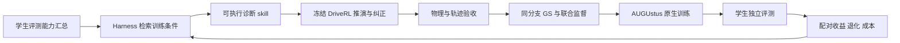

# DriveZero—AUGUstus 的模型服务技能与 RSI 实验边界

DriveZero/DriveRL 可以作为冻结的特权教师，AUGUstus 作为视觉语言动作学生，DriveHarness 负责诊断、选择干预、执行和独立验收。这个组合是可执行的研究架构；现有结果尚未证明 AUGUstus 获益，也尚未证明改进器越来越有效。

## 2026-10-25：真实新历史联合训练更新

本节替代下文早期“反事实联合训练尚未接入”的状态描述；下文保留设计与历史边界。最新机器回执位于 `exp/augustus-memory-training-v2/`，不得用本文替代准入回执。

- 新 NAVSIM 分支经 DriveRL 实际到达、同锚点未来执行、95 分门槛与接触检查后，再进入 GS。已修复源日志缺少运动证据导致的停车对象漂移；不删除对象或忽略接触。
- Boston July 分支通过原有 `experimental_source24_v1` 视觉档位。源位姿平均 PSNR 26.482 dB，不是留出新视角 PSNR，也不是 SimScale 27 dB 主实验达标。四帧新历史、八帧原生未来、物理状态、图像和语言监督绑定同一分支。
- `agents/augustus/projection.py` 在对象框跨相机近裁面时，用保守的原生裁剪视锥区分“确实不在画面内”和“仍有几何歧义”。可见交叉仍拒绝；不是一律丢弃对象。辅助实现也进入产物哈希，修改后原样本不能继续沿用资格。
- 当前合格样本的原生三相机裁剪内没有满足既定距离/可见性规则的预测对象，使用显式空 prediction 标签；不能宣称验证了复杂多对象未来语言监督。
- 统一原生 SFT 已消费新增样本。训练 forward/optimizer 日志绑定实际 frame ID 与有效学习率，区分读样本、零学习率步骤与正学习率参数更新。原生模型、FM/语言损失、归一化、优化器不修改。
- 训练/续训与重放是不同进程。评测使用预先锁定的四个官方 navtest 样本，来自四个原始日志；测试内容不进入优化或原生训练验证输入。不对 navtrain 做学生 PDM 评分。小样本测试为自适应试验，不能称全量复现或稳定提升。
- `src/rsi/experiments/augustus_pair.py` 核对同父权重、实际学习率与预算、原始及混合缓存的历史摘要、测试覆盖和逐样本均分。普通续训与合成组比较的是实际最终检查点。
- 无记忆、固定前置检查、有记忆三种模式均重新执行教师推演。本例生成的实际物理分支一致；不能把共享数据的配对训练当成三次独立学习对照，或用单次耗时证明技能效率提升。
- 配对结果可以记入 `SkillMemory` 的尚不能归因于技能选择的观察（`credited=false`）；只有执行前已有技能计划、训练实际数据具有该计划血缘、完整预算和评价证据时才能奖励技能。本次人工筛选的合格分支不追记成记忆策略的成功。

仍缺：第二及更多来源的视觉合格新分支、非空联合对象语言监督的大样本检验、技能计划到有区分度干预再到训练收益的受控多轮比较。Pittsburgh 高程空洞、Singapore 两个测量路面候选继续拒绝，不以高 PDMS 覆盖视觉问题。

## 三种能力不能混为一谈

| 对象 | 能力存在哪里 | 怎样证明提高 |
|---|---|---|
| 驾驶学生 | AUGUstus 权重及原生运行时 | 关闭特权教师和外部纠正后的锁定评测 |
| 模型服务 skill | 可执行程序、前置条件、输入输出、适用范围、失败与成本记忆 | 同类问题上的诊断或干预成功率、成本；不能用教师分数代替训练收益 |
| RSI 改进策略 | 选择哪些任务、方法、预算的决策规则或学习策略 | 同父模型、同资源预算下，相对固定策略产生更多独立验证的学生收益 |

VLA 不是 RSI 的必要条件。使用 AUGUstus 的理由是它有视觉、语言和动作联合监督与公开 SFT/GRPO 基础；改 prompt、增加工具数量或把流程写成 SKILL.md 都不足以证明 RSI。也不能把“绕行数据生成 skill”说成 AUGUstus 已拥有在线绕行 skill。

## 职责和闭环

评测侧向选择器提供能力汇总；训练候选来自 navtrain 的向量、审核过的 caption 和结构化条件。无需对 navtrain 运行学生评分。检索相关性不是因果诊断。测试明细不进入训练数据；使用测试汇总反复选方法仍属 adaptive evaluation，需要明确报告，最终泛化需未参与决策的锁定验证。

LLM 可以选择已有可执行程序、提出可证伪的假设；不能自行宣布数据合格或把它生成的解释当作 AUGUstus 的监督真值。特权教师的地图和未来对象信息只能用于训练标签/评分，不能泄漏进部署学生输入。

## 已固化的执行边界

`src/config/rsi/skills/augustus-teacher-student.json` 指定真实教师和学生配置。`augustus_difficult_case_diagnosis` 接收封存的 `selected_native_branch`，核查教师身份且要求选中 teacher 分支（基线分支不能沿用实验级教师元信息），输出三部分审计：

1. `physical_validity_audit`：到达历史和纠正未来的接触记录、恢复一致性。缺少证据不能当作没有接触。出现背景接触只触发世界审计，原因仍是 unresolved，不能直接归为模型问题或平台问题。
2. `same_anchor_teacher_audit`：原生反事实协议、95 分门槛、实际历史改变的生产者证据、未来支持及生产者准入。该审计复用生产者证据，不重新执行物理世界或声称独立验证了全部历史。
3. `augustus_supervision_audit`：明确报告尚缺反事实联合缓存和 AUGUstus skill 配对反馈桥接。即使物理轨迹合格，也不会自动准许训练。

`native_branch_reference` 通过已有 Harness 台账校验并引用历史产物，保留原始资格、来源组和引用身份；适用于复审失败。将旧分支送进 AUGUstus 数据兼容性审计，不会改变其原来的选题模型或宣称 AUGUstus 在该场景失败。

模型服务选择器现在要求 AUGUstus 的实际模型配置，能力汇总中的父检查点必须一致。ChainFlow 的10点标签、评测短板和配对训练收益不能移名到 AUGUstus。AUGUstus 未接通的反馈路径明确拒绝收益记账。

## 原生数据和训练语义

当前本地 AUGUstus SFT 桥接使用4帧历史、3相机、2 Hz、8个未来位姿（4秒）和 prediction 语言监督。ChainFlow 的10点/5秒分支可以作为较长物理证据，但不能以插值、补点、换归一化或修改原生 loss 的方式冒充 AUGUstus 原生监督。

原状态仅换未来轨迹标签时，必须满足现有 original-anchor 合同。交互产生了新历史/他车未来后，需要从该分支重新生成 prediction 对象与未来位置监督，并核对视频、对象、相机、时间和标签。不能复用原日志的对象未来，也不能把 Harness 的“为了避让所以减速”等推测写进标签。

建议先用原生 SFT 验证高分教师数据的训练价值；之后单独接原生 GRPO。教师轨迹不是当前策略采样，不能冒充 on-policy GRPO/PPO 数据。原生模型、loss、优化器和归一化保持固定，干预先限制在数据和课程。

DriveRL 的公开仓库当前描述的是推理运行时；本地已有论文衍生学习器也不能称为官方完整训练器。冻结教师生成高分轨迹，并不等于学习型多车 Self-Play；后者需要明确参与者策略、采样更新与对手管理。

## skill 应记住什么

可复用经验应是“条件—假设—操作—可观测结果”，例如：路侧静态障碍附近进度不足时，先检查剩余通行宽度、路线和对象接管，再比较同锚点闭环教师与受约束扰动；若世界本身有接触，进入世界修复而非学生续训。

现有 skill memory 按模型、父检查点、能力、skill版本和评价协议区分证据，记录执行失败/耗时和可归因的配对收益。新的父模型只能参考旧经验，不能继承旧模型的成功结论。单次成功只能形成经验，不能直接标为可靠技能；失败原因、适用边界和未解决结果也必须保留。

本轮新增诊断会输出 next_action，但没有据此虚构可执行的反事实 AUGUstus 导出器或训练器。已有 ChainFlow 的训练反馈机制不能替代尚缺的 AUGUstus 对接。

## 论文应检验的命题

适合研究的是“证据约束的模型服务技能，能否提高困难场景干预带来的学生收益/总成本”，而不是“我们接上 VLA 和 LLM 所以实现了 RSI”。这是候选研究问题，尚未完成针对性查新，不能宣称独有创新。

至少比较：普通继续训练、固定检索与固定生成配方、带执行记忆的 skill 选择、再加入 LLM 的选择。教师、父学生、更新预算、评价协议必须相同；随机或结构化检索对照用于区分检索和决策贡献。统计应包含失败尝试、无效渲染与训练的全部成本。

学生层看安全/进度/舒适性与整体收益；改进器层看在新日志、相同起点和预算下的有效干预比例、收益/成本、失败恢复及跨轮迁移。至少多轮与多随机种子，不能用一次小样本增分证明稳定递归改进。测试侧反复指导开发应披露其适应性使用。

当前证据：两个既有真实教师分支完成技能审计但仍因背景接触拒绝；两条原生训练缓存通过格式/解码检查，来自一个源日志，父模型是否见过未知。本轮没有训练、学生推理或新的评分，没有新增学生收益。缓存可读不代表语言标注正确或训练有效。

## 后续实际缺口

1. 将世界接触的成因定位并修复，取得同一分支的物理与视觉资格。
2. 生成同分支的 AUGUstus prediction 联合标签/缓存，并对照原生预处理。
3. 接通 AUGUstus 新历史配对训练及 skill 血缘、真实成本反馈。
4. 使用学生自己的锁定评测汇总形成能力需求，运行多轮受控实验。
5. GRPO、学习型 Self-Play 和部署技能调用分别验证，不与 SFT 实验混报。

参考：
- [AUGUstus 官方代码](https://github.com/haha-yuki-haha/AUGUstus)
- [AUGUstus 论文](https://arxiv.org/abs/2610.16985)
- [DriveRL 官方运行时说明](https://github.com/XiaomiAutoL3/DriveZero/blob/main/DriveRL/README.md)

### 本轮实测结果（小规模，非完整基准）

普通续训 97.123975、新增合格合成样本 97.123874、同父模型 97.122551；四个锁定官方 navtest 场景、四份日志。合成组相对普通续训 −0.000102 分，没有证明数据增益。两边各四次原生优化器调用（其中三次学习率非零），完整状态的跨进程续训重放均相同。结果与部分成本已写入 skill-learning-memory.sqlite，credited=false；没有模型或技能晋级。详情以本轮 implementation-ledger.json 和 paired/paired-feedback.json 为准。
