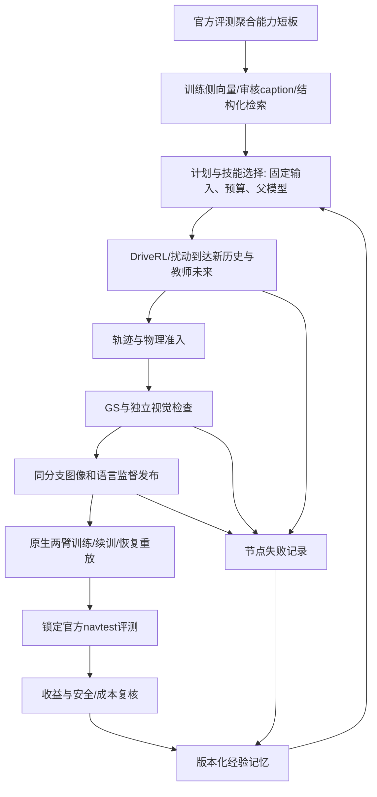

# DriveHarness：固定执行程序、节点记忆与模型后训练

## 参考结论及边界

- RoboRSI 的任务—技能树、逐节点后置条件、局部修复和 evolve/frozen 分离值得采用。失败在最早未通过节点被定位，但这不是驾驶失败根因的自动证明。来源：https://github.com/nssmd/RoboRSI 和 https://arxiv.org/abs/2610.12424 。
- HarnessPAI 固定一次 rollout 内的程序，在 rollout 之间依据执行证据迭代程序；把 problem–repair 经验挂在任务节点，合格执行再供模型后训练。来源：https://arxiv.org/html/2609.29166v1 。其公开仓库 https://github.com/Darwin-Agent/HarnessPAI 当前仅论文/网页，研究代码尚未公开，本工程不是移植/复现。
- 固定实验程序不等于开环开车。DriveRL 仍持续接收新世界状态、执行动作和交通响应；不需要每个物理 tick 调用高层 LLM。
- 三类结果分开：程序执行完成、数据准入通过、学生获得收益。进一步的“改进器更有效”必须用匹配预算的无记忆/固定流程/记忆组检验，不能从一个教师满分推断。

## 整体职责



检索输出的是相关训练候选，不要求学生在 navtrain 上也低分。教师分支的反事实 PDM 是标签准入，与 navtrain 学生评分不同。测试逐样本 token/图像/轨迹不进入训练计划与公开展示；使用测试聚合反馈的开发过程仍为 adaptive evaluation。

已有能力检索/LLM选择入口继续使用 `navsim_scene_expansion_plan` 与 `run_capability_skill.py`。LLM 是候选建议器，不安装任意代码、不更改准入。新的 `augustus_round` 接在现有有界扩充分支或已经验收的原生样本后，统一接到训练和节点反馈；它没有重新实现检索器。

## 三层固化

1. 任务：改善一个模型版本的指定能力；固定父权重内容、原生配方、评测协议与总预算。
2. 子任务：来源选择、物理生成、轨迹准入、视觉准入、联合监督、配对训练、恢复验证、独立评测、收益复核。
3. 基础技能：既有教师/渲染/投影/缓存构造/Harness训练provider，以及按记忆调用的资产闭包预检和配对协议预检。

每个 episode 的 `program.json` 固定计划、代码与输入摘要、memory advice。程序变化必须创建新的目录/修订。原生模型、loss、优化器和评分保留在原生适配器中。

`ServiceMemory` 在指定技能 SQLite 中追加 `service_episodes`，不会覆盖原 `vla_scene_cases` 或 `outcomes`。经验按学生父资产内容、代码内容、教师上下文、训练 seed/batch/预算和评测内容隔离。相同源的修复经验与跨日志条件重合明确区分，条件重合不是迁移准确率。读取到旧问题后执行当前检查，不继承旧的判定。

## 可执行接口

```bash
.venvs/augustus/bin/python -m driversi.rsi.experiments.augustus_round prepare exp/my-program/config.json
.venvs/augustus/bin/python -m driversi.rsi.experiments.augustus_round run exp/my-program/run
# 仅在准入条件满足且明确执行时进入真实训练；原生入口自己再检查一次。
.venvs/augustus/bin/python -m driversi.rsi.experiments.augustus_round run exp/my-program/run --execute
```

配置必须提供 id/output/memory/memory_mode/selection_mode/base_manifest/request_template/evaluator_template/sample_reports/expansion_root。全部产物在 exp。可选 `publication_jobs` 明确传入 branch_report/render_report/visual_admission/label_review，调用原生联合监督发布；不能用预览代替证书。

- `expansion_root`：调用既有有界扩充器，复用其完成回执与断点，不重复已完成物理计算；只消费该批次同分支的正式准入样本。
- `sample_reports`：允许使用已独立验收样本启动训练集成测试；报告明确标记 reuse，不声称新场景或新skill贡献。
- AUGUstus 保持4帧历史、8个未来轨迹点及原生 prediction 语言协议；不把 ChainFlow 的10点协议硬塞进来。
- 两臂共享原始数据池、父权重、原生配方、种子与预算；合成臂仅增加合格样本。train/resume/replay/evaluate/feedback 均运行现有 Harness provider。
- 正学习率样本消费、两臂恢复一致性、锁定测试覆盖和实际检查点一致都通过后才报告 paired gain。微小单次正值仅称 pilot_signal，不自动晋级。

## 反馈和修复

| 最早未通过节点 | 下一步 | 禁止推断 |
|---|---|---|
| 物理生成 | 核查世界、路线和版本后新建尝试 | 直接判为学生缺能力 |
| 轨迹准入 | 改到达策略/教师搜索并保持95分门槛 | 通过放宽门槛完成quota |
| 视觉准入 | 先验证资产覆盖与配准 | 渲染完成等于数据合格 |
| 联合监督 | 复核同分支图像、版本及语言证据 | 改旧hash继续使用旧资格 |
| 恢复验证 | 修复恢复后再比较模型 | 两次不同状态都完成即恢复正确 |
| 无训练收益 | 改数据干预并做新配对试验 | 失败都归因于数据量小 |
| 初步正向信号 | 扩大独立验证 | 自动给生成skill或学生晋级 |

失败回执保留实际 Harness stage、reason、已消耗成本和产物摘要。整轮反馈的持久回写幂等；报告已写、记忆未写的中断可以继续结算而不重跑优化器。结果未知不盲目重试。

`no_memory/fixed/memory` 控制选择与可选预检；`off/frozen/evolve` 控制本轮是否读取/更新记忆。这里 frozen 指技能记忆冻结，允许独立实验回执和候选训练输出，不等同于 RoboRSI 完整 frozen benchmark 的所有数据写入策略。父模型文件始终不被覆盖。

训练收益观察与生成技能信用分开。当前新执行器始终 `skill_gain_credited=false`：旧样本不能追授新技能；prospective assignment、真实样本消费和无记忆/固定/有记忆的比较尚需扩展。已有 capability SkillMemory 的严格归因入口保持独立，不伪造正信用。

## 本轮实际范围

本轮修正了陈旧 AUGUstus 服务能力声明，并新增统一执行程序/节点记忆。先前合格 July 样本在开始时通过校验，但工作区 GS 几何代码随后发生变化，旧资格的内容校验失效；没有修改旧hash。branch-expansion 的两条新图像分支仍无合格视觉证书。真实程序因此分别在联合监督、视觉准入停止，未启动新训练。

程序接口和分阶段回归通过不等于本轮端到端正向训练完成。待当前版本的独立图像/语言准入补齐后，应由相同执行入口完成正向验收，随后扩大日志、多种子和无记忆/固定/有记忆对照。没有完整收益/成本实测前，不能宣称 DriveHarness 已学会持续改进。


## 当前版本的可执行验收（harness-service-training-v2）

实验以新执行的 DriveRL 物理分支、当前 GS 图像、独立视觉检查和同分支原生语言标签进入 `publication_jobs`。本轮使用已知资产完整的一份训练来源，目的是验收执行路径，不作为新难例挖掘或记忆选题收益的证明。

- 执行环境必须使用 `.venvs/augustus/bin/python`；联合监督发布依赖原生 moviepy、av 和 datasets。核心 `.venv` 仅用于物理/通用工具，不能替代模型环境。
- 可选 `generation_receipts` 指向已完成 Harness 任务回执；必须实际产出选中分支，拒绝无关或重复任务费用。记录物理推演、渲染等已测时间与 sim-agent steps，无法覆盖人工检查、资产预训练或未引用的搜索，因此 `complete_total_cost=false`。
- 训练回写同时保存原生学习成本和整个 Harness 任务成本；后者包含独立恢复重放。两种口径存在重叠，不能相加。
- `publication_jobs` 与已发布的 `sample_reports` 采用相同教师内容、生成配方和实际历史条件。源日志用于适用性判断，不充当教师版本。记忆上下文为 service_version=2。
- 代码身份采用项目内相对路径及文件内容；实际证据继续校验绝对路径。共享工作区发生并发修改时应使用普通文件的固定代码副本重新生成、验收，保留原失败证据，不能更新旧摘要来继续运行。本轮运行副本位于 `exp/harness-service-training-v2/runtime/`，权重、数据和环境仍是受校验输入。
- 每臂4次初始更新加4次续训，独立进程另重放续训4次。重放不是给最终模型再加4次更新。真实样本池一致，合成组只追加已准入样本；测试是固定4个官方 navtest 锚点，单种子流程试验，不是全量成绩或稳定收益证明。

当前版本的配置、运行脚本、回执、失败记录和最终结果统一放在 `exp/harness-service-training-v2/`。`runtime/exp/qualified-service/program-native/` 是实际两臂程序目录。完成后的 `review.json`、`paired-feedback.json`、`next-iteration.json` 分别记录本轮判断、实测对照、下一轮建议；`settlement-verification.json` 检查重复结算不再训练及冻结记忆的调度差异。

三种选择模式在同一完成案例上的回放只验证调度；不能将其冒充无记忆、固定流程、有记忆三组独立生成和训练的因果对照。


## Evaluation-only recovery after completed training

A settled service program is immutable. If paired comparison fails at independent
validation after both training arms completed, keep that failure and the original
evaluations. Reuse each exact resume checkpoint in a fresh `phase=evaluate`
attempt; do not replay optimizer updates. Worker launch now pins PYTHONHASHSEED
before interpreter startup in addition to the existing numerical RNG settings.
This improves reproducibility; it does not relax scores or guarantee all kernels
are deterministic.

`augustus_pair.compare(..., evaluation_reports={control: ..., treatment: ...})`
accepts only two explicit complete replacement evaluations. It verifies each
original learned ancestor, checkpoint bytes, actual worker metrics, locked test
population, and exactly equal parent prediction arrays and per-sample metrics.
The old evaluations remain evidence. `augustus_settle.settle` then creates a new
continuation ID, preserves the failed program, records recovery cost separately,
and writes the measured result to service memory with no automatic promotion.

Run settlement against the original frozen runtime with the separately versioned
settlement modules; current workspace changes must not silently requalify old GS
outputs. The 2026-10-25 execution is under `exp/harness-service-training-v2/`.

Memory retains recovered evaluation errors for audit but does not recommend
repeating a repair already completed by a same-context learning-review
continuation. A negative paired result recommends changing the data intervention,
not blindly adding updates. This is advisory, not evidence that the memory policy
outperforms a fixed or no-memory training policy.
