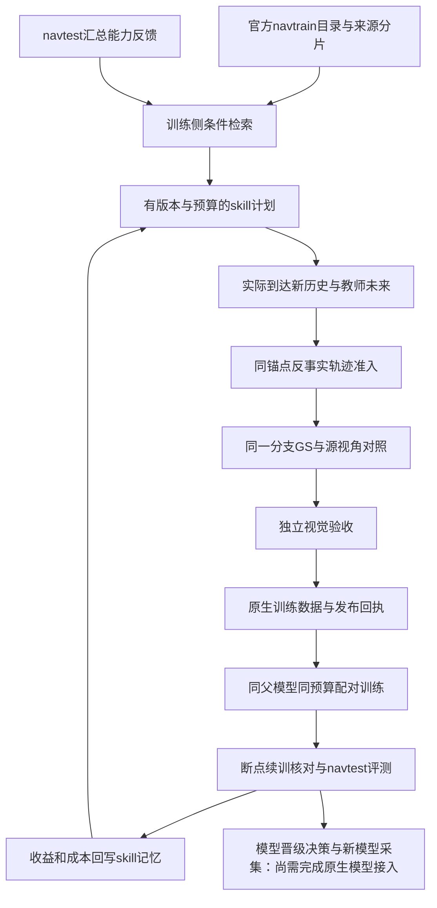

> 历史实现记录：下文保留早期platform-spine试点的配置与边界，不代表当前准入、训练上限或自动课程状态。当前总体设计以[DriveRSI总体架构](../architecture/system-overview.md)为准（2026-10-28），包括历史扰动+TTS、常驻加速、独立合成分类库及逐问题持续学习。

# 当前模型范围

以 [模型范围与代码归属](../models/model-portfolio.md) 和 `src/config/model-selection.json` 为准。下文的 WA-JEPA 试验能力属于历史记录，现已退役；Drive-JEPA 尚待单独接入。

# DriveRSI 主链与模型专属 skill

本轮把现有服务连接为可恢复的执行主链，保留原生模型、loss、评分及准入。完整103,288个navtrain成员身份已核对；这不等于103k已训练、资产齐备或多轮RSI收益已成立。

## 唯一主链



每个执行箭头由既有Harness的typed artifact reference承载，保留任务、阶段、生成代码、来源与失败证据。不能从某次报告复制一个分数给另一条轨迹。阶段完成和数据合格是两个状态。

新增`run_platform_spine.py`提供inventory、pool、continue三个入口。continue可以从已选assignment、已完成teacher或者已保存rendered产物进入。教师技能、GS和原生训练仍使用原实现，没有另建仿真器或学习器。assignment调用原`run_assignment`，这次允许它使用共同Harness台账，使教师产物可被后续任务正式引用。

训练用途新增`qualified_native_branch_selection`：沿用原轨迹准入后才允许渲染。原有诊断入口继续允许查看不合格分支，不改其含义。视觉审核尚未提供时，先读取封存的同分支渲染与源位姿对照。已知高程、源位姿画质、在场对象外观绑定前置条件失败返回`render_not_ready`并列出修复方向；仅在未发现这些机械阻断时返回`waiting_visual_review`。两者都不是训练准入，正式视觉审核与原生准入仍必须执行。现有审核失败会保留拒绝任务，阻断训练。

## 7秒窗口与模型数据的准确含义

物理分支通常执行2秒到达过程，再执行5秒未来。四帧历史是锚点前−1.5、−1、−0.5、0秒，ChainFlow的十点未来为+0.5至+5秒。不能因总窗口7秒就把它称为7秒官方PDMS：当前原生数学评分覆盖4秒，额外1秒仍做真实执行与完整性检查。到达过程可能含控制预热；未来可能由DriveRL、PDM/LQR或搜索生成，实际teacher字段必须保留，不能统一改写成DriveRL。

原日志白膜0.1秒中间状态来自明确标注的离线插值；闭环分支的0.1秒状态来自实际物理推进。两者不得混为10Hz真实传感器数据。四相机RGB、深度、语义、对象轨迹、颜色类别字典、caption必须引用同一分支和相机标定。未来图像与未来caption只作为离线条件或监督，不能进入当前驾驶观测。

## 各模型共享管理协议，不共享错误的监督语义

| 模型 | 训练信息 | 当前边界 |
|---|---|---|
| ChainFlow stage1 | 四帧历史、十点未来、同分支PDM上下文 | 已有合成配对与显式epoch/DDP入口；完整103k epoch及合格合成数据的多卡收益尚未验收 |
| AUGUstus | 四帧三相机、八点未来、同分支对象预测语言监督 | 原日志SFT链路存在；反事实联合缓存与skill配对收益尚未接通 |
| WA-JEPA | 历史、执行动作/轨迹、真实未来观测和有效掩码 | 原生小样本学习存在；合成分支训练消费与驾驶收益验收待完成 |
| DriveRL | 当前策略实际采样的观测、动作、logprob、value、reward、done/truncated | 论文衍生有界在线学习器；高分教师标签不能冒充on-policy样本 |

新模型要接入：声明原生时间/相机/动作契约，提供data preparation、train、resume、evaluate、feedback，再验证真实更新与恢复。没有原生消费者的模态必须返回明确不支持，不能补零、复制旧标签或把VLA文字换成通用caption就算接通。

## VLA的skill与持久记忆

Harness skill是可执行研究程序；VLA学到的驾驶技能在模型参数/策略中。保存一段prompt只提供外部上下文，不是已经完成驾驶技能学习。

现有固化程序包括：

1. `reactive_new_history`和`bounded_perturbation_history`：明确前置条件、版本、预算、实际执行入口以及轨迹/物理/视觉后置条件。
2. `augustus/hard_scene_service`：history_signature、contact_trace_audit、native_readiness_audit，检查世界有效性、教师资格和联合监督准备。使用实际历史条件召回，不用未来结果倒填观察。
3. `capability_skill_feedback`：只对真正绑定该skill的数据配对实验记录学生收益；教师高分与执行完成不产生学生收益信用。

两种SQLite记忆各有职责：SceneSkillMemory保存诊断条件和可复用检查；SkillMemory保存实验结果、失败及成本。每条记忆要保留适用模型/父权重、来源日志、skill版本和证据范围。evolve可追加，frozen只查询；重复回执不重复计数。世界错误不直接归因于教师，混合多skill的训练收益不拆开重复归功。

“模型学会绕行”等能力必须用关闭外部接管后的模型执行来验证。AUGUstus+Harness系统效果与原生AUGUstus效果分开。下一步应将审核通过的同分支联合监督送入原生SFT，再做与普通续训的比较；GRPO必须记录其原生策略采样过程，不能直接塞入教师轨迹。

## 103k规模需要怎样运行

pool入口只读取目录身份列，避免重新推理103k图像。按raw source group分片，全部token恰好出现一次，便于共享地图和GS资产。它是工作索引，不是GPU调度器，也不表示每个样本有重建资产。

训练基础池仍是完整navtrain，合成数据作为增量混入；并非所有103k场景都要先渲染。检索按失败能力分配有限名额，结构化推演通过后再占用渲染预算。缺失资产与平台错误单独保留，不能伪装成模型难例。navtest只进入独立评测与聚合能力接口，逐场景图片/token/特征/标签不进入训练合成。利用navtest汇总进行开发仍需注明adaptive evaluation。

当前有两条明确入口：legacy配对使用batch=1、2–128偶数次更新；`training.epoch_training=true`启用既有epoch/DDP后端，`training.batch_size`为每卡batch（1–64），设备、检查点间隔与混合间隔来自model_config的distributed_training。配对两组共用完整navtrain基础池、父模型、原生优化器/调度器与更新预算；混合间隔固定8，追加样本必须实际被采样。单批合成回执仍最多64。数据游标包含epoch、offset、各类曝光和padding，恢复要求相同世界大小与配方，不支持静默换卡数。已有小规模双卡证据不代表完整103k epoch已通过：仍需全epoch吞吐、长时恢复、调度背压和实际合成训练收益验证。接口清单schema v2分别报告实现能力和全量验证状态。

自动晋级也不能由平均分小幅上涨决定：至少比较父模型、普通续训和合成续训，核对安全子项、样本覆盖、来源与统计不确定性。当前原生模型paired feedback不会自动晋级。本入口只准备或执行这些已有阶段，不把它升级成未经验证的自动晋级器。

## 操作与恢复

```bash
.venv/bin/python scripts/rsi/run_platform_spine.py inventory --output exp/run/interfaces.json
.venv/bin/python scripts/rsi/run_platform_spine.py pool --database exp/scene-catalog-v1/navtrain.sqlite --output exp/run/pool --shards 8
.venv/bin/python scripts/rsi/run_platform_spine.py continue --config /absolute/path/to/continuation.json
.venv/bin/python scripts/rsi/run_platform_spine.py continue --config /absolute/path/to/continuation.json --execute
# 只有合格数据及配对配置准备完成后，显式选择执行小规模训练：
.venv/bin/python scripts/rsi/run_platform_spine.py continue --config /absolute/path/to/continuation.json --execute --execute-training
```

不带execute做准备检查；execute推进教师/渲染/验收/导出，不启动新训练；execute-training使用同一已生成配对任务继续训练。冻结配置后，更换分支、预算、模型或配方必须使用新输出。配置里的运行环境、地图、审核文件、训练清单和skill文件使用绝对路径。视觉review路径可以事先指定，文件出现后再续跑。相同入口的并发调用加锁，已完成/失败/运行中任务不会重复启动；中断任务走已有Harness显式recover，不能悄悄再算一遍。每次调用留下attempts.jsonl，训练记录仍以原Harness台账为准。

若教师底层任务已恢复完成，但外层skill回执丢失/中断，续接入口核验已封存teacher与branch、任务目录及scene内assignment来源后生成独立recovery-receipt，不覆盖原中断记录，也不重复添加execution记忆。无法还原的总成本明确为unknown，不能用于证明单位成本改进。尚未恢复的任务继续明确阻断。

CLI失败、拒绝、未知结果返回非零退出码；准备完成、等待审核或仍在运行的状态返回0，但仍须检查JSON的status，退出0不代表数据合格或训练完成。当前可复现的完整配置见`exp/platform-spine-v1/real-continuation.json`，它引用已保存的真实分支，视觉审核是拒绝案例；运行不会自动重复旧渲染。

本轮真实验证接续的是旧物理分支，不是新生成的数据，也不是新训练收益。全量成员覆盖、阶段回归和负例拒绝验证可以证明接口边界按要求执行，不能保证未来每轮指标单调提升。

## 批量前置检查与修复反馈

资产窗口预筛必须覆盖0–7秒和F0/L0/R0/B0四相机，而不是只检查0–6秒的前相机。原始帧索引必须连续，具体来源匹配使用原有时间戳与标定检查；时间戳抖动时允许读取额外的插值包围帧，不伪造第9、10个未来点。

每次主链续接会写`readiness.json`，保留branch/render/source产物身份、现有visual_quality_profile、机械阻断、待修复项与未决对象。源位姿PSNR不是新视角合格证明。没有独立对象节点也不等于背景像素缺失；但潜在可见且没有可用静态候选的在场对象，是既有准入无法通过的修复前置条件。未在物理分支出现的对象绑定尝试单列，不能记为模型失败或渲染漏物体。

修复须形成新的资产/分支/任务版本；旧拒绝结果不覆盖、已完成任务不重复执行。教师得分、渲染完成、训练更新、学生收益、模型晋级分别记录。`readiness`只负责在既有准入之前分流，永不授予trainable或学习收益。

本轮具体证据见`exp/rsi-readiness-v2`。三个真实拒绝案例均用独立进程重复续接；没有重新渲染、启动训练或晋级。27套资产的245个连续7秒候选起点只证明索引覆盖，不能宣称245个完整可用合成场景。
