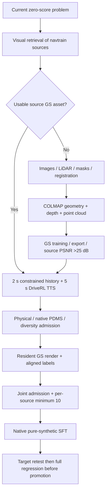

# Harness production generation and recovery

The continual controller owns bounded phase execution. It uses registered skills;
it does not invent new recovery code while a job is running. Unknown failures
remain explicit until a reviewed recovery is registered.

## Primary generation

`src/rsi/experiments/generation_policy.py` selects the existing
`history_endpoint_grid_tts_v1` implementation: a physically executed 0–2 s
constrained history followed by 2–7 s native DriveRL TTS correction. This is a
composite generator, not pure DriveRL sampling or gradient TTO.

The current versioned grid explores both lateral directions and interleaves the
allowed speed levels before the attempt budget truncates it. Each source freezes
its measured two-second history speed, observed path curvature and forward-object
box gap before generation. The current user-authorized profile requires strict
source PSNR >25 dB. Historical >27 dB receipts retain their original protocol.
Native PDMS >95 and physical admission remain unchanged.

Actual started attempts, including interrupted attempts, are charged. Each source
normally receives 32 attempts; the three-round cumulative allowance is 96. A
policy migration does not reset this history. Source availability can choose the
next item only inside the frozen visual retrieval candidate pool.

## Resident production

`reactive_cohort.py` preserves ordered physical admission and diversity checks.
`resident_production.py` submits at most two admitted, distinct physical branches
of the same source asset. Four CPU prefetch workers may prepare physical branches;
they cannot publish data. Two rendering lanes use the existing resident GS and
native export implementations. Fresh feature extraction uses the canonical
generated-only feature service on a separate GPU.

Production requires explicit `purpose=production`, a matching strict27 legacy or
strict25-spatial configuration, and a
sealed reservation. Benchmark remains quarantined by default. The production
path calls the unchanged native export/admission and requires a canonical dataset
reference. Source-pose PSNR is not a held-out novel-view guarantee.

On restart, the original batch's manifest, configuration, reservation, generation,
diversity and output hashes are checked before missing outcomes are collected.
Unknown batches cannot be regrouped or blindly resubmitted. Normal resident
feature memory is permitted only when the configuration, PID birth, exact worker
command and every compute PID on that GPU identify the expected service.

## Reconstruction recovery

The source recovery ladder is appearance optimization, bounded geometry
optimization, then native reconstruction; missing assets start with reconstruction.
These asset operations are separate from accelerated image rendering.

### One-time asset build versus per-branch rendering

Missing-asset construction uses measured nuPlan images, camera calibration,
ego poses and LiDAR. The current MTGS adapter performs preprocessing and LiDAR
registration, creates an initialized COLMAP model, extracts/matches features,
triangulates and refines geometry, aligns the result to the log frame, then
generates depth/point-cloud inputs and trains/exports the GS asset. The adapter
currently enables intrinsic refinement; this is not an assertion that original
calibration remains byte-identical after reconstruction. Output camera geometry
and coordinate alignment must remain consistent with later rendering/export.

COLMAP is a dependency of this particular reconstruction backend, not a required
operation for every synthetic trajectory. A qualified existing asset bypasses
reconstruction. Its many new trajectories use the resident GS renderer and native
dataset exporter directly. Source PSNR >25 dB in the current profile remains a source-view preflight;
physical binding, novel observations and supervision receive separate checks.

Registered native remedies preserve the failure evidence and deduct already used
time. Diagnostic-directory repair resumes verified preprocessing. COLMAP4
trivial-rig recovery preserves image identity, camera calibration, measured poses
and matches, and aligns only inconsistent trivial-rig identifiers before native
triangulation. Dependency recovery requires a fresh-process runtime witness.

The current implementation can execute these known recipes without per-source
human approval. New error classes still need a code fix and validation. A source
certificate only permits trying new branches; it does not grant training admission.

## Learning and release

Every selected source must supply its own minimum admitted, distinct family before
pure-synthetic native SFT. No other source can fill that source's quota. Target
PDMS >0 means local improvement; full navtest regression and safety checks remain
required for incumbent promotion. Generation success never credits learning gain.

Current runs, decisions and receipts are under `exp/`; admitted synthetic data stay
in the separate canonical `dataset/` collection. No navtrain student scoring,
automatic public publishing or paid caption calls are part of this execution.

## Environment speed and independent spatial novelty

`src/rsi/decisions/environment_speed.py` owns versioned, deterministic initial
engineering heuristics. It uses training-source history, not navtest coordinates,
future labels or candidate outcomes. The speed MAE threshold is
`clip(0.08 * source_speed, 0.3, 1.0)` m/s, with a continuous difference of at least
one second. Reference speed perturbations are bounded by
`min(2, max(0.5, 0.25 * source_speed))` m/s; deceleration cannot request negative
speed. Observed curvature and near-object gaps further reduce positive allowance;
unknown curvature/object support invokes conservative bounds. These proxies are
not measured speed limits, proof of safety, or learned optimal thresholds.

Every proposed endpoint is clipped before dispatch, then deduplicated. Fewer
feasible proposals than the current 10/20 target produce a zero-attempt shortage,
not repeated references. Speed variation is classified from actual executed XY
velocities, not desired endpoints. A spatially different equal-speed path is not
rejected merely because it lacks a speed change.

The new profile `experimental_numeric25_spatial05_v1` also requires full-window
and future time-aligned ADE >=0.5m, plus full/future equal-travelled-distance path
ADE >=0.5m. Arc comparison preserves shared world coordinates and requires at
least 2m common support; speed changes along an identical path cannot satisfy it.
These spatial cutoffs are explicit initial engineering choices, not a published
optimal setting. At least ten mutually qualifying samples per selected source are
still required before training. Limited road width may make that quota infeasible;
the finite budget must report a shortage rather than relax thresholds.

The operator protocol revision lives in `protocol-revisions/source25-spatial-speed-v1`
inside the existing campaign. Old rows are not re-signed or auto-imported. Known
pre-render IO failure may be settled only when every exact scheduled physical job
has a terminal receipt and no render reservation exists. Cumulative source attempts
remain charged. Unknown work or concurrent curriculum state changes block migration.

## Timing evidence

`exp/full-synthesis-throughput-v1/` contains an earlier 10-sample benchmark with an
existing qualified asset and preselected successful controls: 747.446 seconds
end-to-end (12.46 minutes). It is not a discovery-time estimate for ten spatially
novel paths from an unknown source and excludes reconstruction, SFT and evaluation.
The current resident production placement uses two render lanes plus one feature
GPU and four CPU physical workers; it must not be described as the four-render-GPU
benchmark's measured speed. Report attempts, admitted counts and elapsed time
separately for the new profile before forecasting completion.
